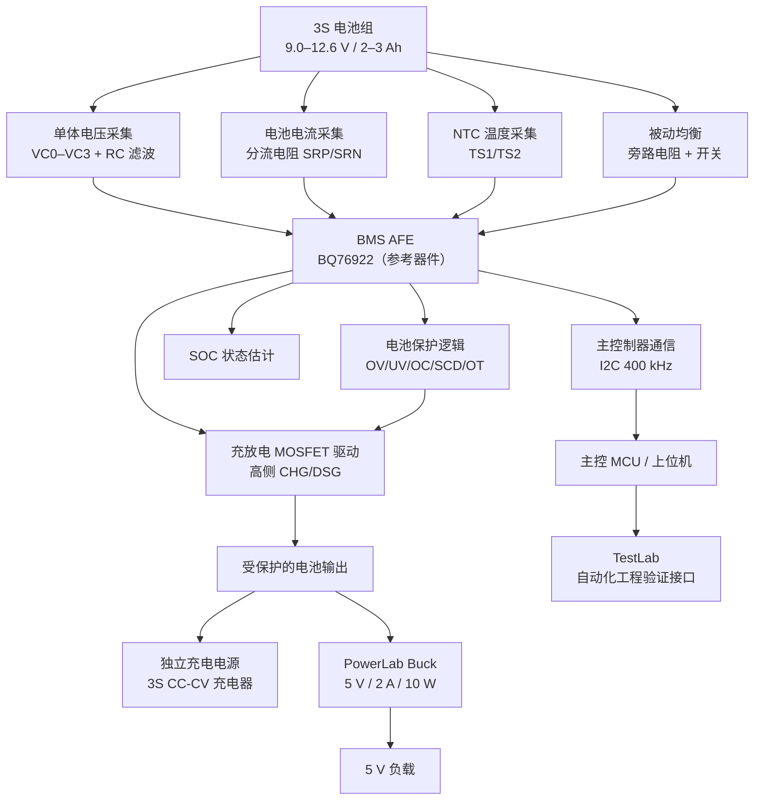

# 07 3S 电池系统架构与设计计算

## 1. 3S1P 定义

3S1P 表示三节电芯串联、每个串联位置只有一节电芯：

```text
Vpack = Vcell1 + Vcell2 + Vcell3（理想一致条件下）
Qpack = Qcell（串联不增加容量 Ah，只增加电压）
```

## 2. 参考系统配置

| 项目 | 教学配置 | 数据参考配置 |
| --- | --- | --- |
| 化学体系 | 锂离子 | 锂离子（CALCE NMC/石墨） |
| 串联/并联 | 3S1P | 3S1P |
| 单体标称电压 | 3.7 V | 3.7 V（系统假设） |
| 单体容量 | 3.0 Ah（教学假设） | 2.0 Ah（CALCE 额定） |
| 单体上限电压 | 4.2 V | 4.2 V（电芯规格） |
| Pack 标称电压 | 11.1 V | 11.1 V |
| Pack 上限电压 | 12.6 V | 12.6 V |
| Pack 下限电压 | 9.0 V | 9.0 V |
| Pack 标称能量 | 33.3 Wh | 22.2 Wh |

配置文件：`configs/battery_system.yaml`。

**注意**：3 Ah 是独立教学设计假设，2 Ah 才是 CALCE 电芯的额定容量。
不得用 3 Ah 计算 CALCE 电芯的 SOC。

## 3. 基础计算

```text
Epack = Vpack_nominal × Qpack = 11.1 V × 3.0 Ah = 33.3 Wh（教学）
Epack = 11.1 V × 2.0 Ah = 22.2 Wh（数据参考）
```

以上为理论设计值，不是实测放电能量。实际可用容量/能量受一致性、电流、温度、老化、
截止电压、内阻极化、保护电路功耗与 DC-DC 效率影响。

## 4. 系统功能架构



说明：这是功能架构示意，不是实际接线图，也不是已经完成的原理图。

## 5. 信号与能量流向

| 流向 | 路径 |
| --- | --- |
| 电池能量 | 3S pack → 保护 MOSFET → 充电器 / PowerLab Buck → 负载 |
| 电压采集 | VCx 引脚 → AFE ADC（差分，带 RC 滤波） |
| 电流采集 | 分流电阻 → SRP/SRN → 库仑计 ADC |
| 温度采集 | NTC 分压 → TSx → ADC |
| 充放电控制 | AFE → CHG/DSG 高侧驱动 → 背靠背 MOSFET 栅极 |
| 故障保护 | 保护比较器 → 驱动关断（自主）或主机命令 |
| 数据流 | AFE 寄存器 → I2C → MCU → TestLab 记录/判定 |

## 6. 职责区分

| 模块 | 职责 | 不负责 |
| --- | --- | --- |
| BMS（系统） | 采集、保护、均衡、SOC/SOH、通信、策略 | 不直接做电压转换 |
| AFE（BQ76922） | 高精度采集、硬件保护、驱动、被动均衡 | 不做完整 SOC 算法与整车策略 |
| 充电管理芯片 | CC-CV 充电环路、充电终止 | 不做电池保护（可配合 AFE） |
| DC-DC（PowerLab Buck） | 把 pack 电压降到 5 V 供给负载 | 不作为充电器使用 |

**关键边界**：PowerLab 的 5 V/2 A Buck 不能用作 12.6 V 电池组的充电器；
充电侧必须使用独立且适合 3S 的 CC-CV 充电拓扑。

## 7. 与 PowerLab 的供电关系（初步理论计算）

PowerLab 已完成的标称仿真效率：93.29%（基准）、94.89%（优化候选）。
负载 10 W 时：

```text
Pin = Pout / η
Ipack = Pin / Vpack
```

| Pack 电压 | 93.29% 时 Pin | 93.29% 时 Ipack | 94.89% 时 Pin | 94.89% 时 Ipack |
| --- | --- | --- | --- | --- |
| 9.0 V | 10.719 W | 1.1910 A | 10.539 W | 1.1710 A |
| 11.1 V | 10.719 W | 0.9657 A | 10.539 W | 0.9494 A |
| 12.6 V | 10.719 W | 0.8507 A | 10.539 W | 0.8364 A |

若按 90% 假设效率（任务书示例）：Pin = 11.111 W，11.1 V 时 Ipack ≈ 1.001 A。

必须声明：

1. 以上是系统初步计算，不是三项目联合仿真结果。
2. PowerLab 效率是 12 V 输入的开关级仿真值，**不能认为在 9–12.6 V 全部工况恒定**。
3. 电池端电压随 SOC 与电流变化，真实联动要到第九阶段建立。

## 8. 后续模拟电路设计清单（Task 24）

| 模块 | 设计要点 | 后续阶段 | 待阅读资料 |
| --- | --- | --- | --- |
| 单体电压采集 | 差分采集、RC 滤波、共模范围、误差预算、开线检测 | 第二/三阶段 | BQ76922 数据手册 6.3/6.x；SLUAA11 |
| 电流采集 | 分流电阻、差分放大、双向检测、失调/增益误差、功耗 | 第二阶段 | 数据手册库仑计章节；SLUAA32 |
| 温度采集 | NTC 分压、B 值曲线、ADC 量程、误差 | 第二阶段 | 数据手册 6.22；SLUAA81 |
| 保护电路 | 比较器阈值/迟滞/延时、背靠背 MOSFET、体二极管 | 第四阶段 | 数据手册 6.25；SLUA952 |
| 均衡电路 | 均衡电阻、受控开关、均衡电流、功耗、热限制 | 第五阶段 | SLUAA81 |
| 充电控制 | CC/CV 环路、PI 调节、模式切换、终止、保护联动 | 第六阶段 | 充电管理芯片手册（后续选型） |
| 系统验证 | 工况扫描、故障注入、限值判定 | 与 TestLab 联动 | TestLab 现有能力 |

## 9. TestLab 接口

TestLab 已有虚拟仪器与自动化测试能力，后续可复用为：

- 采集通道的扫描与记录（电压/电流/温度采样点）；
- 保护阈值与延时的自动化判定；
- 故障注入（开线、过流、过温模拟）；
- 测试报告与限值判定。

本阶段只列出接口关系，未实现联合测试。
