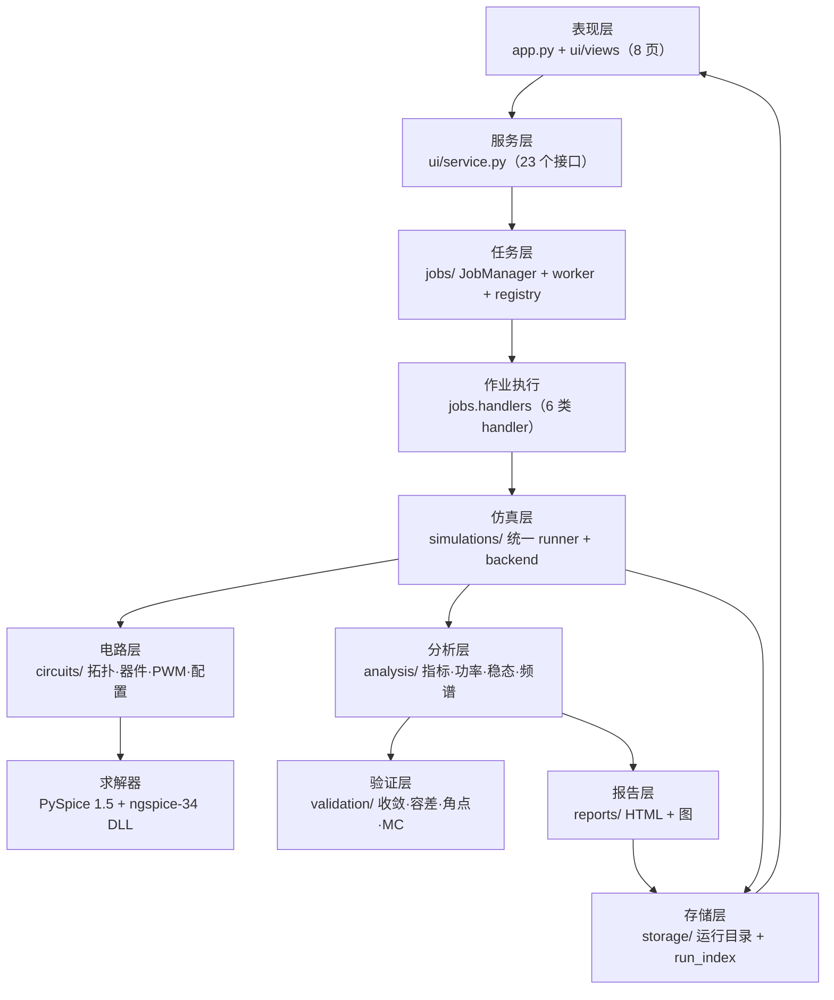
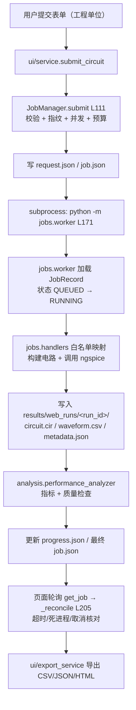

# PowerLab 项目学习与面试实战手册

> 版本：1.0（基于当前工作区真实源码、配置、`results/` 运行产物与 2026-11-26 实测整理）
> 适用环境：Windows 10.0.26200 + conda 环境 `kaifa_power`（Python 3.11.18）
> 项目路径：`PowerLab`；应用版本 `0.9.0`（`app.py` 页脚）
> 关键依赖：PySpice 1.5 + ngspice-34 共享 DLL（CFFI）、Streamlit 1.67.0、Plotly 7.2.0、NumPy 1.26.4
> 证据文件：`docs/25`、`docs/33`、`docs/50`、`docs/60`、`docs/68`、`results/stage7|stage8|stage9/`

## 使用说明

1. 本手册只描述工作区中实际存在并能追溯的代码、配置与运行结果；未执行或未验证的内容统一标注 `NOT_VERIFIED`。
2. 项目性质是 **PySpice + ngspice 的应用层二次开发**，不是 PySpice 分支，也不是企业量产项目；没有真实硬件、没有客户数据。
3. 面试顺序固定：先讲“这是什么”，再讲“我做了哪一层”，最后讲“边界在哪里”，不要把仿真 PASS 说成硬件通过。
4. 建议阅读顺序：先读第 1、3 章建立地图，再按第 4–12 章逐层深入，最后背第 17、21 章与第 22 章三条调用链。
5. 本手册所有数字都能回溯到 `results/`、`docs/` 或一次可复现的命令；面试时不要临场改数字。

### 五个必须主动说明的边界

- **全部是仿真**：数据来源 `spice_simulation` / `spice_derived` / `analytical_theory` / `averaged_model`，没有 `real hardware`。
- **第六阶段缺失**：仓库没有 `docs/34–41` 与对应模块，`design_b_optimized` 被如实标为 `NOT_APPLICABLE`，未合成基线。
- **器件是教学模型**：开关为 ngspice `SW` 近理想模型，MOSFET 为 Level-1 `NMOS_EDU`，二极管为教学参数模型，不代表商业器件。
- **没有硬件对照**：第八阶段 `ACC-HARDWARE = NOT_VERIFIED`，第九阶段 `hardware_validation_available = false`。
- **文档存在滞后**：`README.md` 与 `AGENTS.md` 仍停在“第三阶段”，实际已到第九阶段；以 `app.py`、`docs/68`、`ui/` 为准。

---

## 目录

- [第 1 章 项目全景：这是什么、不是什么](#ch1)
- [第 2 章 从项目代码学 Python 基础](#ch2)
- [第 3 章 目录结构与阅读路线](#ch3)
- [第 4 章 仿真后端：PySpice 与 ngspice](#ch4)
- [第 5 章 基础电路与四类 SPICE 分析（阶段 1–2）](#ch5)
- [第 6 章 Buck 原理与开环仿真（阶段 3）](#ch6)
- [第 7 章 非理想功率级与器件模型（阶段 4）](#ch7)
- [第 8 章 性能指标、功率核算与判定（阶段 5）](#ch8)
- [第 9 章 闭环控制与瞬态响应（阶段 7）](#ch9)
- [第 10 章 仿真可信度与鲁棒性验证（阶段 8）](#ch10)
- [第 11 章 Web 平台与任务系统（阶段 9）](#ch11)
- [第 12 章 数据模型、持久化与运行索引](#ch12)
- [第 13 章 测试体系与质量保障](#ch13)
- [第 14 章 工程化：环境、依赖、边界](#ch14)
- [第 15 章 真实运行数据解读](#ch15)
- [第 16 章 21 个循序渐进的练习](#ch16)
- [第 17 章 100+ 高频面试题（含必背 30）](#ch17)
- [第 18 章 三场模拟面试](#ch18)
- [第 19 章 15 天学习计划](#ch19)
- [第 20 章 简历写法与追问应对](#ch20)
- [第 21 章 求职八股文背诵手册](#ch21)
- [第 22 章 三条完整真实源码调用链](#ch22)
- [第 23 章 最终能力验收清单](#ch23)
- 附录 A 重要文件索引
- 附录 B 常用命令
- 附录 C 错误与异常速查
- 附录 D 术语表
- 附录 E 禁止写入简历的表述

---

<a id="ch1"></a>

# 第 1 章 项目全景：这是什么、不是什么

## 1.1 一句话定义

PowerLab 是一个“电源电路仿真与性能验证平台”的学习型实现：用 PySpice 调用本机 ngspice 共享库，
从分压/RC/RL/RLC/二极管/整流一路做到非同步 Buck 的开环与闭环，再补齐指标分析、功率核算、
可信度验证（收敛/求解器/容差/角点/Monte Carlo）与 Streamlit 可视化工作台。

## 1.2 它不是什么（面试必须先说）

| 不是 | 原因 |
| --- | --- |
| 企业级 EDA / 商业 SPICE | 只做应用层封装，未修改 PySpice/ngspice 源码 |
| 硬件测试平台 | 无示波器、无电源、无电子负载，全部为数值仿真 |
| 量产电源设计工具 | 器件是教学模型；无 Datasheet 级参数、无热模型、无 EMI |
| 已完成产品化系统 | 单用户、单并发、无账号体系、无鉴权 |
| 六阶段完整交付 | 第六阶段（优化设计）缺失，已在验收 JSON 中登记 `stage6_missing` |
| 已容器化交付 | 无 Dockerfile / CI 配置；Docker、Linux、Actions 均 `NOT_VERIFIED` |

## 1.3 真实量化数字（面试可直接背）

| 维度 | 数字 | 口径 |
| --- | --- | --- |
| 阶段进度 | 9 个阶段（缺第 6 阶段） | 阶段 1–5、7–9 有产物与验收 |
| 仿真模型 | 6 个 | 分压 / RC / RL / RLC / 近理想 Buck / 非理想 Buck |
| 电路对照变体 | 5 个（A–E） | SW 基线 → 无源非理想 → 非理想二极管 → 浮地 MOSFET → 含寄生电容 |
| SPICE 分析类型 | 4 类 | `.op` / `.dc` / `.ac` / `.tran` |
| 应用层代码 | 152 个 .py / 27,992 行 | `circuits/simulations/analysis/storage/visualization/control/validation/jobs/ui/experiments` |
| 测试规模 | 94 个测试文件 / 8,282 行 | `tests/` |
| 测试结果 | **854 passed，45.19 s** | 2026-11-26 实测 `pytest tests -q` |
| 配置文件 | 21 个 YAML | `configs/` |
| 文档 | 60 份 Markdown | `docs/01`–`docs/68`（编号有跳号） |
| Web 页面 | 8 个 | 总览、电路仿真、性能分析、闭环控制、批量实验、数值验证、历史、关于 |
| 服务层接口 | 23 个公开函数 | `ui/service.py` |
| 任务类型 | 6 个 | 电路仿真、性能分析、参数扫描、闭环实验、数值验证、Monte Carlo |
| 运行索引 | 313 条记录 / 313 个唯一 run_id | `results/run_index.json` |
| 第八阶段 SPICE 运行 | 76 / 120（预算） | 8 个任务 94.65 s 完成 |
| 第七阶段验收 | 31 项：22 PASS / 8 FAIL / 1 NOT_RESOLVED | 真实失败未修饰 |
| 单次最长波形 | 14,761 点（非理想 Buck） | Web 端默认展示 8,000 点 |
| 直接求解环境 | ngspice-34 DLL 进程内 | 通过 `NgSpiceShared` CFFI 加载 |

## 1.4 架构图（分层，文字版）



为什么这样分层：

- 页面只调用服务层，不拼网表、不复制指标公式，避免“界面改一处、结论错三处”。
- 电路层只负责“拓扑与器件怎么连”，仿真层只负责“怎么算”，分析层只负责“怎么算指标”。
- 任务层把求解放进独立子进程，避免 ngspice 长求解阻塞 Streamlit 会话。
- 存储层同时提供“单次运行目录”和“可重建的元数据索引”，前者可追溯，后者可检索。

## 1.5 一条 Web 仿真任务的完整数据流



## 1.6 常见误解（面试防坑）

| 误解 | 事实 |
| --- | --- |
| “项目是硬件测试平台” | 100% 数值仿真，`data_source` 中没有 `real hardware` |
| “测试 854 个说明覆盖所有边界” | 仓库未统计覆盖率，也没有 ruff 配置；通过数不等于覆盖全 |
| “理想公式 FAIL 说明仿真错了” | 16 个理论 FAIL 全部来自理想公式忽略压降/ESR，非理想公式检查全 PASS |
| “Monte Carlo 通过率 90% 是良率” | 是 30 个假设样本下的条件比例，验收文档明确“不是良率” |
| “效率 101.365% 说明能量不守恒” | DCM 轻载下功率记账口径失效，该值不被当作物理效率 |
| “平均模型运行 0 次说明没验证” | 平均模型在离线计算并标 `averaged_model`，无独立 SPICE runner |
| “Docker/Linux 已验证” | 均为 `NOT_VERIFIED`，仓库中也没有对应配置 |
| “README 写了第三阶段，所以只有三阶段” | README 未更新；实际到第九阶段，见 `docs/68` 与 `ui/views` |

---

<a id="ch2"></a>

# 第 2 章 从项目代码学 Python 基础

> 本章不追求语法大全，只讲“项目里真实用到、面试常问”的部分。每节结构：
> 代码 → 讲解 → 项目位置 → 面试追问。

## 2.1 模块、包与 `__init__.py`

每个一级目录都是包，例如 `analysis/__init__.py` 只做稳定导出：

```python
# analysis/__init__.py（节选）
from .metrics import calculate_metrics
from .buck_theory import calculate_ideal_buck
```

讲解：

- 包让 `from analysis.buck_theory import calculate_ideal_buck` 可用，避免脚本里拼相对路径。
- `__init__.py` 只做接口导出，不写业务逻辑，也不在导入时建目录或连仿真器。
- 运行入口统一 `python -m scripts.<name>`，依赖包根路径；直接 `python scripts\x.py` 会报
  `ModuleNotFoundError: analysis`（`AGENTS.md` 明确写过这一点）。

项目位置：`circuits/`、`simulations/`、`analysis/`、`control/`、`validation/`、`jobs/`、`ui/` 均有 `__init__.py`。

面试追问：**为什么不在 `__init__.py` 里初始化 ngspice？**
答：导入即副作用会让测试无法隔离，也会让只读工具意外加载 DLL；本项目把后端创建收敛到
`simulations/backend.create_simulator()`，由运行器显式调用。

## 2.2 `from __future__ import annotations` 与类型注解

```python
from __future__ import annotations

def build_nonideal_buck(
    config: NonidealBuckConfig,
    variant: str | None = None,
    *,
    title: str = DEFAULT_CIRCUIT_TITLE,
) -> Circuit:
    ...
```

讲解：

- `str | None`、`list[RunIndexEntry]` 在 3.10+ 才完整支持；延迟求值让 3.9 也能写。
- `*` 强制关键字参数，避免调用方把 `variant` 与 `title` 位置写错。
- 注解不参与运行时校验；真正校验在 `circuits/validators.py` 与各配置类的 `__post_init__`。

项目位置：几乎所有模块首行都有该导入；`circuits/nonideal_buck.py` L319-341 是典型签名。

面试追问：**注解会在运行时抛错吗？**
答：不会。想运行时校验必须显式 `isinstance` 或 `raise`；本项目对数值入口统一走 `finite_number`。

## 2.3 `@dataclass(frozen=True)`：参数对象

```python
# circuits/buck_config.py L36-67（简化）
@dataclass(frozen=True)
class BuckConfig:
    input_voltage_v: float = 12.0
    target_output_voltage_v: float = 5.0
    switching_frequency_hz: float = 100_000.0
    duty_cycle: float = 5.0 / 12.0
    inductance_h: float = 47e-6
    capacitance_f: float = 100e-6
    load_resistance_ohm: float = 2.5

    def __post_init__(self) -> None:
        if self.target_output_voltage_v >= self.input_voltage_v:
            raise ValueError("buck target must be lower than input")
```

讲解：

- `frozen=True` 让配置不可变，避免运行中途被页面或 handler 改掉。
- `__post_init__` 承担跨字段约束：Buck 必须降压、占空比必须在 (0,1)。
- 与普通类相比，dataclass 不提供校验，校验必须自己写。
- 默认值只用于代码内构造；YAML 加载缺字段直接 `ValueError`，不做静默兜底
  （`load_buck_config` L263-266）。

项目位置：`circuits/buck_config.py`、`circuits/nonideal_config.py`、`circuits/closed_loop_config.py`、
`analysis/performance_models.py`、`jobs/models.py`。

面试追问：**为什么配置对象要 frozen？**
答：仿真链路里同一份配置会被构建器、分析器、报告同时读取；可变对象容易出现“页面改了一个值，
报告里的限值和波形不对应”。frozen 让配置快照与运行结果强绑定。

## 2.4 `Enum`：状态机与数据来源

```python
# jobs/models.py L34-43（简化）
class JobStatus(str, Enum):
    QUEUED = "QUEUED"
    RUNNING = "RUNNING"
    CANCEL_REQUESTED = "CANCEL_REQUESTED"
    CANCELLED = "CANCELLED"
    COMPLETED = "COMPLETED"
    FAILED = "FAILED"
    TIMED_OUT = "TIMED_OUT"
    PARTIAL = "PARTIAL"
    INTERRUPTED = "INTERRUPTED"
```

讲解：

- 继承 `str` 让枚举可直接 JSON 序列化、直接写入 `job.json`。
- 终态集合 `TERMINAL_STATUSES`、活跃集合 `ACTIVE_STATUSES` 单独定义，避免到处写字符串比较。
- 数据来源同样枚举化：`spice_simulation` / `spice_derived` / `analytical_theory` / `averaged_model` /
  `project_assumption`，报告与前端据此标注，不允许混用。

项目位置：`jobs/models.py` L20-43、`analysis/performance_models.py` 的 `DataSource`、`MetricStatus`。

面试追问：**`CANCEL_REQUESTED` 与 `CANCELLED` 为什么要分开？**
答：前者是“已写入取消标志、还没确认进程退出”，后者是“已确认终止”。合并会让用户在进程仍存活时
看到“已取消”，也会让重启后的对账无法判断该不该清理。

## 2.5 异常体系：分层捕获，不吞异常

```python
# jobs/models.py L46-67
class JobError(RuntimeError): ...
class DuplicateJobError(JobError):
    def __init__(self, existing_job_id: str) -> None:
        super().__init__(f"identical job is already active: {existing_job_id}")
        self.existing_job_id = existing_job_id
class ConcurrencyLimitError(JobError): ...
class InvalidJobRequest(JobError): ...
class JobCancelled(JobError): ...
```

```python
# simulations/backend.py L82-88
try:
    return circuit.simulator(temperature=float(temperature_c), ...)
except Exception as exc:
    raise BackendUnavailableError(f"无法创建 ngspice 仿真器: {exc}") from exc
```

讲解：

- 自定义异常让服务层能按类型给不同提示（`ui/service.submission_error_text` L201-208）。
- `raise ... from exc` 保留原始异常链，日志里能看到 CFFI 的真实报错。
- 仿真失败绝不回退到假数据：`AGENTS.md` 硬约束第 5 条。

项目位置：`jobs/models.py`、`simulations/exceptions.py`、`circuits/validators.py`。

面试追问：**为什么不用一个 Exception 打天下？**
答：无法分层处理。重复提交要提示“已有任务”、并发超限要提示“稍后再试”、参数非法要指出字段；
一个异常类型只能笼统报错。

## 2.6 上下文管理器：共享求解器必须串行

```python
# simulations/backend.py L29-36
_SIMULATION_LOCK = threading.RLock()

@contextmanager
def simulation_lock() -> Iterator[None]:
    with _SIMULATION_LOCK:
        yield
```

讲解：

- ngspice 以共享 DLL 在进程内运行，不是每次新建独立进程；并发调用会互相污染状态。
- `RLock` 允许同一线程重入；跨线程必须串行。
- Web 侧进一步用“独立子进程 + 并发 1”把长任务隔离出去（第 11 章）。

项目位置：`simulations/backend.py` L29-36、`jobs/manager.py` 的 `self._lock`。

面试追问：**`with` 和 `try/finally` 怎么选？**
答：资源生命周期明确时用 `with`；需要同时处理业务异常与清理顺序时用 `try/finally`。本项目两者都有：
仿真锁用 `with`，任务状态与日志用 `finally`。

## 2.7 原子写：先写临时文件再 `os.replace`

```python
# jobs/models.py L136-144
def save(self, job_dir: Path) -> None:
    target = Path(job_dir) / "job.json"
    temporary = target.with_suffix(".json.tmp")
    text = json.dumps(self.to_dict(), ensure_ascii=False, indent=2, allow_nan=False)
    temporary.write_text(text + "\n", encoding="utf-8")
    os.replace(temporary, target)
```

讲解：

- 页面可能随时读取 `job.json`；直接覆盖会出现“读到半截 JSON”。
- `os.replace` 在同一文件系统内是原子替换（Windows 也支持）。
- `allow_nan=False` 强制拒绝 NaN/Infinity，避免写出非法 JSON。

项目位置：`jobs/models.py` L136-150、`jobs/cancellation.py` L46-61。

面试追问：**为什么不加文件锁？**
答：写方只有一个（工作进程），读方只读；原子替换已足够。多写方场景才需要文件锁或数据库。

## 2.8 `pathlib.Path` 与路径穿越防护

```python
# jobs/models.py L74-77
def validate_job_id(job_id: str) -> str:
    if not isinstance(job_id, str) or not JOB_ID_PATTERN.match(job_id):
        raise ValueError(f"invalid job_id format: {job_id!r}")
    return job_id
```

讲解：

- `job_20261125_175754_7c9cfecb` 由正则 `^job_\d{8}_\d{6}_[0-9a-f]{8}$` 限定，杜绝 `../` 穿越。
- 所有目录拼接用 `Path / name`，不手工拼 `\`。
- 运行目录定位限制在 `results/` 下（`ui/result_reader.py`、`storage/result_repository.py`）。

项目位置：`jobs/models.py` L18-77、`storage/result_repository.py`。

面试追问：**只校验格式够不够？**
答：对这个项目够，因为 ID 完全由服务端生成；如果 ID 来自 URL 参数，还需要 `resolve()` 后判断是否
仍在根目录内。

## 2.9 `math.isfinite` 与数值合法性

```python
# circuits/validators.py（结构）
def finite_number(value, name):
    number = float(value)
    if not math.isfinite(number):
        raise ValueError(f"{name} 必须是有限数值")
    return number
```

讲解：

- NaN 能通过 `float()`，但会污染后续积分、JSON 与图表。
- 本项目在配置构造、指标计算、报告序列化三层都拦截非有限值。
- `write_json` 用 `sanitize_for_json` 把非有限值转字符串标记，且 `allow_nan=False`。

项目位置：`circuits/validators.py`、`analysis/frequency_response.sanitize_for_json`。

面试追问：**NaN 和 None 的区别？**
答：NaN 是浮点数，`NaN != NaN`；None 是缺失对象。JSON 标准不支持 NaN，必须显式转换。

## 2.10 生成器与惰性读取

```python
# storage/result_repository.py（结构）
for directory in discover_run_dirs(root):
    yield load_metadata(directory)
```

讲解：

- 索引 313 条记录时逐个读取元数据，避免一次性把所有运行载入内存。
- 波形读取单独走 `load_run_bundle(with_waveform=True, max_points=...)`，默认不带波形。

项目位置：`storage/result_repository.py`、`ui/result_reader.py`。

面试追问：**什么时候不该用生成器？**
答：需要重复遍历、需要随机索引、需要在生成过程中修改集合时，列表更合适。

## 2.11 数值格式化：工程单位与 SI 分离

```python
# circuits/pwm.py L66-84（内部统一 SI）
@property
def period_s(self) -> float:
    return 1.0 / self.frequency_hz

@property
def pulse_width_s(self) -> float:
    return self.target_on_time_s - 0.5 * (self.rise_time_s + self.fall_time_s)
```

```yaml
# configs/buck_config.yaml
step_time_s: 0.0000001      # 100 ns，SI 单位
```

```python
# jobs/registry.py L124（表单用 µF，scale 转 SI）
FieldSpec("capacitance_f", "电容", "µF", 1.0, 1e-3, 1e5, scale=1e-6)
```

讲解：

- YAML 与网表统一用 SI；页面表单用工程单位（µH、µF、ms、ns），提交时统一乘 `scale`。
- `jobs/registry.py` 的 `FieldSpec.scale` 明确每个字段的换算系数（如 `µH → 1e-6`）。
- 这样避免“页面输入 47 被当成 47 H”这类灾难。

项目位置：`jobs/registry.py` L25-71、`ui/form_validation.py`。

面试追问：**单位转换放在哪一层？**
答：只在提交入口做一次，worker 只接收 SI。重复转换或分散转换必然出现遗漏与双重换算。

## 2.12 随机数：可复现的 Monte Carlo

```python
# validation/monte_carlo.py（结构）
generator = np.random.Generator(np.random.PCG64(seed=42))
```

讲解：

- 固定 seed + PCG64，保证同一配置下样本可复现。
- 每个样本记录 `sample_id`、参数取值、状态；失败样本保留，不删除。
- 统计使用 `Wilson` 区间而不是简单的 `p ± 1.96σ`，小样本更稳健。

项目位置：`validation/monte_carlo.py`、`validation/statistical_analysis.py`。

面试追问：**为什么不用 Python `random`？**
答：NumPy 的 `Generator` 接口更明确，PCG64 统计性质更好，也便于数组化采样。

## 2.13 本章小结与自测

1. 为什么配置类要 `frozen=True`，而 `PIController` 不是 frozen？
2. `job.json` 的原子写解决了什么竞态？
3. 为什么 worker 只接收 SI 单位？
4. `JobStatus` 继承 `str` 的实际收益是什么？
5. 说出三处“非法数据必须报错而不是填默认值”的位置。

参考答案要点：

1. 配置是共享只读快照；控制器有积分状态，必须可变。
2. 页面轮询时不会读到半截 JSON；替换失败也不会破坏旧文件。
3. 避免表单、请求、worker 三层重复换算导致数量级错误。
4. 可直接 `json.dumps`、可直接与字符串比较、可直接写数据库。
5. `load_buck_config` 缺字段、`finite_number` 非有限、`PerformanceAnalyzer` 缺列、`JobRecord` 非法 ID。

---

<a id="ch3"></a>

# 第 3 章 目录结构与阅读路线

## 3.1 顶层目录

```text
PowerLab/
├── app.py                  Streamlit 入口（8 页路由 + 异常边界）
├── circuits/               电路拓扑、器件模型、PWM、配置加载
├── simulations/            统一执行器、后端、波形提取、Buck/闭环 runner
├── analysis/               理论公式、稳态、纹波、功率、损耗、频谱、判定
├── control/                平均模型、传递函数、PI、抗饱和、PWM 调制、软启动
├── validation/             收敛、求解器、容差、角点、Monte Carlo、鲁棒性
├── storage/                运行目录写出、运行索引、只读仓库
├── visualization/          Matplotlib（Agg）绘图
├── reports/                HTML 报告与图表组装
├── jobs/                   任务模型、管理器、worker、注册表、取消、预算
├── ui/                     服务层、状态、格式化、图表、导出、8 个视图
├── experiments/            阶段 7/8 的实验编排
├── scripts/                演示与验收入口（约 60 个）
├── configs/                21 个 YAML
├── tests/                  94 个测试文件
├── results/                运行产物（已 gitignore）
└── docs/                   60 份阶段文档
```

## 3.2 每个目录的职责与“不要做什么”

| 目录 | 职责 | 禁止 |
| --- | --- | --- |
| `circuits/` | 拓扑、器件参数、PWM 激励、配置校验 | 不跑仿真、不算指标、不写文件 |
| `simulations/` | 创建求解器、执行分析、提取波形、保存结果 | 不硬编码限值、不做 PASS/FAIL 结论 |
| `analysis/` | 数学公式、指标、质量检查、判定 | 不控制仪器（本项目无仪器）、不改原始波形 |
| `control/` | 平均模型、传函、控制器、调制器 | 不把平均模型当开关波形 |
| `validation/` | 验证实验设计、统计、证据落盘 | 不删失败样本、不合成缺失阶段 |
| `storage/` | 运行目录、索引、只读加载 | 不覆盖历史 run_id |
| `jobs/` | 任务生命周期、资源预算、进程管理 | 不动态导入用户输入、不伪造状态 |
| `ui/` | 展示、表单、导出 | 不拼 SCPI、不复制判定公式、不后台自动跑任务 |
| `reports/` | 报告组装 | 不重新仿真、不改数据 |

## 3.3 推荐阅读路线（按依赖顺序）

1. **先看入口**：`app.py` → `ui/navigation.py` → `ui/views/dashboard.py`，知道页面怎么切。
2. **再看服务层**：`ui/service.py` 的 23 个函数，知道页面能做什么。
3. **再看任务层**：`jobs/models.py` → `jobs/manager.py` → `jobs/worker.py` → `jobs/registry.py`。
4. **进入仿真**：`simulations/backend.py` → `simulations/runner.py` → `circuits/buck.py`。
5. **理解物理**：`circuits/buck_config.py` → `analysis/buck_theory.py` → `analysis/steady_state.py`。
6. **理解指标**：`analysis/ripple_analysis.py` → `analysis/power_metrics.py` → `analysis/performance_analyzer.py`。
7. **理解控制**：`control/averaged_buck.py` → `control/transfer_functions.py` → `control/pi_controller.py`。
8. **理解可信度**：`validation/models.py` → `validation/validation_runner.py` → `docs/60`。
9. **最后读测试**：`tests/test_runner.py`、`test_job_manager.py`、`test_stage8_integration.py`。

## 3.4 三个入口

| 入口 | 命令 | 用途 |
| --- | --- | --- |
| 环境验证 | `python -m scripts.verify_environment` | 真实跑一次分压，确认 DLL 可用 |
| Web 平台 | `python -m streamlit run app.py --server.port 8502` | 8 页工作台 |
| 批量验收 | `python -m scripts.buck_stage8_demo --profile standard` | 可信度验证 |

## 3.5 快速定位代码的方法

| 想找 | 搜什么 |
| --- | --- |
| 某个指标怎么算 | `analysis/` 下搜指标名，如 `output_voltage_ripple_vpp` |
| 谁决定 PASS/FAIL | `analysis/performance_judge.py` |
| 限值在哪 | `configs/performance_limits.yaml` |
| 网表怎么连 | `circuits/buck.py`、`circuits/nonideal_buck.py` |
| 页面提交后发生什么 | `ui/service.submit_*` → `jobs/manager.submit` |
| 为什么任务卡住 | `jobs/manager._reconcile` |
| 结果目录怎么组织 | `storage/result_store.py` 顶部注释 |
| 历史列表来自哪 | `storage/run_index.py` |

---

<a id="ch4"></a>

# 第 4 章 仿真后端：PySpice 与 ngspice

## 4.1 先理解三个概念

| 概念 | 在本项目中的含义 |
| --- | --- |
| PySpice | Python 侧的网表构建与结果封装库（1.5） |
| ngspice | 真正的电路求解器（34 版，64 位共享 DLL） |
| 共享库模式 | `NgSpice.Shared` 通过 CFFI `ffi.dlopen` 在 Python 进程内加载 DLL |

为什么用共享库而不是每次起进程：

- 启动快，适合大量短仿真（第八阶段 76 次运行 94.65 s）。
- 代价是**进程内全局状态**，必须串行；因此有 `simulation_lock()`。
- 长任务又必须可终止，所以 Web 层把求解放进独立工作进程（第 11 章）。

## 4.2 `simulations/backend.py` 做了什么

| 函数/对象 | 作用 | 位置 |
| --- | --- | --- |
| `BACKEND_DESCRIPTION` | 固定描述 `PySpice 1.5 + ngspice-34 shared DLL (CFFI)` | L27 |
| `simulation_lock()` | 进程内串行锁（RLock） | L32-36 |
| `ngspice_version()` | 返回主版本号，失败返回 `None` | L46-51 |
| `ngspice_library_path()` | 返回实际加载的 DLL 路径 | L54-59 |
| `backend_info()` | 汇总版本、库路径、Python、平台 | L62-72 |
| `create_simulator()` | 创建 `CircuitSimulation`，失败抛 `BackendUnavailableError` | L75-88 |
| `analysis_command()` | 生成 `.op/.dc/.ac/.tran` 文本（用于记录） | L99-140 |
| `full_netlist()` | 导出“拓扑 + 分析指令”的完整网表，不执行 | L175-188 |

关键点：

- `analysis_command()` 只是“我请求了什么”的记录，**不能代替真实结果**。
- `full_netlist()` 通过一个未运行的 simulator 追加分析指令，让 `circuit.cir` 可复现。
- 温度同时设置 `temperature` 与 `nominal_temperature`，避免只改一个导致结果不一致。

## 4.3 四类分析怎么调用

```python
# 工作流（示意，非逐字源码）
with simulation_lock():
    simulator = create_simulator(circuit, temperature_c=25.0)
    analysis = simulator.operating_point()          # .op
    analysis = simulator.dc(Vinput=slice(0, 12, 0.5))  # .dc
    analysis = simulator.ac(start_frequency=1, stop_frequency=1e6,
                            number_of_points=60, variation="dec")  # .ac
    analysis = simulator.transient(step_time=100e-9, end_time=5e-3,
                                   max_time=50e-9)  # .tran
```

对应关系：

| 分析 | 用途 | 本项目例子 |
| --- | --- | --- |
| `.op` | 工作点 | 分压 12 V → 6 V |
| `.dc` | 直流扫描 | 分压 25 点、二极管 IV 181 点 |
| `.ac` | 频率响应 | RC 低通 251 点、RLC 801 点 |
| `.tran` | 瞬态 | RC 619/1229 点、Buck 4,903 点 |

## 4.4 时间步长与分辨率约束

```python
# circuits/pwm.py L23
MIN_STEPS_PER_PERIOD = 20

# circuits/pwm.py L102-116
def validate_timing_resolution(frequency_hz, max_step_time_s):
    steps = (1.0 / frequency_hz) / max_step_time_s
    if steps < MIN_STEPS_PER_PERIOD:
        raise ValueError("max_step_time_s is too large for the switching period")
    return steps
```

讲解：

- 100 kHz、最大步长 50 ns → 每周期 200 步，远高于 20 步下限。
- 若把 `max_step_time_s` 调到 1 µs，每周期只有 10 步，构建配置时直接报错。
- 这是“仿真参数必须能解析开关边沿”的硬约束，不是可选建议。

## 4.5 结果对象与波形提取

`SimulationResult` 至少包含：

| 字段 | 含义 |
| --- | --- |
| `run_id` | 唯一运行编号（时间戳 + 8 位十六进制） |
| `analysis_type` | OP/DC/AC/TRANSIENT |
| `data` | pandas DataFrame（列名即节点/支路） |
| `circuit_name` | 电路名 |
| `backend` | 后端描述 |
| `data_source` | 固定 `spice_simulation` |
| `point_count` | 采样点数 |
| `duration_ms` | 求解耗时 |
| `metadata` | 分析命令、变体、环境、质量标记 |

`simulations/waveform_extractor.py` 把原始节点电压转成分析列：

- 电压：`vout_v`、`switch_node_v`、`mosfet_vds_v`、`mosfet_vgs_v`。
- 电流：通过 0 V 传感支路反推 `input_current_a`、`inductor_current_a`、`capacitor_current_a`、
  `load_current_a`、`diode_current_a`。
- 这些列名是分析层的硬契约；缺列会进入数据质量 ERROR，而不是默认 0。

## 4.6 后端验证：只 import 不算通过

```powershell
conda run -n kaifa_power python -m scripts.verify_environment
```

要求：

1. 真实加载 `ngspice-34.dll`；
2. 真实求解一次 12 V 分压；
3. 结果与理论 6 V 的误差在允许范围内；
4. 退出码 0。

只 `import PySpice`、只打印版本号都不算通过。`docs/60` 记录该命令状态 OK。

## 4.7 本章自测

1. 为什么共享 DLL 必须串行？
2. `analysis_command()` 与真实结果的区别是什么？
3. 每周期最少 20 步的依据是什么？
4. 如果网表里少了 `vout_v` 列，分析层会怎么处理？
5. 为什么温度要同时设置 `temperature` 和 `nominal_temperature`？

---

<a id="ch5"></a>

# 第 5 章 基础电路与四类 SPICE 分析（阶段 1–2）

## 5.1 六种基础电路

| 电路 | 文件 | 分析 | 教学目的 |
| --- | --- | --- | --- |
| 电阻分压 | `circuits/divider.py` | `.op` / `.dc` | 验证后端、欧姆定律、线性度 |
| RC 充放电 | `circuits/rc.py`、`rc_circuit.py` | `.tran` | 一阶时间常数 τ=RC |
| RC 低通 | `circuits/rc_circuit.py` | `.ac` | 截止频率与相移 |
| RL 阶跃 | `circuits/rl_circuit.py` | `.tran` | 一阶电流建立 τ=L/R |
| RLC 串并联 | `circuits/rlc_circuit.py` | `.tran` / `.ac` | 阻尼、过冲、谐振 |
| 二极管 / 半波整流 | `circuits/diode_circuit.py`、`rectifier.py` | `.dc` / `.tran` | 指数 IV、平均/RMS 功率 |

## 5.2 分压：最小的闭环验证

```python
# circuits/divider.py（结构）
circuit.V("input", circuit.gnd, "in", vin)
circuit.R("1", "in", "out", r1)
circuit.R("2", "out", circuit.gnd, r2)
```

理论：`Vout = Vin × R2 / (R1 + R2)`。

真实结果（`README` 第一阶段）：

| 项目 | 数值 |
| --- | --- |
| 输入 | 12.000000 V |
| 输出 | 6.000000 V |
| 绝对误差 | 0 V |
| DC 扫描 25 点斜率 | 0.5 |
| 最大误差 | `8.88e-16` V（浮点噪声） |

面试用途：证明“后端真的在求解”，而不是用 Python 公式打印结果。若后端没加载，这一步会直接失败。

## 5.3 RC 瞬态：一阶系统与误差来源

理论：

- `vc(t) = Vin × (1 − e^(−t/τ))`，`τ = R × C`。
- 1τ 达到 63.2%，5τ 达到 99.3%。

真实结果：

| 项目 | 数值 |
| --- | --- |
| 采样点 | 619（0–6 ms，τ=1 ms） |
| 1τ 仿真 | 3.159684 V |
| 1τ 理论 | 3.160603 V |
| 1τ 误差 | 0.919 mV |
| 5τ 仿真 | 4.966295 V |
| 5τ 理论 | 4.966310 V |
| 5τ 误差 | 0.0157 mV |
| 全区间最大绝对误差 | 2.498 mV |
| RMSE | 0.760 mV |

误差为什么集中在早期：激励用了 1 µs 有限上升时间，理论公式假设理想阶跃。误差随 t 增大迅速衰减，
说明模型与公式在“长期行为”上一致，而不是整体偏置。

## 5.4 RC 低通 AC：截止频率与相位

真实结果：

| 指标 | 数值 |
| --- | --- |
| 扫描点 | 251（dec） |
| 截止频率 | 159.1482 Hz |
| 理论 | 159.1549 Hz |
| 误差 | −0.00421% |
| 截止处增益 | −3.0105 dB |
| 截止处相位 | −44.9988° |

讲解：

- `fc = 1/(2πRC)`；相位在 fc 处接近 −45°。
- 误差来自离散频点：`dec` 扫描不一定正好落在 fc，需要插值或接受偏差。
- 报告不能把“最接近的频点”说成“精确 fc”。

## 5.5 RL 阶跃

真实结果：

| 指标 | 数值 |
| --- | --- |
| 采样点 | 619 |
| 1τ 电流 | 0.315968 A |
| 理论 | 1 − e^(−1) ≈ 0.632 × 0.5 A = 0.316 A |
| 误差 | −0.0919 mA |

讲解：RL 与 RC 是同一数学形式，只是一个看电压、一个看电流。面试可用来证明“同一种一阶模型迁移”。

## 5.6 RLC：阻尼、过冲与调节时间

| 负载 | 采样点 | 过冲 | 调节时间 | 结论 |
| --- | --- | --- | --- | --- |
| 10 Ω | 40,017 | 85.4443% | 7.602 ms | 欠阻尼，明显振荡 |
| 200 Ω | 40,017 | 无 | 0.584 ms | 过阻尼 |
| 400 Ω | 40,017 | 无 | 1.489 ms | 过阻尼更慢 |
| AC 扫描 | 801 | 峰值 10.0069 V @ 1584.893 Hz | — | 谐振峰高于输入 |

讲解：

- 二阶系统的阻尼比 `ζ = (1/2R)·sqrt(L/C)`：R 越小，ζ 越小，过冲越大。
- 过冲 85.4% 与理论 85.4468% 几乎一致，说明参数与求解都正确。
- AC 峰值频率 1584.893 Hz 与理论 1587.566 Hz 的差异来自频率栅格分辨率。

## 5.7 二极管 IV 与半波整流

真实结果：

| 项目 | 数值 |
| --- | --- |
| 二极管 IV 点数 | 181 |
| 0.8 V 正向电流 | 24.8795 mA |
| 反偏 −1 V 电流 | −1.0009 nA |
| 整流采样点 | 5,008 |
| 平均电压 | 2.831794 V |
| RMS 电压 | 4.534981 V |
| 平均功率 | 0.020566 W |

讲解：

- 二极管是指数模型，正向电流对电压极敏感；反偏电流接近饱和电流量级。
- 半波整流后平均电压约为峰值/π；RMS 用于功率，不能用平均值算功率。
- 这三个量（mean / RMS / power）是本项目后续“功率核算”的雏形。

## 5.8 综合演示与验收

```powershell
conda run -n kaifa_power python -m scripts.basic_circuits_demo
```

真实结果：

| 项目 | 数值 |
| --- | --- |
| 分析项 | 11 项串行 |
| 通过 | 11/11 PASS |
| 验收命令退出码 | 10 条均为 0 |
| 测试 | 131 passed（11.99 s） |

产物：`results/basic_circuits/summary_<run_id>.json/.csv`，每个分析一个 `run_<run_id>/` 目录。
任一分析失败会标 `FAILED` 并让退出码非零，不会用理论数据填补。

## 5.9 本章自测

1. 分压 12 V→6 V 的“0 误差”为什么不能说明仿真绝对精确？
2. RC 早期误差 2.5 mV 的主要来源是什么？
3. 为什么截止频率误差是“频点分辨率”而不是“模型错误”？
4. RLC 过冲与阻尼比的单调关系是什么？
5. 半波整流的平均电压与 RMS 电压分别用于什么？

---

<a id="ch6"></a>

# 第 6 章 Buck 原理与开环仿真（阶段 3）

## 6.1 一句话概括

第三阶段做的是“固定占空比、开环、非同步 Buck”的真实开关级瞬态仿真：
PWM 由 ngspice `PULSE` 源产生，开关用 `SW` 近理想模型，续流用教学二极管，
输出 LC 滤波器为 47 µH / 100 µF，负载 2.5 Ω，输入 12 V，目标 5 V，100 kHz。

## 6.2 关键参数（`configs/buck_config.yaml`）

| 参数 | 值 | 说明 |
| --- | --- | --- |
| `input_voltage_v` | 12.0 | 输入 |
| `target_output_voltage_v` | 5.0 | 设计目标，不等于实测 |
| `switching_frequency_hz` | 100,000 | 周期 10 µs |
| `duty_cycle` | 0.4166666667 | 5/12，固定开环 |
| `inductance_h` | 47e-6 | 电感 |
| `capacitance_f` | 100e-6 | 电容 |
| `load_resistance_ohm` | 2.5 | 额定 2 A |
| `step_time_s` | 100e-9 | 输出步长 |
| `max_step_time_s` | 50e-9 | 内部最大步长 |
| `end_time_s` | 5e-3 | 5 ms |
| `steady_state.minimum_cycles` | 20 | 稳态窗口最少周期 |

配置类 `BuckConfig.__post_init__` 强制：

- 所有物理量必须为正；
- `0 < duty_cycle < 1`；
- `target_output_voltage_v < input_voltage_v`（Buck 必须降压）；
- `max_step_time_s <= step_time_s`；
- `pwm.frequency_hz == circuit.switching_frequency_hz`（`BuckParameters` L215-224）。

## 6.3 理想 CCM 公式（`analysis/buck_theory.py`）

```python
# L99-107（简化）
period = 1.0 / frequency
vout = vin * duty
iout = vout / load_resistance
ripple_i = (vin - vout) * duty / (inductance * frequency)
boundary_i = ripple_i / 2.0
peak = iout + boundary_i
valley = iout - boundary_i
ripple_v = ripple_i / (8.0 * frequency * capacitance)
```

五个必须能背的公式：

| 量 | 公式 |
| --- | --- |
| 输出电压 | `Vout = D × Vin` |
| 电感电流纹波 | `ΔIL = (Vin − Vout) × D / (L × f)` |
| 输出纹波 | `ΔVout ≈ ΔIL / (8 × f × C)` |
| 临界电流 | `Iboundary = ΔIL / 2` |
| 临界电阻 | `Rboundary = Vout / Iboundary` |

手算（默认参数）：

- `Vout = 0.4167 × 12 = 5.000 V`
- `ΔIL = (12 − 5) × 0.4167 / (47e-6 × 100e3) = 0.6206 A`
- `ΔVout = 0.6206 / (8 × 100e3 × 100e-6) = 7.757 mV`
- `Iout = 5 / 2.5 = 2 A`
- 峰值 `2.3103 A`，谷值 `1.6897 A`，谷值 > 0 → CCM

## 6.4 DCM 公式

```python
# L126-143
k = 2.0 * L / (R * T)
boundary_k = 1.0 - duty
ratio = 2.0 / (1.0 + sqrt(1.0 + 4.0 * k / duty**2))
```

- `M = Vout / Vin = 2 / (1 + sqrt(1 + 4K/D²))`
- 仅当 `K < 1 − D` 时该 DCM 公式成立；否则标记 `dcm_assumption_valid=False`。
- 轻载时输出会升高，不能继续套 `Vout = D × Vin`。

## 6.5 PWM 激励：`PW = D×T − (TR+TF)/2`

```python
# circuits/pwm.py L66-99
@property
def period_s(self): return 1.0 / self.frequency_hz

@property
def target_on_time_s(self): return self.duty_cycle * self.period_s

@property
def threshold_voltage_v(self): return 0.5 * (self.high_voltage_v + self.low_voltage_v)

@property
def pulse_width_s(self):
    return self.target_on_time_s - 0.5 * (self.rise_time_s + self.fall_time_s)
```

讲解：

- SPICE `PULSE(V1 V2 TD TR TF PW PER)` 的 `PW` 是平台宽度，不含上升/下降沿。
- 当阈值在高低电平中点、上升下降时间相等时，实际导通时间 = `PW + (TR+TF)/2`。
- 因此用 `PW = D×T − (TR+TF)/2` 反推，保证“阈值交点测出的占空比”接近目标。
- 实际占空比仍以波形阈值交点为准确认，不拿参数值冒充测量值。

## 6.6 开关与二极管模型

| 器件 | 模型 | 参数 |
| --- | --- | --- |
| 主开关 | ngspice `SW`（压控开关） | 导通 1 mΩ、关断 1 MΩ、阈值 2.5 V、回差 0.1 V |
| 续流二极管 | 教学二极管 `DFREE` | IS=1 µA、N=1.0、RS=1 mΩ |

边界：

- `SW` 没有栅极电荷、没有开关损耗、没有米勒平台。
- 二极管没有结电容、没有反向恢复、没有温度漂移。
- 因此第三阶段的效率只能作为“理想上界参考”，不能当器件选型依据。

## 6.7 稳态判定（`SteadyStateConfig`）

| 条件 | 值 |
| --- | --- |
| 最少周期 | 20 |
| 比较周期 | 10 |
| 均值相对容差 | 0.001 |
| 纹波相对容差 | 0.05 |
| 电压绝对容差 | 0.001 V |
| 电流绝对容差 | 0.001 A |
| 纹波绝对容差 | 0.0005 V |

实现逻辑：

1. 从前 20 个完整周期开始，比较“前半 10 周期”与“后半 10 周期”的均值与纹波；
2. 相对变化与绝对变化同时落在容差内才判 `STEADY_STATE`；
3. 否则窗口后移一个周期继续找；
4. 找不到就返回 `NOT_SETTLED`，指标状态标 `NOT_SETTLED`，不硬算结论。

## 6.8 真实结果（理论 vs SPICE）

| 指标 | 理论（理想 CCM） | 真实 SPICE | 差值 |
| --- | --- | --- | --- |
| 输出平均电压 | 5.000 V | 4.7813 V | −0.2187 V |
| 平均输出电流 | 2.000 A | 1.9126 A | −0.0874 A |
| 电感峰值 | 2.3103 A | 2.2327 A | −0.0776 A |
| 电感谷值 | 1.6897 A | 1.5925 A | −0.0972 A |
| 电感纹波 | 0.6206 A | 0.6402 A | +0.0196 A |
| 输出纹波 | 7.757 mVpp | 8.139 mVpp | +0.382 mVpp |
| 伏秒平衡相对误差 | 0 | `3.39e-10` | 数值级 |
| 电荷平衡相对误差 | 0 | `2.40e-6` | 数值级 |
| 稳态窗口 | — | 4.790–4.990 ms（20 周期） | — |
| 启动峰值 | — | 7.8463 V / 7.7124 A | 无软启动 |

为什么输出低于 5 V：

- 开关导通电阻与二极管正向压降产生压降；
- 理想公式 `D×Vin` 不含这些项；
- 这不是仿真错误，而是“理想公式不适用”的典型证据。

## 6.9 负载与占空比扫描

负载：

| 负载 | 模式 | 输出 |
| --- | --- | --- |
| 2.5 Ω | CCM | 4.7813 V |
| 16.1144 Ω | DCM | 升高 |
| 50 Ω | DCM | 7.2189 V |

占空比：

| 占空比 | 实测输出 |
| --- | --- |
| 0.25 | 2.7312 V |
| 0.4167 | 4.7814 V |
| 0.50 | 5.8094 V |
| 0.60 | 7.0446 V |

讲解：开环下占空比与输出近似线性，但轻载进入 DCM 后斜率不再等于 `Vin`。

## 6.10 时间步长敏感性

100 / 50 / 25 ns 三档，输出纹波相对差异 `4.45e-5`。这说明默认 50 ns 已经足够解析
100 kHz 开关周期；但“差异小”不等于“收敛到真值”，第八阶段用 200/100/50/12.5 ns 做了更严格检查。

## 6.11 本章自测

1. 为什么默认工况输出是 4.78 V 而不是 5.00 V？
2. 谷值电流 1.59 A 说明是 CCM 还是 DCM？
3. `PW` 为什么要减去 `(TR+TF)/2`？
4. 稳态判定为什么要“前后各 10 个周期”而不是只看最后一点？
5. 50 Ω 轻载输出 7.2 V，能否用 `Vout = D×Vin` 解释？

---

<a id="ch7"></a>

# 第 7 章 非理想功率级与器件模型（阶段 4）

## 7.1 五种对照变体（`circuits/nonideal_buck.py` L116-172）

| 变体 | 主开关 | 驱动 | 续流二极管 | DCR | ESR | 寄生电容 |
| --- | --- | --- | --- | --- | --- | --- |
| A | `SW` | 对地 PWM | 理想教学 D | 否 | 否 | 否 |
| B | `SW` | 对地 PWM | 理想教学 D | 是 | 是 | 否 |
| C | `SW` | 对地 PWM | 非理想 D | 是 | 是 | 否 |
| D | Level-1 NMOS | 浮动驱动 | 非理想 D | 是 | 是 | 否 |
| E | Level-1 NMOS | 浮动驱动 | 非理想 D | 是 | 是 | 是 |

为什么要做 A–E 递进：

- 每次只增加一类非理想因素，才能说清“是哪一项导致输出/损耗变化”。
- Model A 直接复用第三阶段构建器，保证基线未被悄悄改动。
- E 是“最完整教学模型”，也是第五至九阶段默认使用的功率级。

## 7.2 器件参数（`configs/nonideal_buck_config.yaml`）

| 器件 | 参数 | 值 |
| --- | --- | --- |
| NMOS_EDU | VTO | 3.0 V |
| NMOS_EDU | KP | 0.01 A/V² |
| NMOS_EDU | W/L | 1000（W=1 mm, L=1 µm） |
| NMOS_EDU | RD / RS | 5 mΩ / 2 mΩ |
| NMOS_EDU | Cgs / Cgd / Cds | 1 nF / 0.2 nF / 0.3 nF |
| 栅极驱动 | 驱动电压 | 10 V |
| 栅极驱动 | Rg / 下拉 | 10 Ω / 100 kΩ |
| 二极管 | IS / N / RS | 1 µA / 1.0 / 15 mΩ |
| 二极管 | CJO / VJ / M | 200 pF / 0.7 V / 0.5 |
| 电感 | L / DCR | 47 µH / 50 mΩ |
| 电容 | C / ESR | 100 µF / 30 mΩ |

边界必须主动说：

- Level-1 MOSFET 没有沟道长度调制以外的短沟道效应，也没有热模型。
- 二极管没有反向恢复电荷 Qrr，`transit_time_s: 0.0`。
- 所有参数是 `educational_assumption`，不是厂商 Datasheet。

## 7.3 浮动驱动与电流传感

非同步 Buck 的高边 NMOS 源极在开关节点上浮动，栅极驱动必须相对源极：

```text
VIN → VDSENSE → drain ── M1 ── sw ── VLSENSE ── lx ── L1 ── l_dcr ── out
                                  │                                     │
                                 DFREE                                 RLOAD
                                  │                                     │
                                 GND                                   GND
```

- `VDSENSE`、`VLSENSE`、`VCSENSE`、`VDIOSENSE` 都是 0 V 电压源，只用于取支路电流，不改变拓扑。
- `ECDRV` 理想受控源把 PWM 指令叠加到浮动源极上，形成 `Vgs`。
- 这是“测量不影响电路”的标准技巧，面试可讲。

## 7.4 损耗核算（`analysis/loss_analysis.py`）

| 损耗项 | 计算方式 |
| --- | --- |
| MOSFET 导通损耗 | `∫ vds × id dt / T`（仅在导通窗口） |
| 二极管损耗 | `∫ vd × id dt / T` |
| 电感 DCR 损耗 | `∫ iL² × DCR dt / T` |
| 电容 ESR 损耗 | `∫ iC² × ESR dt / T` |
| 栅极电阻损耗 | `∫ iG² × Rg dt / T` |
| 下拉电阻损耗 | `∫ vgs² / Rpulldown dt / T` |
| 驱动电源功率 | 驱动源输出功率 |

真实值（VAL001 E 变体，`results/stage8`）：

| 项目 | 数值 |
| --- | --- |
| 输入功率 | 10.7498 W |
| 驱动功率 | 0.010624 W |
| 总输入功率 | 10.7604 W |
| 输出功率 | 10.0429 W |
| MOSFET 损耗 | 0.055667 W |
| 二极管损耗 | 0.447762 W |
| DCR 损耗 | 0.202623 W |
| ESR 损耗 | 0.001032 W |
| 栅极电阻损耗 | 0.009937 W |
| 下拉损耗 | 0.000443 W |
| 总损耗 | 0.717464 W |
| 功率残差 | `9.77e-5 W` |
| 功率残差比 | `9.08e-6` |
| 功率级效率 | 93.424% |
| 系统效率 | 93.331% |

面试要点：

- 二极管损耗占比最大（约 62%），因为续流期间压降约 0.7 V、电流约 2 A。
- DCR 损耗次之（约 28%）。
- MOSFET 损耗小，是因为 `Rds_on` 很小且占空比 0.445。
- 效率不是“90% 的模型参数”，而是由波形积分得到。

## 7.5 为什么非理想后输出更接近 5 V

第三阶段理想开关模型、D=0.4167 时输出 4.7813 V。第八阶段用平均非理想模型把占空比校准到
0.4452 后，E 变体实测 5.0104 V。差异来自：

1. 二极管模型不同（理想 1 mΩ + 固定行为 vs 指数模型 + 15 mΩ + CJO）；
2. 开关实现不同（`SW` vs NMOS + 浮动驱动）；
3. 占空比按“平均非理想模型”校准到 5 V 目标（`validation_cases.yaml` 的 `calibration`）。

面试时必须说明：**校准后的占空比写入配置快照，不是事后修改结果**；也不能把“校准后 5.01 V”
当成“非理想模型天然更准”。

## 7.6 温度建模的边界

- 配置支持 `temperature_c` 与 `nominal_temperature_c`；
- 但器件参数没有温度系数，也没有热网络；
- 第八阶段温度固定 25 °C，没有温度与 Monte Carlo 耦合；
- 因此“温度分析”只能算“在某个温度点上求解”，不能算“热设计验证”。

## 7.7 本章自测

1. A–E 五个变体分别增加了什么？
2. 0 V 传感源为什么不会改变电路？
3. 为什么二极管损耗最大？
4. E 变体输出 5.01 V 是否说明“非理想模型更准”？
5. 温度参数存在是否等于做了热分析？

---

<a id="ch8"></a>

# 第 8 章 性能指标、功率核算与判定（阶段 5）

## 8.1 指标分族

| 族 | 代表指标 | 文件 |
| --- | --- | --- |
| 电压 | 均值、最大、最小、峰峰、绝对/带符号误差 | `analysis/metrics.py`、`performance_analyzer.py` |
| 电流 | 输入/电感/电容/负载均值、RMS、峰值 | 同上 |
| 纹波 | 峰峰、总 RMS、AC RMS、纹波百分比 | `ripple_analysis.py` |
| 功率 | Pin、Pout、各器件损耗、残差比 | `power_metrics.py`、`loss_analysis.py` |
| 开关 | 频率、占空比、上升/下降时间、延迟、开关能量 | `switching_analysis.py` |
| 频谱 | 基波、谐波、THD、频率分辨率 | `spectrum_analysis.py`、`harmonic_analysis.py` |
| 调整率 | 负载调整率、线性调整率 | `regulation_analysis.py` |
| 瞬态 | 过冲、跌落、恢复时间、调节时间 | `transient_metrics.py`、`startup_analysis.py` |

## 8.2 纹波四个量不能混

```python
# analysis/ripple_analysis.py L71-97（简化）
mean_value = time_weighted_mean(time, array)
total_rms = time_weighted_rms(time, array)
ac_rms = time_weighted_ac_rms(time, array)
ripple_pp = peak_to_peak(array)
ripple_percent = ripple_pp / abs(mean_value) * 100
```

| 量 | 定义 | 常见误用 |
| --- | --- | --- |
| `mean` | 时间加权平均 | 用采样点算术平均（非均匀步长会偏） |
| `total_rms` | 含直流的有效值 | 把 5 V 输出的 total_rms 当纹波 |
| `ac_rms` | 去直流后的有效值 | 与峰峰值混用 |
| `peak_to_peak` | 原始样本最大−最小 | 先平滑再取峰峰，导致低估 |

项目明确：峰峰值直接来自原始样本，不做平滑；采样必须是原始波形，展示才允许降采样。

## 8.3 功率核算

```text
Pin  = ∫ vin(t) × iin(t) dt / T
Pout = ∫ vout(t) × iout(t) dt / T
Ploss = Σ(器件损耗)
residual_ratio = (Pin − Pout − Ploss) / Pin
```

判定：

- `|residual_ratio| <= 0.05` 才允许作为“功率自洽”；
- 第八阶段实测 `9.08e-6`，说明记账闭合；
- 但能量平衡残差 4.24% 远大于瞬时功率残差，因为窗口积分与储能近似口径不同，两者不能互相替代。

## 8.4 开关指标

| 指标 | 定义 |
| --- | --- |
| 开关频率 | 由栅极指令的完整周期反算 |
| 占空比 | 阈值交点测得的高电平时间 / 周期 |
| 上升/下降时间 | 10%–90% |
| 开通/关断延迟 | 指令边沿到阈值交点 |
| 开通/关断能量 | `∫ vds × id dt` 在边沿窗口 |
| 开关分辨率 | 边沿样本数是否足够 |

真实值（VAL001 E）：

| 指标 | 数值 |
| --- | --- |
| 实测频率 | 99,999.99999999999 Hz |
| 实测占空比 | 0.4452005446 |
| 占空比绝对误差 | `1.89e-15` |
| 开通时间 | 4.1518 ns |
| 关断时间 | 6.4778 ns |
| 开通能量 | `6.31e-8 J` |
| 关断能量 | `1.10e-7 J` |
| 开关功率 | 0.0170 W |

## 8.5 判定状态机（`analysis/performance_judge.py`）

| 状态 | 含义 |
| --- | --- |
| `PASS` | 数据可用且在限值内 |
| `FAIL` | 数据可用但越限 |
| `NOT_VERIFIED` | 指标存在但未解析/未稳定 |
| `NOT_APPLICABLE` | 模型不适用（如 SW 基线没有栅极电荷） |
| `ERROR` | 指标缺失或数据非法 |
| `SKIP` | 限值被显式关闭 |

汇总优先级：`ERROR > FAIL > INCOMPLETE > PASS`（L169-186）。

关键规则：

- 必填指标缺失 → ERROR；可选指标缺失 → SKIP。
- 指标状态 `NOT_APPLICABLE` 时，不按正常限值判 FAIL。
- 全部 SKIP → `INCOMPLETE`，不是 PASS。
- 有必填的 `NOT_VERIFIED/NOT_APPLICABLE` → `INCOMPLETE`。

## 8.6 五套限值 profile（`configs/performance_limits.yaml`）

| profile | 用途 | 关键限值 |
| --- | --- | --- |
| `baseline_open_loop` | 固定占空比基线 | 纹波 ≤50 mV、频率 99–101 kHz、占空比误差 ≤0.005、效率 ≥85% |
| `target_5v_design` | 目标 5 V | 输出 4.9–5.1 V、纹波 ≤50 mV、效率 ≥85% |
| `light_load_open_loop` | 轻载 | 不套 5 V 限值、效率 ≥70% |
| `data_quality` | 数据质量 | 功率残差 ≤5%、能量残差 ≤5% |
| `numerical_analysis` | 数值分辨率 | 频谱分辨率 ≤10 kHz |

注意：`baseline_open_loop` 的 `output_voltage_target` 是 `enabled: false`，因为开环 5 V 只是设计参考，
不是强制 PASS 条件。这是“避免用错限值制造假 FAIL”的设计。

## 8.7 数据质量检查（`analysis/performance_quality.py`）

| 检查 | 作用 |
| --- | --- |
| `check_waveform_frame` | 必需列、长度、有限值、时间递增 |
| `check_steady_state` | 是否进入稳态 |
| `check_power_residual` | 功率记账是否闭合 |
| `check_switching` | 边沿分辨率、占空比一致性 |
| `check_spectrum` | 频率分辨率、窗函数影响 |
| `check_metric_consistency` | 峰峰值 ≥ AC RMS 等关系 |

原则：

- 数据质量 ERROR 先于限值判定；ERROR 级数据不得进入 PASS/FAIL。
- 不静默删除异常样本，只标记并记录原因。
- 空载效率不可定义时输出 `None`，不填 0% 或 100%。

## 8.8 报告

`reports/performance_report.py` 生成 HTML：

- 运行编号、任务编号、时间；
- 配置快照与网表路径；
- 指标表与判定表；
- 波形图与扫描图；
- 数据来源声明与“不是硬件实测”声明。

第九阶段进一步提供 Web 导出（第 11 章）。

## 8.9 本章自测

1. 为什么 `total_rms` 不能当纹波？
2. 功率残差 9e-6 与能量残差 4.24% 为什么不矛盾？
3. 为什么必填指标缺失要判 ERROR 而不是 FAIL？
4. `baseline_open_loop` 为什么关闭 5 V 目标限值？
5. 数据质量为什么必须先于限值判定？

---

<a id="ch9"></a>

# 第 9 章 闭环控制与瞬态响应（阶段 7）

## 9.1 为什么先做平均模型

开关级 SPICE 每次求解要几秒到几十秒，直接拿来做控制器整定太慢。
平均模型把开关周期“抹平”，用两个状态量描述：

- `iL`：电感电流；
- `vC`：电容电压。

```python
# control/averaged_buck.py L102-122（理想）
vout = (vc + esr*il) / (1 + esr/R)
di = (d*vin - vout) / L
ic = il - vout/R
dv = ic / C
```

非理想模型（L125-152）再减去：

```python
series_drop = il * (d*rds_on + dcr)
voltage = d*vin - (1-d)*vf - series_drop - vout
```

## 9.2 稳态工作点（解析）

```python
# L155-201（非理想、阻性负载）
vout = (d*vin - (1-d)*vf) / (1 + (d*rds_on + dcr)/R)
il = vout / R
delta = (vin - vout) * d * T / L
valley = il - 0.5*delta
continuous_conduction = valley > 0
```

用途：

- 给控制器一个合理初值；
- 校准开环占空比，使闭环/开环对比公平；
- 判断当前工作点是否 CCM。

## 9.3 线性化与传递函数

`linearize()` 用数值雅可比（中心差分）得到 `A/B/C/D`，再转传递函数：

```python
# control/transfer_functions.py L108-119
# 理想 Buck：Gvd(s) = Vin / (LC s² + (L/R)s + 1)
TransferFunction(
    num=[vin],
    den=[L*C, L/R, 1.0],
)
```

| 量 | 公式 |
| --- | --- |
| 自然频率 | `ωn = 1/√(LC)` |
| 阻尼比 | `ζ = (1/2R)·√(L/C)` |
| ESR 零点 | `fz = 1/(2π·ESR·C)` |
| 直流增益 | `Gvd(0) = Vin` |

默认参数手算：

- `ωn = 1/√(47e-6 × 100e-6) = 14,588 rad/s` → `fn ≈ 2.32 kHz`
- `ζ = (1/2×2.5)×√(47e-6/100e-6) = 0.137`（欠阻尼）
- `fz = 1/(2π×0.03×100e-6) = 53.05 kHz`

## 9.4 PI 控制器（`control/pi_controller.py`）

控制律（与 SPICE 行为源一致）：

```text
e      = Vref − Vout
d_ff   = Vref / Vin          （前馈，可关闭）
d_p    = Kp × e
d_raw  = d_ff + d_p + xI
d      = clamp(d_raw, d_min, d_max)
xI    += (Ki × e + 抗饱和项) × dt
```

配置（`configs/closed_loop_config.yaml`）：

| 参数 | 值 |
| --- | --- |
| Kp | 0.0585 |
| Ki | 117.66 |
| duty 范围 | 0.02–0.90 |
| tracking_gain | 2000 |
| 软启动 | 2 ms |
| 载波 | 100 kHz 正弦 |
| 调制阈值/宽度 | 0.5 / 0.02 |

## 9.5 抗积分饱和三种模式

| 模式 | 积分增量 | 适用 |
| --- | --- | --- |
| `none` | `Ki·e·dt` | 基线对照 |
| `conditional` | 饱和方向权重 0，反向仍可退饱和 | 简单可靠 |
| `back_calculation` | `(Ki·e + Kaw·(D−D_raw))·dt` | 恢复更快 |

代码：

```python
# control/anti_windup.py L82-90
if method == "none":
    return gain * error * dt, 0.0
if method == "conditional":
    weight = conditional_integral_weight(raw, error, duty_min, duty_max)
    return gain * error * weight * dt, 0.0
if method == "back_calculation":
    correction = back_calculation_correction(tracking_gain, limited, raw)
    return (gain * error + correction) * dt, correction
```

面试追问：**为什么需要抗饱和？**
答：启动或大负载阶跃时，误差长时间为正，积分项累积到远超占空比上限；等输出追上参考后，
积分需要很久才能“退”回来，表现为长时间过冲或振荡。抗饱和让积分在饱和区停止或反向修正。

## 9.6 PWM 调制与软启动

- `control/pwm_modulator.py`：正弦载波、有效占空比、脉冲统计、载波增益。
- `control/soft_start.py`：参考电压按斜率上升，限制启动冲击。
- 软启动 0/2/5/10 ms 四档实验，真实结果显示无软启动时启动过冲 61.72%，
  超过 10% 限值；这是阶段 7 就保留的真实 FAIL。

## 9.7 第七阶段真实验收

| 项目 | 数值 |
| --- | --- |
| 验收检查 | 31 项 |
| PASS | 22 |
| FAIL | 8 |
| NOT_RESOLVED | 1（增益裕度不可用） |
| 总体状态 | `PARTIAL_FAILURE` |
| SPICE 运行 | 28 |
| 平均模型运行 | 11 |
| 墙钟 | 397.9 s |
| E 变体稳态 | 4.99842 V |
| SW 变体稳态 | 5.00043 V |
| 负载阶跃最差超调 | 0.84122 V（限值 0.30 V） |
| 开环 E 稳态偏差 | 50.65 mV（限值 ±50 mV） |

必须会解释的三个 FAIL：

1. **负载阶跃超调 0.84 V**：PI 带宽有限，负载突加时输出先跌后恢复，超调超过 0.30 V 限值。
2. **开环 E 稳态偏差 50.65 mV**：固定占空比没有反馈，器件压降导致略低于 5 V。
3. **无软启动启动过冲 61.72%**：启动瞬间误差最大，占空比饱和，LC 储能过冲。

这些问题没有被“调限值”掩盖，而是作为阶段 8 鲁棒性分析的输入。

## 9.8 闭环鲁棒性（阶段 8 复用）

| 项目 | 数值 |
| --- | --- |
| 线性化角点筛查 | 4 个，0 失败 |
| 相位裕度 | 64.666°–69.694° |
| 带宽 | 112.916–113.605 Hz |
| 增益裕度 | NaN（未解析） |
| 标称闭环最大偏差 | 0.014296 V |
| 标称闭环纹波 | 0.027530 V |
| 低电感高 ESR 最大偏差 | 0.021031 V |
| 低电感高 ESR 纹波 | 0.039047 V |

注意：相位裕度来自线性化平均模型，不是开关级 AC 扫描；不能声称“开关级环路已测”。

## 9.9 本章自测

1. 平均模型与开关级模型的区别是什么？
2. 为什么默认参数下 ζ 只有 0.137？
3. 前馈 `Vref/Vin` 的作用是什么？
4. 三种抗饱和模式各适合什么场景？
5. 0.84 V 超调为什么不能通过“把限值改成 1 V”解决？

---

<a id="ch10"></a>

# 第 10 章 仿真可信度与鲁棒性验证（阶段 8）

## 10.1 为什么需要“可信度”章节

“仿真跑通”不等于“结果可信”。阶段 8 回答四个问题：

1. 结果是否随步长收敛？
2. 换求解器设置是否一致？
3. 守恒律是否满足？
4. 参数波动时结论是否稳定？

## 10.2 八个任务

| 任务 | 内容 | 产物 |
| --- | --- | --- |
| theory | 5 工况 × C/E 与理论对照 | `experiments/theoretical_comparison.json` |
| convergence | 200/100/50/12.5 ns | `timestep_convergence.json` |
| solver | 7 组求解器设置 | `solver_comparison.json` |
| conservation | 伏秒/电荷/节点电流/能量 | `conservation.json` |
| tolerance | 6 参数 × 3 水平 | `tolerance.json` |
| corner | 7 个显式角点 | `corner.json` |
| monte-carlo | 30 样本 | `monte_carlo_standard.json` |
| robustness | 闭环角点筛查 + SPICE | `robustness.json` |

预算：SPICE 上限 120，实际 76；平均模型上限 40，实际 0；墙钟 94.65 s。

## 10.3 13 项 ACC 检查

| 检查 | 状态 | 证据 |
| --- | --- | --- |
| ACC-THEORY-EXECUTED | PASS | 5 cases |
| ACC-CCM-APPLICABILITY | PASS | VAL005 14 项 N/A |
| ACC-CONVERGENCE | PASS | NUMERICALLY_STABLE |
| ACC-SOLVER | PASS | 5 completed / 7 attempted |
| ACC-CONSERVATION | PASS | 4 checks |
| ACC-TOLERANCE | PASS | 6 parameters |
| ACC-CORNER | PASS | 7 corners |
| ACC-MONTE-CARLO | PASS | 30 records |
| ACC-ROBUSTNESS | PASS | design_b=N/A |
| ACC-DATA-SOURCE | PASS | 全部 `spice_simulation` |
| ACC-NO-SILENT-DELETE | PASS | 30 records / 30 declared |
| ACC-HARDWARE | **NOT_VERIFIED** | 无外部硬件 |
| ACC-BUDGET | PASS | 76/120 |

总体：`COMPLETE_WITH_OPEN_ITEMS`。含义是“流程完成、开放项登记”，不是“硬件精度通过”。
`build_acceptance` 只有在出现 FAIL 时才给 `PARTIAL_FAILURE`。

## 10.4 理论对照：16 个 FAIL 的真相

五个工况：

| 工况 | 输入 | 负载 | 预期模式 |
| --- | --- | --- | --- |
| VAL001 | 12 V | 2.5 Ω | CCM |
| VAL002 | 9 V | 2.5 Ω | CCM |
| VAL003 | 16 V | 2.5 Ω | CCM |
| VAL004 | 12 V | 5 Ω | CCM |
| VAL005 | 12 V | 50 Ω | DCM / 边界 |

检查结果：

- 指标检查：40 PASS / 16 FAIL / 14 NOT_APPLICABLE；
- 模型交叉：22 PASS / 8 FAIL / 5 INSUFFICIENT_DATA / 10 NOT_APPLICABLE。

16 个 FAIL 全部来自**理想公式**：

| 检查 | 现象 | 原因 |
| --- | --- | --- |
| TH-VOUT-IDEAL | 理想 5.3424 V，实测 5.0179 V | 理想公式忽略导通压降 |
| TH-VRIPPLE-IDEAL | 理想 7.88 mV，实测 19.41 mV | 理想公式忽略 ESR，ESR 主导纹波 |

非理想公式检查全部 PASS。因此这不是“仿真错误”，而是“理想假设不适用”。

## 10.5 收敛性

请求 200/100/50/25/12.5 ns，完成 200/100/50/12.5 ns（25 ns ERROR 保留）。

结论：

- 7 个指标在 3 个相邻步长对上都满足 `max(1 mV, 2%)`；
- 因此判 `NUMERICALLY_STABLE`；
- 但 50→12.5 ns 方向非单调（Vout 回升 0.38 mV），只能说“在该范围内稳定”，
  不能说“收敛到真值”。

经验收敛阶（200/100/50 三点）：

| 指标 | 阶 |
| --- | --- |
| Vout | −2.39 |
| 输出纹波 | −1.56 |
| IL 纹波 | −1.13 |
| IL 峰值 | +1.03 |
| 总损耗 | −3.90 |
| 效率 | NOT_RESOLVED |
| 功率残差 | NOT_RESOLVED |

JSON 明确注明“经验值，不是正确性证明”。

## 10.6 求解器对照

7 组设置，5 完成、2 失败：

| 设置 | 状态 |
| --- | --- |
| baseline | 完成 |
| reltol 1e-3 | 完成 |
| reltol 1e-4 | 失败 |
| reltol 1e-5 | 失败 |
| method_gear | 完成 |
| abstol 1e-10 | 完成 |
| vntol 1e-5 | 完成 |

12 个指标一致性检查 PASS（Vout 1 mV、纹波 0.5 mV、效率 0.1 个百分点）。
但“完成的设置接近”只是数值等价，不是物理正确性证明。

## 10.7 守恒检查

| 检查 | 值 | 限值 | 状态 |
| --- | --- | --- | --- |
| 伏秒平衡 | `1.731e-5` | 0.02 | PASS |
| 电荷平衡 | `1.824e-5` | 0.02 | PASS |
| 节点电流一致性 | `6.92e-8` | 0.02 | PASS |
| 能量平衡 | `0.04242` | 0.05 | PASS |

`Pin=11.4908 W`、`Pout=10.0417 W`、`Ploss=0.9616 W`。
能量残差 4.24% 大于瞬时功率残差，是窗口积分/储能近似导致的口径差。

## 10.8 容差、角点、Monte Carlo

容差：

- L/C/DCR/KP/二极管 RS ±20%，ESR ±30%；
- 主导参数：Vout→DCR、IL 纹波→L、效率→DCR；
- 18 行全部真实执行。

角点：

- 7 个显式角点全部完成、限值全 PASS；
- 最差纹波 31.306 mV，是标称 19.397 mV 的 1.61 倍；
- Vout 范围 4.984263–5.029293 V；
- `low_l_high_esr` 在 50 ns 失败后回退 25 ns，两次尝试都保留。

Monte Carlo：

| 项目 | 数值 |
| --- | --- |
| seed / 采样器 | 42 / PCG64 |
| 计划 / 完成 / 失败 | 30 / 27 / 3 |
| Vout 均值 / σ | 5.011879 V / 0.012503 V |
| Vout p5–p95 | 4.992889–5.028845 V |
| 纹波均值 / p95 | 0.020093 V / 0.025959 V |
| 效率均值 / σ | 93.3741% / 0.23818% |
| 通过比例（全部样本） | 27/30 = 0.9，Wilson 0.7438–0.9654 |
| 通过比例（有效样本） | 27/27 = 1.0，Wilson 0.8754–1.0 |

必须强调：这是假设样本下的条件比例，不是产品良率；独立同分布是简化。

## 10.9 鲁棒性

- 4 个角点线性化筛查 0 失败；
- PM 64.666°–69.694°，带宽 112.916–113.605 Hz，GM 未解析；
- 闭环 SPICE：标称最大偏差 0.014296 V，低电感高 ESR 0.021031 V；
- 设计 B：`NOT_APPLICABLE`，原因 `stage6_missing`，没有合成基线。

## 10.10 开放项（面试要主动说）

1. 第六阶段缺失，设计 B 无法对照；
2. 无硬件验证；
3. 3/30 Monte Carlo 未收敛；
4. 2 个更严 reltol 设置失败；
5. 效率/功率残差收敛阶未解析；
6. 角点有限，不证明全局最坏；
7. 容差分布是教学假设；
8. DCM 效率 101.365% 暴露功率记账局限；
9. 无温度耦合；
10. 无覆盖率与 lint。

## 10.11 本章自测

1. 为什么 16 个理论 FAIL 不影响 `COMPLETE_WITH_OPEN_ITEMS`？
2. `averaged_runs=0` 是没做平均模型吗？
3. 25 ns 缺失如何限制结论？
4. 3 个 MC 失败样本为什么不删？
5. 求解器一致能否说“结果与求解器无关”？

---

<a id="ch11"></a>

# 第 11 章 Web 平台与任务系统（阶段 9）

## 11.1 为什么要把求解放进子进程

ngspice 是共享 DLL，运行在 Python 进程内。如果在 Streamlit 线程里直接求解：

- 长求解会阻塞页面，用户以为卡死；
- 无法安全终止（DLL 内部状态无法从外部打断）；
- 一次异常可能污染整个会话。

本项目做法：

```python
# jobs/manager.py L171-193
subprocess.Popen(
    [sys.executable, "-m", "jobs.worker", "--job-id", job_id, "--jobs-root", str(self.root)],
    cwd=str(PROJECT_ROOT),
    stdout=log_handle,
    stderr=subprocess.STDOUT,
    creationflags=CREATE_NO_WINDOW,
)
```

代价：进程启动开销、跨进程状态同步、需要落盘 `job.json`。收益：可终止、可隔离、可观测。

## 11.2 八个页面

| 页面 | key | 作用 |
| --- | --- | --- |
| 总览 | `dashboard` | 运行概况、环境状态、最近结果 |
| 电路仿真 | `circuit_lab` | 6 个模型表单 |
| 性能分析 | `performance` | 指标、判定、派生分析、导出 |
| 闭环控制 | `closed_loop` | 真实闭环开关级仿真 |
| 批量实验 | `batch` | 参数扫描、Monte Carlo、数值验证 |
| 数值验证与验收 | `validation` | 步长收敛与环境证据 |
| 历史记录 | `history` | 全部运行、索引、导出 |
| 关于与限制 | `about` | 版本、数据来源、手动验收 |

入口路由：

```python
# app.py L33-42
PAGE_RENDERERS = {
    "dashboard": dashboard.render,
    "circuit_lab": circuit_lab.render,
    ...
}
```

异常边界（L56-62）：页面渲染异常时只显示“已阻止继续执行”，不展示半截数据。

## 11.3 服务层 23 个接口

| 类别 | 函数 |
| --- | --- |
| 任务提交 | `submit_circuit`、`submit_sweep`、`submit_closed_loop`、`submit_validation`、`submit_monte_carlo`、`submit_performance_analysis` |
| 任务查询 | `job_status`、`session_jobs`、`recent_jobs`、`active_jobs`、`job_summary`、`job_log_tail` |
| 任务控制 | `cancel_job` |
| 索引 | `load_index`、`rebuild_index`、`run_entry` |
| 结果 | `run_bundle`、`environment_status`、`stage8_reference` |
| 元数据 | `available_models`、`sweep_parameters` |
| 错误文案 | `submission_error_text` |

页面禁止直接 import `jobs.manager` 或 `storage`，必须经过服务层。

## 11.4 任务状态机

```text
QUEUED → RUNNING → COMPLETED
              ├── FAILED
              ├── TIMED_OUT
              ├── PARTIAL
              ├── INTERRUPTED
              └── CANCEL_REQUESTED → CANCELLED
```

9 个状态（`jobs/models.py` L34-43）：

| 状态 | 含义 |
| --- | --- |
| `QUEUED` | 已创建，worker 尚未进入 RUNNING |
| `RUNNING` | 正在求解 |
| `CANCEL_REQUESTED` | 已写取消标志，未确认退出 |
| `CANCELLED` | 已确认终止 |
| `COMPLETED` | 全部工况完成 |
| `FAILED` | 求解或处理失败 |
| `TIMED_OUT` | 超过单任务时限 |
| `PARTIAL` | 部分工况完成 |
| `INTERRUPTED` | 进程意外退出/从未启动 |

## 11.5 提交时的五道闸门

```python
# jobs/manager.py L120-133
validated = validate_request(job_type, request)
fingerprint = _fingerprint(job_type, validated)
with self._lock:
    for record in active: 
        if record.request_fingerprint == fingerprint:
            raise DuplicateJobError(...)
    if len(active) >= self.max_concurrency:
        raise ConcurrencyLimitError(...)
    estimate = ensure_within_budget(...)
    disk = ensure_disk_space(...)
```

1. **白名单**：只允许 6 种 `job_type`，未知类型直接拒绝。
2. **字段校验**：必填、范围、单位换算。
3. **指纹去重**：`sha256(job_type + 排序后的 request)`，相同请求在活跃任务中拒绝。
4. **并发上限**：默认 1，从 `job_limits.yaml` 读取。
5. **资源预算**：SPICE 次数、MC 样本、绘图点数、磁盘空间。

## 11.6 资源预算（`configs/job_limits.yaml`）

| 限制 | 值 |
| --- | --- |
| 并发任务 | 1 |
| 单任务时限 | 3600 s |
| 单工况时限 | 300 s |
| 唯一 SPICE 运行 | 120 |
| MC 样本 | 30 |
| 绘图点数 | 30,000 |
| 最小磁盘 | 1024 MB |
| 日志上限 | 2 MB |

`profiles.smoke` 把 SPICE 上限降到 8，用于快速验证；`extended` 默认关闭且需要显式确认。

## 11.7 状态核对（`_reconcile`）

```python
# jobs/manager.py L205-250
if record.status == QUEUED:
    if record.worker_pid is None and age > 30: INTERRUPTED
    elif worker_pid and age > 5 and not process_alive: INTERRUPTED
elapsed = age(started_at or created_at)
if elapsed > max_single_job_seconds:
    terminate_process(...); TIMED_OUT
if worker_pid and not process_alive:
    重新读取最新 job.json
    若仍活跃 → CANCELLED/INTERRUPTED
```

设计要点：

- 用“惰性核对”而不是后台心跳线程：页面每次查询都会核对，避免额外线程与竞态。
- 死进程任务不会永久停留在 RUNNING。
- 进程刚写完状态就退出时，先重读一次再判定，避免把 COMPLETED 误判为 INTERRUPTED。

## 11.8 两级取消

```python
# jobs/cancellation.py L86-109
taskkill /PID <pid> /T /F
# 轮询 5 s 确认退出
```

1. **工况边界取消**：worker 在每个工况开始前检查 `cancel.flag`。
2. **进程终止**：管理器对已验证 pid 发 `taskkill /T /F`，并确认进程消失后才写 `CANCELLED`。

边界：

- 单元级取消测试 11 项通过；
- **真实长求解中途取消 `NOT_VERIFIED`**；
- 真实 3600 s 超时 `NOT_VERIFIED`。

## 11.9 进度与状态落盘

`jobs/progress.py` 写 `progress.json`：

| 字段 | 含义 |
| --- | --- |
| `planned_cases` | 计划工况数 |
| `completed_cases` | 完成数 |
| `failed_cases` | 失败数 |
| `current_case` | 当前工况 |
| `phase` | 阶段名 |
| `fraction` | 完成比例（无真实计数时不显示） |
| `spice_runs` | 实际 SPICE 调用次数 |
| `cache_hits` | 缓存命中 |

原则：没有真实计数就不显示百分比，不预先填 100%。

## 11.10 导出

`ui/export_service.py`：

| 导出 | 文件 | 真实大小（示例） |
| --- | --- | --- |
| 指标 CSV | `..._metrics.csv` | 4,637 B |
| 摘要 JSON | `..._summary.json` | 3,074 B |
| 完整波形 CSV | `..._waveform.csv` | 3,680,392 B |
| HTML 报告 | `..._report.html` | 14,764 B |

原则：

- 全部从磁盘真实数据生成，**不重新运行 SPICE**；
- HTML 自包含，含运行编号、任务编号与“不是硬件实测”声明；
- 文件名含唯一 run_id，不覆盖历史；
- 路径限制在 `results/` 下。

## 11.11 波形展示与降采样

- 原始波形 14,761 点；
- 默认展示 8,000 点，可选 2,000–30,000；
- 上限 30,000（配置）；
- 降采样保留最小/最大值，避免漏掉峰值；
- 分析始终使用原始波形，展示才降采样。

```python
# 9 阶段证据
test_downsample_keeps_extreme_points  # 300 → ≤100 点，峰值 10.0 保留
读取完整波形耗时 0.032 s；30,000 点上限 0.036 s
```

## 11.12 第九阶段真实运行

| 项目 | 结果 |
| --- | --- |
| pytest | 854 passed，47.96 s（文档记录） |
| `verify_web` | PASS 18/18 |
| 电路仿真（分压） | COMPLETED |
| 非理想 Buck | COMPLETED |
| 参数扫描 | COMPLETED |
| 数值验证 | COMPLETED（3 个 run） |
| Monte Carlo（5 样本） | COMPLETED |
| 闭环（2 ms） | COMPLETED |
| 性能派生分析 | COMPLETED |
| 健康检查 | `200 ok` |
| 浏览器 | PASS（修复 pyarrow 后） |
| 索引 | 313 条 / 313 唯一 |

真实缺陷（面试可讲）：

- `pyarrow 26.0.1` 要求 NumPy ≥2，而 PySpice 环境固定 NumPy 1.26.4，导致 `st.dataframe` 报 ImportError；
- 修复：把 `pyarrow` 固定到 17.0.0；
- 复验：仪表盘、环境证据、结果概况、最近运行、任务状态均正常；
- 未做多浏览器、移动端与全部 8 页逐页截图。

## 11.13 本章自测

1. 为什么不让 Streamlit 线程直接跑 ngspice？
2. `job.json` 作为唯一事实源的优缺点？
3. `CANCEL_REQUESTED` 与 `CANCELLED` 为什么分开？
4. 指纹去重应包含哪些字段？
5. 为什么展示可以降采样、分析不可以？

---

<a id="ch12"></a>

# 第 12 章 数据模型、持久化与运行索引

## 12.1 一次运行目录长什么样

```text
results/<prefix>_<timestamp>_<uuid8>/
├── metadata.json            运行元数据（状态、后端、环境、变体）
├── config_snapshot.yaml     输入配置快照
├── circuit.cir              完整网表（含 .tran/.ac 指令）
├── analysis_parameters.json 分析参数
├── waveform.csv             原始波形（12 位有效数字）
├── theory.csv               理论对照（如适用）
├── comparison.csv           仿真 vs 理论
├── summary.json             指标与结论摘要
├── waveform.png             图（如适用）
└── execution.log            执行日志
```

失败运行：

```text
run_<id>/
├── metadata.json    status=failed + error.type/message/cause
├── summary.json     同样标 failed
├── config_snapshot.yaml
└── execution.log    失败原因
```

**不生成** `waveform.csv` 等伪结果文件（`storage/result_store.py` L223）。

## 12.2 命名与不覆盖

```python
# storage/result_store.py L40-42
def new_run_id() -> str:
    return f"{datetime.now().strftime('%Y%m%d_%H%M%S')}_{uuid4().hex[:8]}"
```

```python
# L85-97
for _ in range(5):
    directory = self.root / f"run_{identifier}"
    try:
        directory.mkdir(parents=True, exist_ok=False)
    except FileExistsError:
        if run_id is not None:
            raise
        continue
```

- 时间戳 + 8 位随机码，冲突极低；
- `exist_ok=False` 保证不覆盖；
- 显式传入 `run_id` 时冲突直接报错，不静默换名。

## 12.3 JSON 序列化：非有限值不静默变数字

```python
# storage/result_store.py L45-53
text = json.dumps(
    sanitize_for_json(payload),
    ensure_ascii=False,
    indent=2,
    allow_nan=False,
)
```

讲解：

- `allow_nan=False` 让 NaN/Infinity 直接抛错；
- `sanitize_for_json` 先把非有限值转成字符串标记（如 `"NaN"`），保留“这里确实异常”的信息；
- 这样下游读 JSON 不会把异常值当正常数字。

## 12.4 CSV 精度

```python
frame.to_csv(path, index=False, encoding="utf-8", float_format="%.12g")
```

- 12 位有效数字足够保留 µV/mA 级差异；
- 统一 UTF-8，避免中文列名乱码；
- 波形文件可能到 MB 级（3.68 MB 示例），按运行目录归档。

## 12.5 运行索引（`storage/run_index.py`）

索引只存元数据，不存波形：

| 字段 | 含义 |
| --- | --- |
| `run_id` | 运行编号 |
| `path` | 目录绝对路径 |
| `run_kind` | simulation / parameter_sweep / numerical_validation / monte_carlo / derived_analysis |
| `analysis_type` | OP/DC/AC/TRANSIENT/… |
| `circuit_name` | 电路名 |
| `model` | 模型/变体 |
| `data_source` | spice_simulation / spice_derived |
| `status` | success / failed / unknown |
| `created_at` | 创建时间 |
| `job_id` | 关联任务 |
| `parent_run_id` | 派生分析来源 |
| `has_waveform` / `has_performance` / `has_summary` / `has_netlist` | 文件存在性 |
| `point_count` / `duration_ms` / `size_bytes` | 规模 |
| `summary_path` | 摘要路径 |

设计原则：

- **可重建**：`rebuild_run_index` 从磁盘扫描，不改任何运行目录；
- **不存大数组**：索引 313 条只有约 242 KB；
- **未知就写 unknown**：118 条早期运行没有 `status` 字段，索引如实记 `unknown`，不猜 success；
- **版本字段**：`INDEX_SCHEMA_VERSION = "1.0"`，升级时可判断兼容性。

真实索引统计（`docs/68`）：

| 维度 | 数量 |
| --- | --- |
| 总记录 | 313 |
| 唯一 run_id | 313 |
| `spice_simulation` | 312 |
| `spice_derived` | 1 |
| simulation | 309 |
| parameter_sweep | 1 |
| numerical_validation | 1 |
| monte_carlo | 1 |
| derived_analysis | 1 |
| status=unknown | 118 |

## 12.6 只读仓库（`storage/result_repository.py`）

| 函数 | 作用 |
| --- | --- |
| `RESULTS_ROOT` | 统一结果根目录 |
| `discover_run_dirs` | 发现运行目录 |
| `locate_run` | 按 run_id 定位，限制在根目录内 |
| `load_metadata` | 读 metadata.json |
| `load_run_bundle` | 一次性加载 metadata + summary + 可选波形 |

`load_run_bundle(with_waveform=True, max_points=...)` 支持只读前 N 点，用于页面预览。

## 12.7 任务状态与工程结论分离

`jobs/models.py` 顶部注释明确：

> 任务执行状态只描述进程执行结果，工程性能判定由 `analysis.performance_judge` 负责；
> 两者字段严格分离，禁止互相冒用。

例子：

- `JobStatus.COMPLETED` 只表示“求解完成”；
- 性能结论可能是 FAIL（例如超调 0.84 V）；
- 不能因为任务 COMPLETED 就说“测试通过”。

## 12.8 数据来源标签

| 标签 | 使用位置 |
| --- | --- |
| `spice_simulation` | ngspice 直接求解的波形与指标 |
| `spice_derived` | 由波形积分/统计得到的指标 |
| `analytical_theory` | 理论公式（只对照） |
| `averaged_model` | 平均状态空间模型 |
| `project_assumption` | 限值、教学目标 |
| `comparison` | 仿真 vs 理论对照 |
| `config_assumption` | 配置假设 |
| `not_available` | 硬件验证 |

面试追问：**为什么数据来源要写进每条记录？**
答：仿真项目最容易出现的错误是“把理论值当仿真值”。标签让报告、图表、简历都能追溯到真实来源。

## 12.9 本章自测

1. 为什么失败运行也要建目录？
2. 索引为什么不存波形？
3. 118 条 unknown 为什么不补成 success？
4. `JobStatus.COMPLETED` 是否等于测试通过？
5. `spice_simulation` 与 `spice_derived` 的区别？

---

<a id="ch13"></a>

# 第 13 章 测试体系与质量保障

## 13.1 规模

| 项目 | 数值 |
| --- | --- |
| 测试文件 | 94 |
| 测试代码 | 8,282 行 |
| 测试用例 | 854 passed |
| 实测耗时 | 45.19 s（2026-11-26） |
| 阶段增长 | 22 → 131 → 249 → （阶段 5/7）→ 659 → 854 |

## 13.2 测试分层

| 层 | 代表文件 | 特点 |
| --- | --- | --- |
| 纯函数 | `test_buck_theory.py`、`test_ripple_analysis.py` | 不跑 SPICE，毫秒级 |
| 配置校验 | `test_buck_config.py`、`test_nonideal_config.py` | 非法值必须报错 |
| 单电路集成 | `test_buck_integration.py`、`test_nonideal_buck_integration.py` | 真实 ngspice |
| 任务层 | `test_job_manager.py`、`test_job_registry.py` | 状态机、指纹、并发 |
| Web/AppTest | `test_app_smoke.py`、`test_ui_*` | 8 页渲染与表单 |
| 阶段验收 | `test_stage8_integration.py` | 端到端 8 任务 |

## 13.3 关键 fixture 技巧

1. **`tmp_path` 隔离结果目录**：测试不写真实 `results/`。
2. **`monkeypatch` 改环境变量**：切换结果根与索引路径。
3. **真实求解只在必要时跑**：纯公式测试不启动 ngspice，保证 854 项能在 45 s 内完成。
4. **固定 seed**：Monte Carlo 测试可复现。
5. **异常断言**：`pytest.raises(ValueError, match="duty")`，不吞异常。

## 13.4 如何新增一条测试（标准流程）

1. 在对应 `tests/test_<module>.py` 里加用例，命名 `test_<行为>_<预期>`。
2. 纯函数用构造参数，不读全局配置。
3. 需要真实 SPICE 的用例标记清楚，尽量缩小 `end_time_s`。
4. 断言数值时给容差，不写 `==`。
5. 新增错误分支必须同时测“合法通过”和“非法报错”。
6. 运行 `pytest tests -q`，确认总数增加且全绿。

## 13.5 覆盖率与静态检查

- 仓库未配置覆盖率统计；
- 未配置 ruff；
- 因此不能声称“覆盖率 80%”或“lint 通过”；
- `docs/60` 明确写：没有配置就不运行，也不声明通过。

面试时正确说法：

> “我验证的是 854 项测试全部通过、真实 SPICE 集成链路可复现；覆盖率与 lint 未接入，
> 属于后续工程化项。”

## 13.6 三个真实测试坑

1. **浮点比较**：`0.1 + 0.2 != 0.3`；统一用 `pytest.approx` 或显式容差。
2. **Windows 文件占用**：CSV 未关闭时重命名/删除失败；用上下文管理器关闭。
3. **SPICE 数值噪声**：同一配置不同步长结果略有差异；断言要基于容差，不基于精确值。

## 13.7 本章自测

1. 854 项测试为什么能 45 s 跑完？
2. 为什么不能声称覆盖率？
3. 新增配置字段时至少要补哪几类测试？
4. 真实 SPICE 测试怎么控制耗时？
5. 浮点断言应该怎么写？

---

<a id="ch14"></a>

# 第 14 章 工程化：环境、依赖、边界

## 14.1 两个 conda 环境必须隔离

| 环境 | 用途 | 解释器 |
| --- | --- | --- |
| `kaifa` | TestLab（仪器测试） | `C:\\Users\\<user>\.conda\envs\kaifa\python.exe` |
| `kaifa_power` | PowerLab（电路仿真） | `C:\\Users\\<user>\.conda\envs\kaifa_power\python.exe` |

硬约束：

- 不向 `kaifa` 安装 PowerLab 依赖；
- 不修改 TestLab 任何文件、数据库与 Git 状态；
- 不修改 PySpice / ngspice 源码（`PySpice-master` 只读参考）。

## 14.2 依赖

`requirements.txt`（9 项）与 `requirements-dev.txt`（2 项）锁定版本。
关键版本冲突：

- PySpice 1.5 依赖 NumPy 1.26.4；
- pyarrow 26 要求 NumPy ≥2；
- 因此 pyarrow 固定 17.0.0。

这是第九阶段真实踩坑，面试可讲“依赖矩阵冲突如何定位与修复”。

## 14.3 ngspice DLL 不是 pip 能装完的

```powershell
conda run -n kaifa_power pyspice-post-installation --install-ngspice-dll
```

- PySpice 只是 Python 封装，真正求解器是 `ngspice-34.dll`；
- 必须确认 DLL 位数（64 位）与 Python 位数一致；
- 验证命令必须真实求解一次分压。

## 14.4 版本与文档

| 文档 | 状态 |
| --- | --- |
| `README.md` | 停在第三阶段，未更新 |
| `AGENTS.md` | 停在第三阶段，未更新 |
| `docs/68` | 第九阶段真实验收 |
| `app.py` 页脚 | `0.9.0 · 第九阶段` |

面试主动说：“README 有滞后，实际能力以 `docs/68` 和代码为准。” 这是诚实，不是扣分项。

## 14.5 没有 Docker / CI / Linux 验证

| 项 | 状态 |
| --- | --- |
| Dockerfile | 不存在 |
| docker-compose | 不存在 |
| GitHub Actions | 不存在 |
| Linux 运行 | `NOT_VERIFIED` |
| ngspice 许可证精确版本 | `NOT_VERIFIED` |

原因：ngspice DLL 是 Windows 本地库，容器化需要额外处理许可证与二进制分发；
项目选择“先把数值链路做扎实”，而不是堆部署配置。

## 14.6 Git 与产物

`.gitignore` 排除：

- `results/`（运行产物，可能数百 MB）；
- `.pytest_cache/`、`__pycache__/`；
- 本地 DLL 与绝对路径配置。

原则：仓库只保留可复现的代码、配置与文档，结果由命令重新生成。

## 14.7 安全与边界

| 风险 | 措施 |
| --- | --- |
| 路径穿越 | `job_id` 正则校验，结果路径限制在 `results/` |
| 动态执行 | handler 用静态白名单，不动态 import 用户输入 |
| 资源耗尽 | 并发 1、单任务 3600 s、SPICE 120 次、磁盘 1 GB |
| 状态伪造 | `job.json` 由 worker 写，管理器只核对不臆造 |
| 数据造假 | 失败不生成波形；理论/仿真来源分离 |
| 多用户 | 明确不支持；无账号体系 |

## 14.8 本章自测

1. 为什么两个环境必须隔离？
2. pyarrow 冲突的根因是什么？
3. 为什么没有 Docker 不能算“交付完成”？
4. 结果目录为什么不进 Git？
5. 单并发是技术限制还是产品选择？

---

<a id="ch15"></a>

# 第 15 章 真实运行数据解读

## 15.1 阶段 1–3 基线

| 阶段 | 项目 | 结果 |
| --- | --- | --- |
| 1 | 分压 12 V→6 V | 误差 0 V |
| 1 | RC 1τ | 误差 0.919 mV |
| 1 | pytest | 22 passed |
| 2 | 11 项分析 | 11/11 PASS |
| 2 | RC 低通 fc | 159.1482 Hz（误差 −0.00421%） |
| 2 | RLC 10 Ω 过冲 | 85.4443% |
| 2 | 半波整流 | 平均 2.831794 V / RMS 4.534981 V |
| 2 | pytest | 131 passed |
| 3 | Buck 输出 | 4.7813 V |
| 3 | 电感纹波 | 0.6402 A |
| 3 | 输出纹波 | 8.139 mVpp |
| 3 | 伏秒/电荷误差 | `3.39e-10` / `2.40e-6` |
| 3 | pytest | 249 passed |

## 15.2 阶段 7 闭环

| 项目 | 结果 |
| --- | --- |
| 验收 | 31 项：22 PASS / 8 FAIL / 1 NOT_RESOLVED |
| 总体 | `PARTIAL_FAILURE` |
| E 稳态 | 4.99842 V |
| SW 稳态 | 5.00043 V |
| 最差负载超调 | 0.84122 V |
| 开环稳态偏差 | 50.65 mV |
| 软启动过冲 | 61.72%（无软启动） |
| SPICE / 平均模型 | 28 / 11 |
| 墙钟 | 397.9 s |

## 15.3 阶段 8 可信度

| 项目 | 结果 |
| --- | --- |
| 任务 | 8/8 |
| SPICE | 76 / 120 |
| 墙钟 | 94.65 s |
| ACC | 12 PASS / 1 NOT_VERIFIED |
| 理论检查 | 40 PASS / 16 FAIL / 14 N/A |
| 收敛 | NUMERICALLY_STABLE |
| 求解器 | 5 完成 / 2 失败 |
| 守恒 | 4/4 PASS |
| 容差 | 6 参数 × 3 水平 |
| 角点 | 7 个全 PASS |
| MC | 27/30 完成 |
| 鲁棒性 | 4 角点 0 失败 |

## 15.4 阶段 9 Web

| 项目 | 结果 |
| --- | --- |
| pytest | 854 passed |
| verify_web | 18/18 |
| 页面 | 8 |
| 任务类型 | 6 |
| 服务接口 | 23 |
| 索引 | 313 / 313 |
| 导出 | CSV / JSON / HTML |
| 健康检查 | 200 ok |
| 浏览器 | 桌面单浏览器 PASS |

## 15.5 数据解读的四个禁止

1. **禁止把理论值当仿真值**：`analytical_theory` 只能对照。
2. **禁止把 PASS 当硬件通过**：所有结论都在仿真域内。
3. **禁止用通过率掩盖失败**：8 个 FAIL、3 个 MC ERROR 必须保留。
4. **禁止改限值让结果变好**：`target_5v_design` 注释明确“必须保留实际 FAIL”。

## 15.6 面试时的数据讲法

错误讲法：

> “我做了个电源仿真平台，效率 93%，测试全过。”

正确讲法：

> “PowerLab 是 PySpice + ngspice 的应用层项目。默认 12 V→5 V、100 kHz、47 µH/100 µF、2.5 Ω，
> 开环实测 4.78 V、纹波 8.1 mV；换成非理想 E 变体后效率 93.3%，其中二极管损耗占 62%。
> 854 项测试通过，但阶段 7 有 8 个真实 FAIL（负载超调 0.84 V），阶段 8 有 16 个理想公式 FAIL，
> 这些都在报告里保留，没有改限值。项目没有硬件验证，所以结论只到仿真层。”

---

<a id="ch16"></a>

# 第 16 章 21 个循序渐进的练习

> 所有命令都在 `PowerLab` 下执行，使用 `kaifa_power` 环境。
> 标注“只读”的练习不要改仓库文件；需要改配置时先复制到临时目录。

## 练习 1：确认环境与后端（只读）

```powershell
conda run -n kaifa_power python -m scripts.verify_environment
```

观察：是否真实求解分压、退出码是否为 0、DLL 路径是否正确。

## 练习 2：跑一次分压 DC 扫描（只读）

```powershell
conda run -n kaifa_power python -m scripts.dc_analysis_demo
```

观察：`results/` 新目录中的 `circuit.cir`、`waveform.csv`、`summary.json`。

## 练习 3：RC 瞬态与 τ（只读）

```powershell
conda run -n kaifa_power python -m scripts.rc_transient_demo
```

手算 `τ=1 ms`、1τ 电压 3.1606 V，与输出对比。

## 练习 4：RC 低通 AC（只读）

```powershell
conda run -n kaifa_power python -m scripts.rc_ac_demo
```

找到 −3 dB 点，核对 159.15 Hz。

## 练习 5：RLC 阻尼对比（只读）

```powershell
conda run -n kaifa_power python -m scripts.rlc_demo
```

比较 10/200/400 Ω 的过冲与调节时间，解释 ζ 的变化。

## 练习 6：二极管 IV（只读）

```powershell
conda run -n kaifa_power python -m scripts.diode_iv_demo
```

观察 0.8 V 附近电流的非线性。

## 练习 7：半波整流（只读）

```powershell
conda run -n kaifa_power python -m scripts.rectifier_demo
```

核对平均电压 ≈ 峰值/π、RMS 用于功率。

## 练习 8：11 项基础分析汇总（只读）

```powershell
conda run -n kaifa_power python -m scripts.basic_circuits_demo
```

观察 `summary_<run_id>.json` 的 11/11 PASS。

## 练习 9：Buck 理论手算（只读）

```powershell
conda run -n kaifa_power python -m scripts.buck_theory_demo
```

核对 `Vout=5.0`、`ΔIL=0.6206 A`、`ΔV=7.757 mV`。

## 练习 10：Buck 开环瞬态（只读）

```powershell
conda run -n kaifa_power python -m scripts.buck_steady_state_demo
```

观察实测 4.78 V 与理论 5.00 V 的差异。

## 练习 11：占空比扫描（只读）

```powershell
conda run -n kaifa_power python -m scripts.buck_duty_demo
```

记录 0.25/0.4167/0.5/0.6 对应的输出。

## 练习 12：CCM/DCM 识别（只读）

```powershell
conda run -n kaifa_power python -m scripts.buck_ccm_dcm_demo
```

观察 2.5 Ω CCM、50 Ω DCM，以及谷值电流。

## 练习 13：非理想 A–E（只读）

```powershell
conda run -n kaifa_power python -m scripts.nonideal_buck_demo
```

比较五变体的输出、纹波、效率。

## 练习 14：损耗分解（只读）

```powershell
conda run -n kaifa_power python -m scripts.buck_loss_demo
```

核对二极管损耗是否最大。

## 练习 15：性能分析（只读）

```powershell
conda run -n kaifa_power python -m scripts.buck_stage5_demo
```

观察指标表、判定表与 HTML 报告。

## 练习 16：闭环 2 ms（只读）

```powershell
conda run -n kaifa_power python -m scripts.closed_loop_buck_demo
```

观察稳态 4.998 V 与启动过程。

## 练习 17：负载阶跃（只读）

```powershell
conda run -n kaifa_power python -m scripts.load_step_demo
```

找到最差超调，核对 0.84 V。

## 练习 18：软启动对比（只读）

```powershell
conda run -n kaifa_power python -m scripts.soft_start_demo
```

比较 0/2/5/10 ms 的启动过冲。

## 练习 19：可信度验证（只读，耗时约 95 s）

```powershell
conda run -n kaifa_power python -m scripts.buck_stage8_demo --profile smoke
```

先跑 smoke，再跑 standard，观察预算与 13 项 ACC。

## 练习 20：Web 平台（只读）

```powershell
conda run -n kaifa_power python -m streamlit run app.py --server.port 8502
```

依次打开 8 页，提交一次分压、一次非理想 Buck，观察任务状态与导出。

## 练习 21：跑全量测试并读失败（只读）

```powershell
conda run -n kaifa_power python -m pytest tests -q
```

要求：854 passed；若失败，先读第一个错误的完整堆栈，不要盲改。

---

<a id="ch17"></a>

# 第 17 章 100+ 高频面试题（含必背 30）

## 17.1 必背 30 题

1. **PowerLab 是什么？** PySpice 1.5 + ngspice-34 的应用层二次开发，做电源电路仿真与性能验证。
2. **做到第几阶段？** 9 个阶段，缺第 6 阶段；1–5、7–9 有产物与验收。
3. **有哪些模型？** 分压、RC、RL、RLC、近理想 Buck、非理想 Buck，共 6 个。
4. **Buck 默认参数？** 12 V→5 V、100 kHz、D=0.4167、L=47 µH、C=100 µF、R=2.5 Ω。
5. **为什么开环输出 4.78 V？** 开关导通电阻与二极管压降，理想公式不含。
6. **电感纹波公式？** `ΔIL=(Vin−Vout)·D/(L·f)`。
7. **输出纹波公式？** `ΔV≈ΔIL/(8fC)`，不含 ESR。
8. **怎么判 CCM/DCM？** 谷值电流 + 近零时间占比，不只看 `min==0`。
9. **CCM 条件？** 谷值 > 0；理论临界 `Iboundary=ΔIL/2`。
10. **DCM 变换比？** `M=2/(1+√(1+4K/D²))`，`K=2L/(RT)`。
11. **A–E 变体？** SW 基线→无源非理想→非理想二极管→浮地 MOSFET→含寄生电容。
12. **为什么用 0 V 传感源？** 取支路电流且不改变拓扑。
13. **效率怎么算？** `Pout/(Pin+Pdriver)`，由真实波形积分。
14. **最大损耗项？** 二极管，VAL001 中约 0.448 W / 0.717 W。
15. **功率残差判据？** `|Pin−Pout−Ploss|/Pin ≤ 5%`。
16. **判定状态有哪些？** PASS/FAIL/NOT_VERIFIED/NOT_APPLICABLE/ERROR/SKIP。
17. **汇总优先级？** ERROR > FAIL > INCOMPLETE > PASS。
18. **数据质量与限值谁先？** 数据质量先，ERROR 数据不进限值判定。
19. **闭环控制结构？** 电压模式 PI + 前馈 + 限幅 + 抗饱和。
20. **三种抗饱和？** none / conditional / back_calculation。
21. **闭环真实问题？** 负载超调最差 0.84 V，超 0.30 V 限值，保留 FAIL。
22. **阶段 8 做什么？** 理论对照、收敛、求解器、守恒、容差、角点、MC、鲁棒性。
23. **16 个理论 FAIL 为什么？** 理想公式忽略压降/ESR，非理想公式全 PASS。
24. **收敛结论？** 4 个步长上数值稳定，不是“收敛到真值”。
25. **MC 通过率 90% 是良率吗？** 不是，30 个假设样本的条件比例。
26. **Web 为什么用子进程？** ngspice 共享 DLL 无法从外部安全打断，长任务阻塞页面。
27. **任务状态事实源？** `job.json`，原子写，管理器只核对。
28. **并发多少？** 1；单任务 3600 s；SPICE 上限 120。
29. **测试规模？** 94 文件 / 8,282 行 / 854 passed / 45 s。
30. **最大边界？** 全部仿真、无硬件、第 6 阶段缺失、文档滞后。

## 17.2 Python（15 题）

1. `dataclass(frozen=True)` 的作用？不可变配置，防止运行中篡改。
2. `__post_init__` 用来做什么？跨字段校验。
3. 为什么用 `Path`？跨平台、可 `resolve`、可防穿越。
4. `os.replace` 为什么原子？同文件系统内替换目录项。
5. `Enum` 继承 `str` 的好处？可直接 JSON/数据库/字符串比较。
6. `@contextmanager` 与 `with` 的关系？生成器包装 `__enter__/__exit__`。
7. `RLock` 与 `Lock` 区别？可重入。
8. 生成器什么时候不适合？需要重复遍历或随机访问。
9. `allow_nan=False` 的作用？拒绝非法 JSON。
10. `math.isfinite` 拦什么？NaN 与 Infinity。
11. 类型注解运行时检查吗？不检查。
12. `*` 在函数签名里？强制后续为关键字参数。
13. `defaultdict` 与 `setdefault`？长期结构 vs 临时聚合。
14. 为什么不用全局变量存配置？测试难隔离、并发不安全。
15. `subprocess.Popen` 的 `creationflags` 在 Windows 做什么？隐藏控制台窗口。

## 17.3 SPICE / 仿真（15 题）

1. PySpice 与 ngspice 分工？前者构建/封装，后者求解。
2. 共享 DLL 模式优缺点？快，但必须串行且难中断。
3. `.op/.dc/.ac/.tran` 各算什么？
4. `.tran` 的 `step_time` 与 `max_time` 区别？输出步长 vs 内部最大步长。
5. 为什么最大步长要小于 T/20？
6. `PULSE` 的 `PW` 与占空比关系？
7. 温度为什么要设两个参数？
8. 网表里 0 V 源的作用？
9. 如何导出可复现网表？
10. 仿真失败能否用理论值补？不能。
11. 浮点噪声对结果的影响？
12. 如何验证后端真的加载？真实求解一次分压。
13. `data_source` 有哪些？
14. 为什么同一配置不同步长结果不同？
15. 求解器 reltol 失败的启示？

## 17.4 电源 / Buck（15 题）

1. Buck 基本关系？
2. 为什么叫非同步？续流用二极管而不是下管。
3. 电感电流纹波与 L、f 的关系？
4. 输出纹波与 C 的关系？
5. ESR 对纹波的影响？
6. DCM 为什么输出升高？
7. 临界电阻怎么算？
8. 占空比与输入输出关系？
9. 启动峰值为什么高？
10. 二极管反向恢复缺失的影响？
11. 为什么二极管损耗最大？
12. DCR 损耗怎么算？
13. 开关损耗怎么算？
14. 为什么效率不能超过 100%？本项目出现 101.365% 说明什么？
15. 开环与闭环的本质区别？

## 17.5 控制（12 题）

1. 平均模型的状态量？
2. 为什么平均模型不能替代开关波形？
3. 非理想平均模型多了哪些项？
4. 传递函数 `Gvd(s)`？
5. 自然频率与阻尼比公式？
6. ESR 零点？
7. PI 的控制律？
8. 前馈的作用？
9. 积分饱和是什么？
10. 条件积分怎么工作？
11. 反算抗饱和怎么工作？
12. 相位裕度与增益裕度的意义？

## 17.6 指标 / 判定（12 题）

1. mean / RMS / AC RMS / 峰峰的区别？
2. 为什么峰峰不能先平滑？
3. 功率核算四项？
4. 残差比阈值？
5. 开关时间 10%–90% 定义？
6. 占空比测量为什么用阈值交点？
7. 频谱分辨率怎么定？
8. 负载调整率分母？
9. 线性调整率为什么只用 NORMAL 采样？
10. `NOT_APPLICABLE` 与 `SKIP` 区别？
11. 为什么必填缺失判 ERROR？
12. 为什么全 SKIP 是 INCOMPLETE？

## 17.7 可信度 / 验证（12 题）

1. 为什么做收敛分析？
2. 收敛稳定的正确表述？
3. 求解器一致能证明什么？
4. 守恒四项？
5. 能量残差 4.24% 说明什么？
6. 容差实验怎么设计？
7. 角点分析覆盖什么、不覆盖什么？
8. MC 为什么要固定 seed？
9. 失败样本为什么保留？
10. Wilson 区间为什么适合小样本？
11. 设计 B 为什么 N/A？
12. `COMPLETE_WITH_OPEN_ITEMS` 含义？

## 17.8 存储 / 数据（10 题）

1. 运行目录包含哪些文件？
2. 为什么失败也建目录？
3. 如何保证不覆盖？
4. 索引存什么、不存什么？
5. 索引如何重建？
6. 118 条 unknown 怎么处理？
7. CSV 精度为什么 12 位？
8. JSON 非有限值怎么处理？
9. `run_id` 与 `job_id` 关系？
10. 派生分析如何证明没重跑 SPICE？

## 17.9 Web / 任务（10 题）

1. 8 个页面分别是什么？
2. 服务层为什么必须唯一入口？
3. 任务状态机？
4. 提交五道闸门？
5. 指纹去重字段？
6. 死进程任务怎么处理？
7. 两级取消？
8. 为什么用惰性核对而不是心跳线程？
9. 波形降采样怎么保留峰值？
10. AppTest 能证明什么、不能证明什么？

## 17.10 工程 / 简历（10 题）

1. 为什么两个 conda 环境隔离？
2. ngspice DLL 怎么装？
3. 为什么没有 Docker？
4. README 滞后怎么解释？
5. 为什么没有覆盖率？
6. 单并发是缺陷吗？
7. 项目最大的技术难点？
8. 如果给你硬件，第一步做什么？
9. 这个项目最不适合投什么岗位？
10. 你从项目里学到最重要的一件事？

---

<a id="ch18"></a>

# 第 18 章 三场模拟面试

## 18.1 模拟一：仿真 / 电源算法岗（45 分钟）

**Q1：自我介绍（2 分钟）**

要点：PowerLab 是什么 → 你做了哪几层 → 一个真实数字 → 边界。

**Q2：Buck 为什么输出 4.78 V 而不是 5 V？**

要点：理想公式 `D×Vin`；实际有开关导通电阻、二极管压降、DCR；4.78 V 是真实 SPICE 结果，
不是参数写错。

**Q3：怎么判断 CCM/DCM？**

要点：谷值电流、近零时间占比、反向电流异常；不能只用 `min==0`，因为数值噪声让电流不精确为 0。

**Q4：纹波 8.1 mV 是怎么算的？**

要点：峰峰值来自原始样本；`ΔIL/(8fC)` 只是理论参考；ESR 会主导实际纹波。

**Q5：效率 93.3% 可信吗？**

要点：由波形积分得到；损耗分项相加与输入输出差闭合到 9e-6；但器件是教学模型，
不代表真实硬件效率。

**Q6：阶段 8 的 16 个 FAIL 怎么回事？**

要点：全部来自理想公式；非理想公式全 PASS；说明理想假设不适用，不是仿真错误。

**Q7：如果让你把这个项目做到硬件，第一步做什么？**

要点：先做仪器校准与量测链路（示波器/电子负载/电源），再做仿真-硬件对照，
最后才谈效率与可靠性。

## 18.2 模拟二：电力电子 / 硬件岗（40 分钟）

**Q1：非同步 Buck 的续流路径？**

要点：开关关断时电感电流经续流二极管续流，节点电压被钳到约 −0.7 V。

**Q2：为什么二极管损耗最大？**

要点：续流期间电流约 2 A、压降约 0.7 V，占空比互补约 0.55，能量大。

**Q3：ESR 对纹波的影响？**

要点：`ΔV_ESR = ΔIL × ESR`；本例 0.6497 A × 30 mΩ ≈ 19.5 mV，与实测 19.4 mV 同量级，
说明 ESR 主导。

**Q4：软启动为什么必要？**

要点：启动时误差最大、占空比饱和，LC 储能过冲 61.72%；软启动让参考缓慢上升。

**Q5：负载阶跃 0.84 V 超调怎么改？**

要点：提高带宽/相位裕度、增加前馈、减小 L 或增大 C、优化 PI；但要重新做稳定性与鲁棒性验证。

**Q6：为什么不能直接说“效率 93%”？**

要点：教学模型、无温度、无反向恢复、无磁芯损耗；只能说“在该模型与工况下的仿真效率”。

## 18.3 模拟三：项目深挖与压力追问（30 分钟）

**Q1：854 个测试能证明什么？**

要点：证明已实现行为可复现；不能证明覆盖率、不能证明硬件正确。

**Q2：为什么任务状态和测试结论要分开？**

要点：COMPLETED 只表示进程跑完；性能可能 FAIL；混在一起会误导用户。

**Q3：为什么 Web 只允许 1 个并发？**

要点：ngspice 共享 DLL + 资源预算 + 单用户定位；多并发需要进程池与资源隔离。

**Q4：你怎么保证报告不造假？**

要点：报告只读磁盘真实数据，不重跑；每条记录带 `data_source`；失败样本保留；
没有硬件就写 `NOT_VERIFIED`。

**Q5：这个项目最大的不足？**

要点：第六阶段缺失、无硬件对照、器件模型简化、无覆盖率/lint、文档滞后。

**Q6：如果面试官说“这就是个玩具项目”怎么回应？**

要点：承认规模与硬件边界；强调真实求解链路、可追溯证据、失败保留、工程化约束；
不夸大成产线系统。

---

<a id="ch19"></a>

# 第 19 章 15 天学习计划

| 天 | 主题 | 必读 | 产出 |
| --- | --- | --- | --- |
| 1 | 项目全景 | 第 1、3 章；`app.py`、`ui/navigation.py` | 画一张自己的架构图 |
| 2 | 环境与后端 | 第 4 章；`simulations/backend.py` | 跑通 `verify_environment` |
| 3 | 基础电路 | 第 5 章；`scripts/dc_analysis_demo.py` | 复述分压/RC/RL 误差 |
| 4 | Buck 原理 | 第 6 章；`analysis/buck_theory.py` | 手算 5 个公式 |
| 5 | Buck 瞬态 | `circuits/pwm.py`、`buck.py` | 解释 4.78 V 与 8.1 mV |
| 6 | CCM/DCM | `analysis/conduction_mode.py` | 画三种模式的电流波形 |
| 7 | 非理想模型 | 第 7 章；`circuits/nonideal_buck.py` | 背 A–E 变体表 |
| 8 | 损耗与效率 | `analysis/loss_analysis.py` | 手算二极管/DCR 损耗占比 |
| 9 | 指标与判定 | 第 8 章；`performance_judge.py` | 画状态优先级图 |
| 10 | 闭环控制 | 第 9 章；`control/pi_controller.py` | 解释 0.84 V 超调 |
| 11 | 可信度验证 | 第 10 章；`docs/60` | 复述 13 项 ACC |
| 12 | Web 与任务 | 第 11 章；`jobs/manager.py` | 画任务状态机 |
| 13 | 存储与索引 | 第 12 章；`storage/run_index.py` | 解释 313/118 |
| 14 | 测试与工程化 | 第 13、14 章 | 跑 854 项测试 |
| 15 | 面试冲刺 | 第 17、18、21 章 | 录音自我介绍 3 遍 |

每天固定动作：

1. 用一句话总结今天学的物理量。
2. 记一个真实数字（带单位和工况）。
3. 记一个边界（不能声称什么）。
4. 回答本章 5 道自测题。

---

<a id="ch20"></a>

# 第 20 章 简历写法与追问应对

## 20.1 通用项目条目（推荐）

> **PowerLab｜电源电路仿真与性能验证平台（个人项目）**
> - 基于 PySpice 1.5 + ngspice-34 构建 6 类电路与 5 种非理想 Buck 变体的真实 SPICE 仿真链路，
>   完成开环/闭环、纹波、损耗、频谱、调整率等指标分析，854 项测试全部通过。
> - 设计四态判定与数据质量前置机制，区分 PASS/FAIL/NOT_VERIFIED/NOT_APPLICABLE/ERROR/SKIP，
>   避免用错限值制造假结论。
> - 实现 8 页 Streamlit 工作台与 6 类任务系统：独立子进程求解、请求指纹去重、单并发预算、
>   原子状态落盘、两级取消、可重建运行索引。
> - 完成可信度验证：时间步收敛、5 组求解器对照、4 项守恒、6 参数容差、7 角点、
>   30 样本 Monte Carlo；16 个理想公式 FAIL 与 3 个 MC 失败样本均保留并解释。

## 20.2 三个岗位的替换句

| 岗位 | 替换重点 |
| --- | --- |
| 电源硬件/测试 | 强调 Buck 拓扑、器件损耗、纹波/效率、闭环与瞬态 |
| 仿真/算法 | 强调 SPICE 后端、收敛、守恒、Monte Carlo、统计 |
| 上位机/工具开发 | 强调 8 页工作台、任务状态机、子进程、索引与导出 |

## 20.3 八个高频追问的标准答法

1. **“这个项目是你独立做的吗？”**
   → 是个人项目；PySpice/ngspice 是上游，我只做应用层封装，不修改上游源码。
2. **“有没有真实硬件数据？”**
   → 没有；全部 `spice_simulation`，硬件验证 `NOT_VERIFIED`。
3. **“为什么效率只有 93%？”**
   → 二极管与 DCR 损耗；教学模型，不代表真实器件。
4. **“16 个 FAIL 是不是说明没做好？”**
   → 是理想公式不适用；非理想公式全 PASS；失败被保留而不是删除。
5. **“为什么只有单并发？”**
   → 共享 DLL + 单用户定位 + 资源预算；多并发需要进程池与隔离。
6. **“第六阶段为什么缺？”**
   → 仓库没有对应交付物；设计 B 标 `NOT_APPLICABLE`，没有合成基线。
7. **“测试覆盖多少？”**
   → 854 项通过；未接入覆盖率与 lint，不虚报。
8. **“你最大的贡献是什么？”**
   → 把“仿真能跑”变成“结论可追溯、失败不隐藏、边界可解释”。

## 20.4 简历禁用词

| 禁用 | 原因 |
| --- | --- |
| “高精度测量系统” | 没有仪器、没有校准 |
| “量产级/工业级” | 个人学习项目 |
| “硬件在环/HIL” | 没有硬件 |
| “效率 95%+” | 教学模型下约 93.3% |
| “零缺陷/零失败” | 阶段 7 有 8 个 FAIL、MC 有 3 个 ERROR |
| “已部署上线” | 只有本地 Streamlit |
| “支持多用户并发” | 单用户、并发 1 |
| “完成 9 个阶段” | 第 6 阶段缺失 |

---

<a id="ch21"></a>

# 第 21 章 求职八股文背诵手册

## 21.1 Python 八股（20 条）

1. 可变默认参数陷阱 → 用 `None` + 内部创建。
2. `is` 与 `==` → 身份 vs 值。
3. 深拷贝浅拷贝 → 嵌套对象是否共享。
4. 生成器 vs 列表 → 惰性、内存、一次性。
5. 装饰器 → 高阶函数，不改原函数签名（用 `functools.wraps`）。
6. 上下文管理器 → `__enter__/__exit__`，异常也清理。
7. GIL → CPython 同一时刻一个线程执行字节码。
8. 多进程 vs 多线程 → CPU 密集用进程，IO 密集用线程。
9. `dataclass` → 自动生成方法，适合数据载体。
10. `Enum` → 有限状态，避免魔法字符串。
11. 异常链 → `raise ... from`。
12. `pathlib` → 跨平台路径。
13. 类型注解 → 静态提示，不运行时校验。
14. `f-string` → 可读、性能好。
15. `collections.Counter` → 计数。
16. `defaultdict` → 缺失键自动创建。
17. `itertools` → 组合、分组、无限序列。
18. `functools.lru_cache` → 缓存纯函数结果。
19. `subprocess` → 独立进程，注意超时与编码。
20. `logging` → 分级、可落盘、不要用 print 代替。

## 21.2 仿真与数值八股（15 条）

1. SPICE 三种分析 → OP/DC/AC/TRANSIENT。
2. 步长与精度 → 越小越准但越慢。
3. 收敛失败常见原因 → 步长过大、模型不连续、初值差。
4. reltol/abstol/vntol → 相对/绝对电流/电压容差。
5. 数值稳定 ≠ 物理正确。
6. 守恒检查 → 伏秒、电荷、节点电流、能量。
7. Monte Carlo → 参数分布采样 + 统计。
8. 角点分析 → 有限显式组合，不证明全局最坏。
9. 灵敏度 → 单参数扰动对指标的影响。
10. 一阶灵敏度传播 → 线性近似。
11. Wilson 区间 → 小样本比例置信区间。
12. 收敛阶 → 误差随步长的幂次。
13. 非单调收敛 → 不能强行拟合阶次。
14. 数据来源标签 → 防止理论与仿真混用。
15. 仿真失败 → 非零退出，不回退假数据。

## 21.3 电源与硬件八股（15 条）

1. Buck/Boost/Buck-Boost 基本关系。
2. CCM/DCM/BCM 定义。
3. 电感伏秒平衡。
4. 电容电荷平衡。
5. 纹波公式。
6. ESR 与 ESL 影响。
7. 同步 vs 非同步整流。
8. 开关损耗与导通损耗。
9. 二极管反向恢复。
10. 米勒平台。
11. 死区时间。
12. 软启动。
13. 负载调整率与线性调整率。
14. 环路相位裕度/增益裕度。
15. 热设计与降额。

## 21.4 控制八股（10 条）

1. 开环 vs 闭环。
2. P/I/D 各自作用。
3. 积分饱和。
4. 条件积分。
5. 反算抗饱和。
6. 前馈。
7. 平均模型。
8. 状态空间与传递函数。
9. 零极点与稳定性。
10. 带宽与响应速度的权衡。

## 21.5 数据与存储八股（8 条）

1. 原子写。
2. 唯一 ID。
3. 不可变历史。
4. 索引与事实表分离。
5. JSON/CSV 取舍。
6. 非有限值处理。
7. 事务与幂等。
8. 可重建索引。

## 21.6 Web 与任务八股（8 条）

1. 进程隔离。
2. 状态机。
3. 幂等与去重。
4. 超时与取消。
5. 资源预算。
6. 进度上报。
7. 异常边界。
8. 单用户限制。

## 21.7 工程化八股（10 条）

1. 虚拟环境隔离。
2. 依赖锁定。
3. 可复现命令。
4. 测试分层。
5. 失败保留。
6. 日志与追溯。
7. 路径安全。
8. 配置快照。
9. 文档与代码一致性。
10. `NOT_VERIFIED` 的使用。

## 21.8 项目数字口诀（背这段）

> 九个阶段缺第六，六种模型五变体；
> 十微秒周期百千赫，四十七微亨一百微法；
> 开环四七八，纹波八点一；非理想五零一，效率九三三；
> 阶段七，三十一检查八失败；阶段八，七十六次九十五秒；
> 十三项 ACC 十二过；三十样本二十七成；
> 八页六任务二十三接口；三百一十三索引；八百五十四测试四十五秒。

## 21.9 三档自我介绍模板

**30 秒**

> 我做了一个电源仿真平台 PowerLab，用 PySpice 调 ngspice，从分压/RC 做到非理想 Buck 开环闭环，
> 再做指标分析、可信度验证和 Streamlit 工作台，854 项测试通过。全部是仿真，没有硬件。

**2 分钟**

> PowerLab 分九个阶段（缺第六阶段）。前两阶段是基础电路与四类 SPICE 分析，第三阶段是
> 100 kHz、12 V→5 V 的开环 Buck，实测 4.78 V、纹波 8.1 mV；第四阶段做 A–E 五种非理想变体，
> E 变体效率 93.3%，二极管损耗占 62%。第五阶段做指标与功率核算，第七阶段做 PI 闭环，
> 负载阶跃最差超调 0.84 V，超过 0.30 V 限值，我保留了这个 FAIL。第八阶段做收敛、求解器、
> 守恒、容差、角点、Monte Carlo 和鲁棒性，13 项 ACC 12 项 PASS，硬件验证 NOT_VERIFIED。
> 第九阶段做 8 页 Web 工作台和 6 类任务，求解放独立子进程，索引 313 条运行。
> 边界是：没有硬件、器件是教学模型、第六阶段缺失。

**5 分钟**

按“背景 → 物理 → 工程 → 验证 → 边界 → 反思”六段展开，每段带一个数字。

## 21.10 反问面试官（5 个）

1. 团队现在主要用哪套仿真/测试工具链？
2. 仿真结果与硬件对照的流程是怎样的？
3. 这个岗位更偏建模、测试还是工具开发？
4. 新人前三个月的第一个交付物通常是什么？
5. 团队如何管理“仿真通过但硬件不通过”的差异？

## 21.11 八股背诵检查表

- [ ] 能不看稿说出 5 个 Buck 公式
- [ ] 能解释 4.78 V 与 5.01 V 的差异
- [ ] 能画出 CCM/DCM 电流波形
- [ ] 能说出 A–E 变体差异
- [ ] 能解释 16 个理论 FAIL
- [ ] 能说出 13 项 ACC 中哪项 NOT_VERIFIED
- [ ] 能画出任务状态机
- [ ] 能解释 313 与 118
- [ ] 能说出 854 与 45 s
- [ ] 能主动说出 5 个边界

---

<a id="ch22"></a>

# 第 22 章 三条完整真实源码调用链

## 22.1 调用链一：Web 提交非理想 Buck 到结果入库

```text
ui/views/circuit_lab.py
  → ui/service.submit_circuit(request)
  → jobs/manager.JobManager.submit("circuit_simulation", request)
      validate_request → 单位换算 → 指纹 → 并发 → 预算 → 磁盘
      创建 results/web_jobs/job_<id>/
      写 request.json、job.json(QUEUED)
      subprocess: python -m jobs.worker --job-id ...
  → jobs/worker.main
      读 job.json → RUNNING → 写 progress.json
      jobs/registry 白名单 → jobs/handlers 对应 handler
  → simulations.runner / circuits.nonideal_buck.build_nonideal_buck
      create_simulator → simulation_lock → transient(...)
  → analysis.performance_analyzer.analyze
      波形提取 → 稳态 → 纹波/功率/开关/频谱 → 质量检查
  → storage.result_store.save_result
      circuit.cir / waveform.csv / metadata.json / summary.json
  → worker 写 job.json(COMPLETED) + result_run_ids
  → 页面 get_job → _reconcile → 展示
  → ui/export_service.html_report(run_id) 只读磁盘生成报告
```

关键证据：

- 6 类任务真实 COMPLETED（`docs/68`）；
- 非理想 Buck 运行 `20261125_175823_618448b9`；
- HTML 14,764 B、波形 CSV 3,680,392 B。

面试总结句：

> “页面只提交参数；任务层负责隔离与状态；仿真层负责真实求解；分析层负责指标；
> 存储层负责不可变证据；导出层只读不重跑。”

## 22.2 调用链二：阶段 8 理论对照与验收

```text
scripts/buck_stage8_demo --profile standard
  → experiments/_stage8_common（BudgetCounter / 运行 / 指标）
  → validation.reference_cases.load_validation_cases
      5 工况 → 校准占空比 → 构建配置快照
  → 每个工况 × 变体 C/E：
      simulations.runner → ngspice 瞬态
      → analysis.performance_analyzer 指标
      → validation.theoretical_validation.evaluate_theory
          理想公式 vs 非理想公式 vs 实测
      → validation.model_cross_validation.cross_validate
  → validation.convergence_analysis（200/100/50/12.5 ns）
  → validation.solver_validation（7 组设置）
  → validation.conservation_checks（伏秒/电荷/节点/能量）
  → validation.tolerance_analysis + corner_analysis
  → validation.monte_carlo（30 样本）
  → validation.robustness_analysis（闭环）
  → validation.validation_runner.build_summary / build_acceptance
  → results/stage8/{validation_summary.json, stage8_acceptance.json, ...}
  → reports/validation_report.py → HTML + 5 张图
```

真实结果：

- 8/8 任务；76 次 SPICE；94.65 s；
- 理论 40 PASS / 16 FAIL / 14 N/A；
- ACC 12 PASS / 1 NOT_VERIFIED；
- 总体 `COMPLETE_WITH_OPEN_ITEMS`。

## 22.3 调用链三：闭环负载阶跃

```text
configs/closed_loop_config.yaml
  → circuits/closed_loop_config.load_closed_loop_config
  → circuits/dynamic_load（CurrentStepLoad）
  → circuits/closed_loop_buck.build_closed_loop_buck
      功率级（nonideal_buck）+ 行为 PI + 正弦载波
  → simulations/closed_loop_runner.run_closed_loop
      create_simulator → transient
  → analysis/transient_metrics.analyze_event
      过冲、跌落、恢复时间
  → analysis/control_comparison
      开环 vs 闭环
  → reports/transient_report
      results/stage7/... + HTML
```

真实结果：

- 28 次 SPICE + 11 次平均模型；
- 397.9 s；
- 31 项检查：22 PASS / 8 FAIL / 1 NOT_RESOLVED；
- 最差负载超调 0.84122 V。

## 22.4 三条链的共同点（面试总结句）

> 三条链都遵循“参数 → 构建 → 求解 → 分析 → 校验 → 落盘 → 报告”，
> 每一步都有数据来源标签；失败不跳过、不补假数据；报告只读结果目录，不重新仿真。

---

<a id="ch23"></a>

# 第 23 章 最终能力验收清单

## 23.1 项目理解

- [ ] 能一句话说清 PowerLab 是什么、不是什么
- [ ] 能说出 9 个阶段与第 6 阶段缺失
- [ ] 能画出 5 层架构
- [ ] 能说出 6 个模型、5 个变体、8 个页面、6 类任务
- [ ] 能主动说出 5 个边界

## 23.2 Python 能力

- [ ] 能解释 frozen dataclass 与 `__post_init__`
- [ ] 能解释原子写与 `os.replace`
- [ ] 能解释上下文管理器与 RLock
- [ ] 能解释 Enum 状态机
- [ ] 能解释生成器与惰性读取
- [ ] 能解释 `math.isfinite` 与 `allow_nan=False`

## 23.3 电力电子能力

- [ ] 能推 5 个 Buck 公式
- [ ] 能判 CCM/DCM
- [ ] 能解释 4.78 V 与 5.01 V
- [ ] 能分解二极管/DCR/ESR 损耗
- [ ] 能解释软启动与负载超调
- [ ] 能解释为什么不能声称硬件效率

## 23.4 仿真与验证能力

- [ ] 能解释共享 DLL 与串行锁
- [ ] 能解释四类分析
- [ ] 能解释收敛、求解器、守恒、容差、角点、MC
- [ ] 能解释 16 个理论 FAIL
- [ ] 能解释 13 项 ACC 与 `COMPLETE_WITH_OPEN_ITEMS`
- [ ] 能解释数据来源标签

## 23.5 工程与求职能力

- [ ] 能画任务状态机
- [ ] 能解释指纹去重、并发、预算、取消、核对
- [ ] 能解释运行索引 313/118
- [ ] 能说出测试 854/45 s
- [ ] 能在 2 分钟内讲完项目
- [ ] 能在压力追问下不改口、不夸大

---

# 附录 A 重要文件索引

| 文件 | 作用 |
| --- | --- |
| `app.py` | Streamlit 入口与 8 页路由 |
| `ui/service.py` | 服务层 23 个接口 |
| `ui/views/*.py` | 8 个页面 |
| `jobs/models.py` | 任务状态、异常、JobRecord |
| `jobs/manager.py` | 提交、核对、取消、单例 |
| `jobs/worker.py` | 工作进程入口 |
| `jobs/registry.py` | 6 类任务与 6 个模型表单 |
| `jobs/cancellation.py` | 取消标志与进程终止 |
| `jobs/resource_budget.py` | 预算与磁盘检查 |
| `circuits/buck_config.py` | Buck 参数与校验 |
| `circuits/pwm.py` | PWM 参数与分辨率 |
| `circuits/buck.py` | 近理想 Buck 拓扑 |
| `circuits/nonideal_buck.py` | A–E 变体 |
| `circuits/nonideal_config.py` | 非理想参数 |
| `simulations/backend.py` | 后端、锁、分析命令 |
| `simulations/runner.py` | 统一执行器 |
| `simulations/waveform_extractor.py` | 波形列提取 |
| `analysis/buck_theory.py` | 理想公式 |
| `analysis/steady_state.py` | 稳态窗口 |
| `analysis/ripple_analysis.py` | 纹波 |
| `analysis/power_metrics.py` | 功率核算 |
| `analysis/loss_analysis.py` | 损耗分项 |
| `analysis/switching_analysis.py` | 开关指标 |
| `analysis/spectrum_analysis.py` | 频谱 |
| `analysis/performance_analyzer.py` | 指标总入口 |
| `analysis/performance_judge.py` | 判定状态机 |
| `control/averaged_buck.py` | 平均模型 |
| `control/pi_controller.py` | PI |
| `control/anti_windup.py` | 抗饱和 |
| `control/transfer_functions.py` | 传函 |
| `validation/validation_runner.py` | 8 任务验收 |
| `validation/*.py` | 收敛/求解器/守恒/容差/角点/MC/鲁棒性 |
| `storage/result_store.py` | 运行目录写入 |
| `storage/run_index.py` | 运行索引 |
| `storage/result_repository.py` | 只读加载 |
| `ui/export_service.py` | CSV/JSON/HTML 导出 |
| `configs/*.yaml` | 21 个配置 |
| `docs/25`、`33`、`50`、`60`、`68` | 各阶段验收 |

# 附录 B 常用命令

```powershell
# 环境
conda run -n kaifa_power python -m scripts.verify_environment

# 基础电路
conda run -n kaifa_power python -m scripts.dc_analysis_demo
conda run -n kaifa_power python -m scripts.rc_transient_demo
conda run -n kaifa_power python -m scripts.rc_ac_demo
conda run -n kaifa_power python -m scripts.rlc_demo
conda run -n kaifa_power python -m scripts.basic_circuits_demo

# Buck
conda run -n kaifa_power python -m scripts.buck_theory_demo
conda run -n kaifa_power python -m scripts.buck_startup_demo
conda run -n kaifa_power python -m scripts.buck_steady_state_demo
conda run -n kaifa_power python -m scripts.buck_ccm_dcm_demo
conda run -n kaifa_power python -m scripts.nonideal_buck_demo
conda run -n kaifa_power python -m scripts.buck_loss_demo
conda run -n kaifa_power python -m scripts.buck_stage5_demo

# 闭环与验证
conda run -n kaifa_power python -m scripts.closed_loop_buck_demo
conda run -n kaifa_power python -m scripts.load_step_demo
conda run -n kaifa_power python -m scripts.soft_start_demo
conda run -n kaifa_power python -m scripts.buck_stage8_demo --profile smoke
conda run -n kaifa_power python -m scripts.buck_stage8_demo --profile standard --max-runs 120

# Web
conda run -n kaifa_power python -m streamlit run app.py --server.port 8502
conda run -n kaifa_power python -m scripts.verify_web
conda run -n kaifa_power python -m scripts.web_smoke_demo --model voltage_divider

# 测试
conda run -n kaifa_power python -m pytest tests -q
```

# 附录 C 错误与异常速查

| 现象 | 原因 | 处理 |
| --- | --- | --- |
| `ModuleNotFoundError: analysis` | 直接跑 `python scripts\x.py` | 用 `python -m scripts.x` |
| `BackendUnavailableError` | DLL 未装/位数不对 | 重装 ngspice DLL，跑 `verify_environment` |
| `ValueError: max_step_time_s too large` | 步长无法解析开关周期 | 降低 `max_step_time_s` |
| `ValueError: target_output_voltage_v >= input` | 不是 Buck | 修正配置 |
| `DuplicateJobError` | 相同请求已在跑 | 等完成或取消 |
| `ConcurrencyLimitError` | 已有 1 个活跃任务 | 等待或取消 |
| `InvalidJobRequest` | 字段缺失/超范围 | 看提示修正表单 |
| `Command 'run' failed` | ngspice 求解失败 | 看 `failure_reason`，不要改结果 |
| `st.dataframe` ImportError | pyarrow 与 NumPy 冲突 | 固定 pyarrow 17.0.0 |
| 页面无数据 | 索引未重建 | 点击重建索引 |
| 118 条 unknown | 早期元数据无 status | 如实保留，不猜 |

# 附录 D 术语表

| 术语 | 含义 |
| --- | --- |
| SPICE | 电路仿真器 |
| OP | 工作点分析 |
| DC | 直流扫描 |
| AC | 小信号频率扫描 |
| TRAN | 瞬态分析 |
| CCM | 电感电流连续 |
| DCM | 电感电流断续 |
| ESR | 电容等效串联电阻 |
| DCR | 电感直流电阻 |
| PWM | 脉宽调制 |
| PI | 比例积分控制 |
| 抗饱和 | 防止积分项在限幅区过度累积 |
| 稳态窗口 | 用于计算指标的稳定周期区间 |
| 收敛 | 结果随步长减小趋于稳定 |
| 角点 | 参数上下限组合 |
| Monte Carlo | 参数随机采样统计 |
| Wilson 区间 | 小样本比例置信区间 |
| run_id | 单次运行编号 |
| job_id | 单次任务编号 |
| 指纹 | 请求内容哈希 |

# 附录 E 禁止写入简历的表述

| 禁止表述 | 正确表述 |
| --- | --- |
| “硬件测试平台” | “电源电路仿真与验证平台” |
| “实测效率 93%” | “仿真效率 93.3%（教学器件模型）” |
| “通过全部 9 个阶段” | “完成 8 个阶段，第 6 阶段缺失” |
| “零失败” | “854 项测试通过；阶段 7 保留 8 个真实 FAIL” |
| “支持并发/多用户” | “单用户、单并发” |
| “工业级/量产级” | “个人学习项目” |
| “已部署” | “本地 Streamlit 运行” |
| “与硬件吻合” | “未做硬件对照，`NOT_VERIFIED`” |

---

> 结语：这个项目的价值不在“算出一个 5 V”，而在“每一个数字都能追溯到哪次运行、哪个网表、
> 哪份配置、哪条限值，以及哪些结论不能下”。面试时把这句话讲清楚，比多背十个公式更有用。
