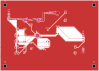

# Electronics Engineering Portfolio

**Power Electronics | Battery Management | Semiconductor Applications | PCB Design | Engineering Validation**

Three independent, reproducible electronics projects: a battery management system (BatteryLab),
power-circuit simulation (PowerLab), and automated test & engineering validation (TestLab).
Everything is produced by real local SPICE solves, automated tests and KiCad EDA checks —
**no fabricated measurements, no hardware fabrication, no soldering, no real battery or instrument tests.**

> This is a **personal engineering research prototype**. No boards were fabricated, soldered or powered.
> There is **no Production Ready / Hardware Validated claim**. See [known_limitations.md](known_limitations.md).

## The three projects

- **BatteryLab — Battery Management System**
  Analog front-end acquisition, AFE error budget, MOSFET protection, passive balancing, CC-CV charging,
  SOC estimation, plus **two editable KiCad schematics and two four-layer PCBs**.

- **PowerLab — Power Circuit Simulation**
  Buck topology, non-ideal power-device modelling, efficiency & loss analysis, Pareto optimisation,
  PI control, soft-start.

- **TestLab — Automated Test & Validation**
  SCPI virtual instruments, automated testing, parameter sweeps, fault injection, engineering validation.

## BatteryLab quantified results

Each line is labelled by result type: `simulation` / `analytical` / `public-data analysis` / `EDA design` / `software test`.

| Result | Value | Type | Evidence |
|---|---|---|---|
| Worst-case voltage sampling error budget | 30.887 → 3.837 mV | simulation | `portfolio/BatteryLab_resume_metrics_v3.csv` |
| Worst-case current sampling error budget | 37.736 → 6.666 mA | simulation | same |
| Passive-balancing cell spread | 130 → 10.47 mV | simulation | same (B01) |
| Standalone MOSFET protection trip | 0.871 µs | simulation (SPICE waveform) | `BatteryLab/portfolio/BatteryLab_MOSFET保护真实性复验.md` |
| Combined-system protection trip | 119.8 µs (**RISK**) | simulation | `BatteryLab/portfolio/BatteryLab_研发岗成果证据卡_v3.md` |
| CC-CV power-stage efficiency | 98.01 % | simulation | `BatteryLab/portfolio/BatteryLab_CC_CV控制优化前后对照.md` |
| CC error / CV steady-state error / CC→CV overshoot | 1.09 mA / 13.50 mV / 2.07 mV | simulation | `BatteryLab/portfolio/BatteryLab_CC_CV控制优化前后对照.md` |
| SOC estimation RMSE | 1.8247 percentage points | public-data analysis (CALCE replay) | `BatteryLab/portfolio/BatteryLab_研发岗成果证据卡.md` (E01) |
| Editable schematics | 2 (BMS / charger) | EDA design | `hardware/eda/*V2/` |
| Four-layer PCBs | 2, 100.1 × 72.1 mm | EDA design | `hardware/eda/*V2/release/routing_metrics.json` |
| Track segments / vias (total) | 620 / 96 | EDA design | both boards (304+316 / 46+50) |
| Unconnected items | 65 / 51 → 0 / 0 | EDA check | `release/unconnected_nets.csv` |
| DRC errors | 4 / 0 → 0 / 0 | EDA check | `release/drc.json` |
| Board-area reduction | ~42 % (102×122 → 100.1×72.1 mm) | analytical | [FINAL_DATA_AUDIT.md](docs/FINAL_DATA_AUDIT.md) |
| Regression tests | 594 passed | software test | `BatteryLab/portfolio/BatteryLab_工程指标真实性核查报告_v3.md` |

> All figures are simulation / analytical / public-data / EDA / software-test results,
> **not measurements from a commercial BMS board**.

## Real PCB previews (KiCad SVG export)

Exported by `kicad-cli` directly from the actual `.kicad_pcb` files — not renders or mock-ups.

**BMS V2 — 4 layers, 100.1 × 72.1 mm, 304 segments / 46 vias, 0 unconnected**

**Charger V2 — 4 layers, 100.1 × 72.1 mm, 316 segments / 50 vias, 0 unconnected**

**3D / STEP**: this repository deliberately provides **no fabricated 3D renders**. Download the
[BMS STEP](BatteryLab/hardware/eda/BatteryLab_BMS_V2/release/board.step) or
[Charger STEP](BatteryLab/hardware/eda/BatteryLab_Charger_V2/release/board.step) and open it in
KiCad PCB Editor, FreeCAD or any STEP viewer.

## Evidence index

- Full evidence index: [docs/EVIDENCE_INDEX.md](docs/EVIDENCE_INDEX.md)
- Final data audit: [docs/FINAL_DATA_AUDIT.md](docs/FINAL_DATA_AUDIT.md)
- Before/after comparison: [BatteryLab/portfolio/BatteryLab_PCB工程设计前后对照.md](BatteryLab/portfolio/BatteryLab_PCB工程设计前后对照.md)
- ERC warning classification: [BatteryLab/hardware/eda/review/schematic_warning_review.csv](BatteryLab/hardware/eda/review/schematic_warning_review.csv)
- Routing plan & stack-up: [BatteryLab/hardware/eda/review/routing_plan.md](BatteryLab/hardware/eda/review/routing_plan.md)
- Schematics (PDF): [BMS](BatteryLab/hardware/eda/BatteryLab_BMS_V2/release/schematic.pdf) /
  [Charger](BatteryLab/hardware/eda/BatteryLab_Charger_V2/release/schematic.pdf)

> Note: raw run outputs (`results/`, pytest logs) are large and contain local paths, so they are
> **not shipped**; in-repo evidence is the summary CSVs, validation docs and EDA release files.
> Raw outputs can be regenerated locally following the reproduction steps.

## Honest limitations

- Results are simulation / EDA results, not measurements.
- Known failures are kept: combined protection 119.8 µs (RISK), loop bandwidth ratio 1.86× (FAIL),
  load-step exceeding 300 mV limit (FAIL, overload study), low-SOC error (LIMITED).
- 109 ERC warnings remain (BMS 59 + charger 50); they are classified but not all eliminated.
- Charger SW node copper trace is 108.5 mm long; high-frequency layout is unverified.
- In1 reference-plane continuity is an open item; thermal, EMI, SI and hardware tests are **NOT_VERIFIED**.
- Manufacturing outputs are engineering-study files: **not approved for fabrication**.

## License

Original and AI-assisted code written by the owner is released under the MIT License (see
[LICENSE](LICENSE)). Third-party code, data, SPICE models, footprints and tools keep their own
licenses — see [THIRD_PARTY_NOTICES.md](THIRD_PARTY_NOTICES.md).

## AI assistance

AI was used for code organisation and documentation. All numbers are produced by the scripts in this
repository and their raw outputs are retained.
