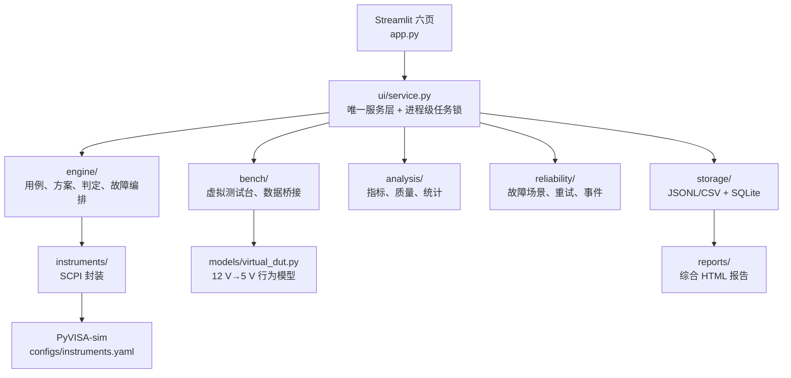

# TestLab — 基于 PyVISA-sim 的工业自动化测试与虚拟仪器平台

TestLab 在 PyVISA-sim 之上构建独立的应用层：用虚拟程控电源、数字万用表、
电子负载与 12 V→5 V DC-DC 行为模型，完成电源类产品的自动化测试、工程指标
计算、PASS/FAIL 判定、故障注入、可靠性验证、历史管理与可打印报告。

> **本项目为个人自主开发的仿真测试项目，运行在模拟环境。**
> 所有结果来自 PyVISA-sim SCPI 响应与 VirtualDUT 行为模型，
> **不是真实硬件测量，也不构成量产/认证结论。**

## 项目状态（本地实测）

| 项目 | 状态 |
| --- | --- |
| 单元/集成/界面测试 | 557 passed（本地 Windows，conda `kaifa`） |
| 静态检查 | `ruff check .` 通过（0 错误） |
| 依赖检查 | `pip check` 干净 |
| 覆盖率 | 总 84%（`docs/29_test_quality_report.md`） |
| 发布验收 | `scripts.verify_release` 核心检查 7/7 PASS；Docker/Linux/CI 为 NOT_VERIFIED |
| 版本 | `1.0.0`（见 `VERSION`） |
| GitHub Actions | 配置已编写，仓库尚未推送，**无真实 CI 运行结果** |
| 许可证 | 尚未选定，见 `LICENSE` |

## 1. 数据来源声明

| 标签 | 含义 |
| --- | --- |
| `pyvisa-sim SCPI` | 仪器设定值/回读值，经 PyVISA-sim 模拟后端传输 |
| `behavioral_model` | VirtualDUT 12 V→5 V DC-DC 行为模型的计算结果 |
| `model(virtual_dut)+dmm_noise` | 模型真值叠加 DMM ADC 噪声后的读数 |
| `fault_injected_model` | 可靠性验证中的注入视图，不修改原始 `DUTResult` |
| `static_mock` | DMM 固定 SCPI 响应，只用于通信链路演示 |
| `real hardware` | 未来接入真实仪器时使用（当前不存在） |

报告与数据库记录均保留来源字段，禁止把模拟结果写成真实测量。

## 2. 系统架构



分层约束（`AGENTS.md` 有完整清单）：

- `ui/` 只做展示与参数收集，不拼接 SCPI、不复制公式与限值；
- `instruments/` 只做通信与量程校验；
- `engine/` 只做编排与判定；
- `models/` 只做数学建模，不访问 VISA；
- `analysis/` 只做指标与质量检查；
- `storage/` 只做持久化，SQL 全部参数化；
- `reports/` 只读历史，生成报告不重新执行测试。

## 3. Web 界面（实际运行截图）

| 运行概览 | 自动化测试历史 |
| --- | --- |
|  |  |

仅提供以上两张**实际运行截图**；其余页面（仪器控制、性能扫描、可靠性验证、
历史记录）已由 Streamlit AppTest 验证渲染与交互，未提供截图时不宣称完成
视觉验收。本地启动后可自行复现。

## 4. 核心功能

- **虚拟仪器**：电源、DMM、电子负载；统一 `InstrumentManager`，单
  ResourceManager、共享资源、幂等关闭。
- **VirtualDUT 模型**：9–16 V 输入、5 V 输出、2 A 上限、0.02 Ω 输出电阻、
  预设 0.90 效率；状态机 `OUTPUT_OFF → UNDERVOLTAGE → OVERVOLTAGE →
  OVERCURRENT → INPUT_CURRENT_LIMIT → NORMAL`。
- **显式数据桥接**：PSU/ELoad SCPI → 模型 → DMM 噪声；不假设虚拟仪器共享
  物理状态。
- **工程指标**：输入/输出功率、效率、电压绝对/相对/带符号误差、
  负载调整率、线性调整率、测试通过率、数据缺失检测。
- **数据质量**：缺失、NaN/inf、负值、功率不守恒、效率 >100%、来源不一致、
  保护状态输出异常、重复工况。
- **自动化引擎**：YAML 用例/方案、设置值回读校验、四态判定
  `PASS/FAIL/ERROR/SKIP`、清理失败强制停止、退出码 0/1/2/3。
- **可靠性验证**：F001–F009 确定性故障、异常分类、有限重试、清理验证、
  JSONL + SQLite 事件、业务状态与实验结论分离。
- **Web 平台**：六页导航、真实进度、任务串行、刷新不重复执行、历史筛选、
  详情、配置快照、CSV/JSON/HTML 导出。
- **综合报告**：离线 HTML、A4 打印、无 CDN、带时间戳不覆盖、只读历史。
- **工程化**：统一路径、依赖/环境定义、启动脚本、Docker 配置、CI 配置、
  数据库备份、发布验收脚本。

### 指标口径（摘要）

| 指标 | 公式 | 备注 |
| --- | --- | --- |
| 效率 | `Pout / Pin × 100` | `Pin = 0` 返回 `None` |
| 电压绝对误差 | `abs(Vmeas - Vref)` | 单位 V |
| 带符号电压误差 | `(Vmeas - Vref) / Vref × 100` | 保留偏高/偏低方向 |
| 负载调整率 | `abs(V空载 - V满载) / V标称 × 100` | 分母统一为标称电压 |
| 线性调整率 | `(Vout_max - Vout_min) / V标称 × 100` | 只取 NORMAL 采样 |
| 有效判定通过率 | `PASS / (PASS + FAIL) × 100` | `ERROR/SKIP` 不计入分母 |
| 整体执行完成率 | `(PASS+FAIL+ERROR) / 计划数 × 100` | 综合报告并列展示 |

保护状态下指标为 `NOT_APPLICABLE`；空载效率为 `N/A`，不填 0% 或 100%。
完整定义见 `docs/12_engineering_metrics.md` 与 `docs/13_data_quality.md`。

## 5. 快速开始（Windows + conda `kaifa`）

```powershell
# 进入项目
cd TestLab

# 1) 安装/核对依赖
& "C:\\Users\\<user>\.conda\envs\kaifa\python.exe" -m pip install -r requirements.txt
& "C:\\Users\\<user>\.conda\envs\kaifa\python.exe" -m pip check

# 2) 运行测试
& "C:\\Users\\<user>\.conda\envs\kaifa\python.exe" -m pytest tests -q

# 3) 启动 Web 平台
.\scripts\start_windows.ps1
# 或
& "C:\\Users\\<user>\.conda\envs\kaifa\python.exe" -m streamlit run app.py
```

常用命令：

```powershell
# 自动化方案
python -m scripts.run_test_suite --list
python -m scripts.run_test_suite --suite SUITE-SMOKE
python -m scripts.run_test_suite --suite SUITE005

# 故障与可靠性（仅模拟环境）
python -m scripts.fault_injection_demo --list
python -m scripts.reliability_demo

# 综合 HTML 报告（只读历史）
python -m scripts.generate_report --list
python -m scripts.generate_report --run-id <run_id>

# 数据库备份（不覆盖、带完整性校验）
python -m scripts.backup_database --backup-dir D:\testlab-backups

# 发布验收（临时目录，不污染真实历史）
python -m scripts.verify_release

# 质量检查
python -m ruff check .
python -m pytest tests -q --cov=core --cov=instruments --cov=models ^
  --cov=bench --cov=analysis --cov=engine --cov=storage ^
  --cov=reliability --cov=ui --cov=reports --cov-report=term-missing
```

（上面的 `python` 在 `kaifa` 环境中即为
`C:\\Users\\<user>\.conda\envs\kaifa\python.exe`。）

### 环境变量

| 变量 | 作用 |
| --- | --- |
| `TESTLAB_RESULTS_DIR` | 结果目录（容器/部署推荐） |
| `TESTLAB_RESULTS_ROOT` | 兼容阶段九 AppTest 的历史变量名 |
| `TESTLAB_DB_PATH` | 单独指定 SQLite 路径 |

优先级：`TESTLAB_RESULTS_DIR` > `TESTLAB_RESULTS_ROOT` > 默认 `results/`；
数据库默认 `<结果目录>/testlab.db`。统一实现见 `core/paths.py`。

## 6. 测试方案与目录

| 方案 | 内容 |
| --- | --- |
| `SUITE-SMOKE` | 标称工况冒烟 |
| `SUITE-REGRESSION` | 多工况回归 |
| `SUITE005` | 阶段九验收用 5 条用例 |

`configs/engine_validation_cases.yaml` 故意包含 FAIL/SKIP/ERROR，
不得加入默认回归方案。

运行时产物：

```text
results/
├── automation/run_<run_id>/     # JSONL/CSV、summary、配置快照、metadata
├── reliability/run_<run_id>/    # 故障事件、可靠性报告与图表
├── reports/                     # 综合 HTML 报告（带时间戳）
├── testlab.db                   # SQLite 历史
├── backups/                     # 数据库备份（默认）
└── *.csv / *.html               # 历史性能扫描
```

## 7. 部署

- Windows：`scripts/start_windows.ps1`
- Linux：`scripts/start_linux.sh`（详见 `docs/31_linux_deployment.md`）
- Docker：`Dockerfile` + `compose.yaml`（本机未安装 Docker，未构建验证）
- 远程访问：优先 SSH 端口转发，不直接开放公网

## 8. 项目结构

```text
TestLab/
├── app.py                  # Streamlit 入口
├── ui/                     # 六页视图、服务层、状态、组件
├── instruments/            # 仪器驱动与统一管理
├── models/                 # VirtualDUT 行为模型
├── bench/                  # 虚拟测试台与数据桥接
├── analysis/               # 指标、数据质量、统计
├── engine/                 # 用例、方案、判定、故障注入
├── reliability/            # 故障场景、异常分类、重试、可靠性统计
├── storage/                # JSONL/CSV 与 SQLite
├── reports/                # JSON/CSV/综合 HTML 报告与模板
├── core/                   # 统一路径
├── configs/                # 仪器、DUT、限值、用例、方案、故障、重试
├── scripts/                # CLI、演示、备份、报告、发布验收
├── tests/                  # 557 项测试
├── docs/                   # 设计/验收/质量/部署/契约文档
├── portfolio/              # 项目说明、贡献、简历、面试、学习与演示
├── assets/screenshots/     # 实际运行截图
├── Dockerfile / compose.yaml
├── .github/workflows/ci.yml
├── VERSION / CHANGELOG.md / LICENSE / THIRD_PARTY_NOTICES.md
└── requirements.txt / requirements-dev.txt / environment.yml / pyproject.toml
```

## 9. 与上游项目的关系

- 上游：**PyVISA**（MIT）与 **PyVISA-sim**（MIT），版本分别为 1.16.2 与 0.7.1；
- TestLab 是应用层二次开发，未修改上游源码；
- 本地 `pyvisa-sim-main/` 仅作阅读参考，运行时不加载；
- 第三方许可证见 `THIRD_PARTY_NOTICES.md`；
- 本项目尚未选定自主许可证，见 `LICENSE`。

## 10. 局限性与免责声明

1. **仿真环境**：没有真实电源、DMM、负载，也没有真实被测芯片；
2. **模型边界**：VirtualDUT 是稳态数学行为模型，不是 SPICE 电路仿真；
   0.90 效率为预设参数，不是实测值；不包含纹波、瞬态与温度效应；
3. **数据一致性**：多台 PyVISA-sim 仪器不共享物理状态，必须经
   `DutDataBridge` 显式桥接；
4. **判定含义**：PASS 仅表示满足预设模拟验证条件，不代表产品合格；
5. **并发能力**：单进程任务串行，不支持多副本、多用户并发；
6. **部署验证**：Docker、Linux、GitHub Actions 未在本机实机验证，
   状态以 `docs/30_release_validation.md` 为准；
7. **许可证**：未选定前默认保留所有权利。

## 11. 文档索引

- 环境与上游：`docs/01`–`docs/02`
- 仪器驱动：`docs/03`–`docs/07`
- 虚拟 DUT 与数据桥接：`docs/09`–`docs/11`
- 指标、质量与性能：`docs/12`–`docs/14`
- 用例、引擎与存储：`docs/15`–`docs/18`
- 故障与可靠性：`docs/20`–`docs/23`
- Web 平台：`docs/24`–`docs/27`
- 第十阶段：`docs/28`–`docs/34`
- 开发约定：`AGENTS.md`

## 12. 贡献边界

- 提交前必须运行：`ruff check .`、`pytest tests -q`、`scripts.verify_release`；
- 不得伪造 PASS、覆盖率、截图或硬件结论；
- 修改上游 PyVISA-sim 源码、接入真实硬件、上传公开仓库均需单独评审；
- 详细约束见 `AGENTS.md`。
