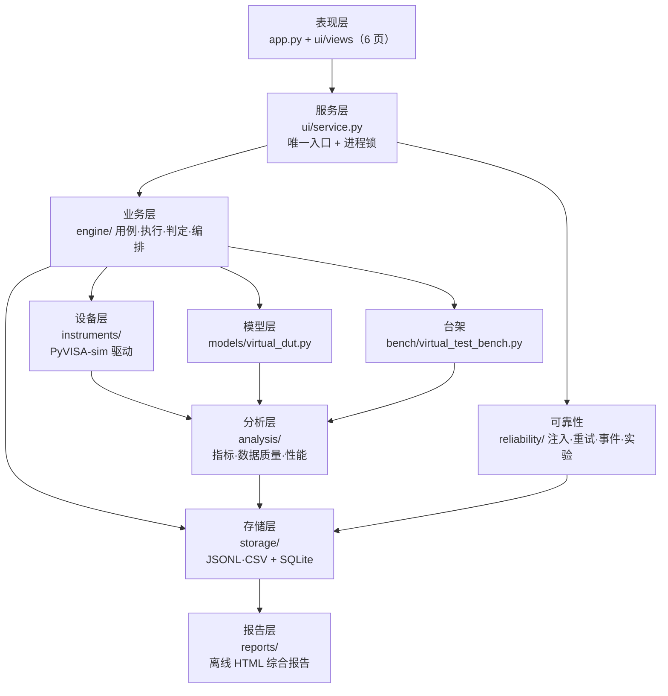
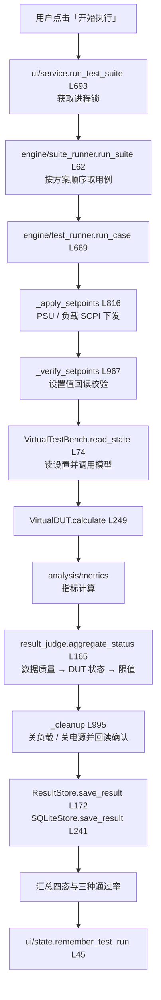
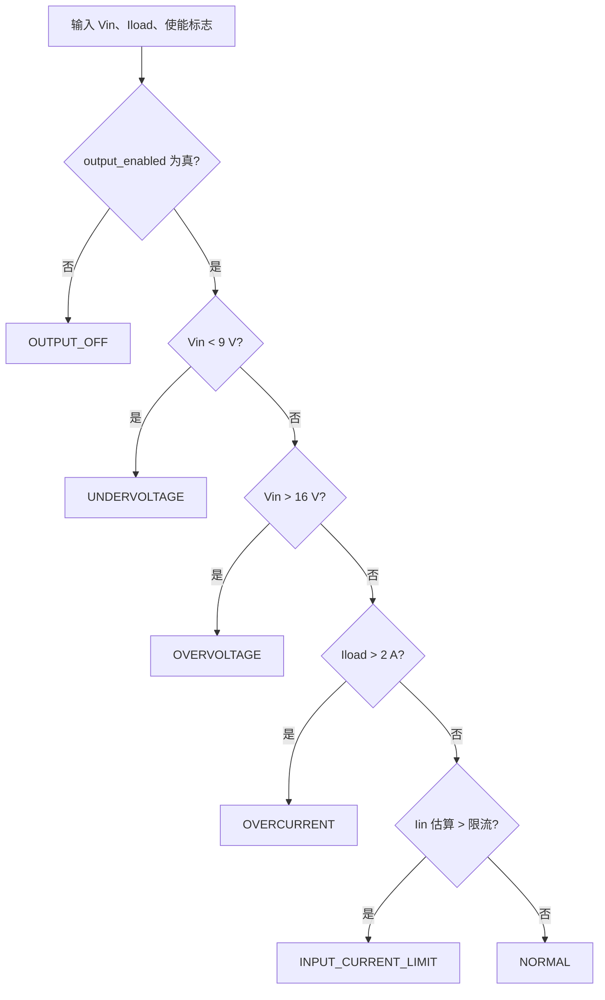
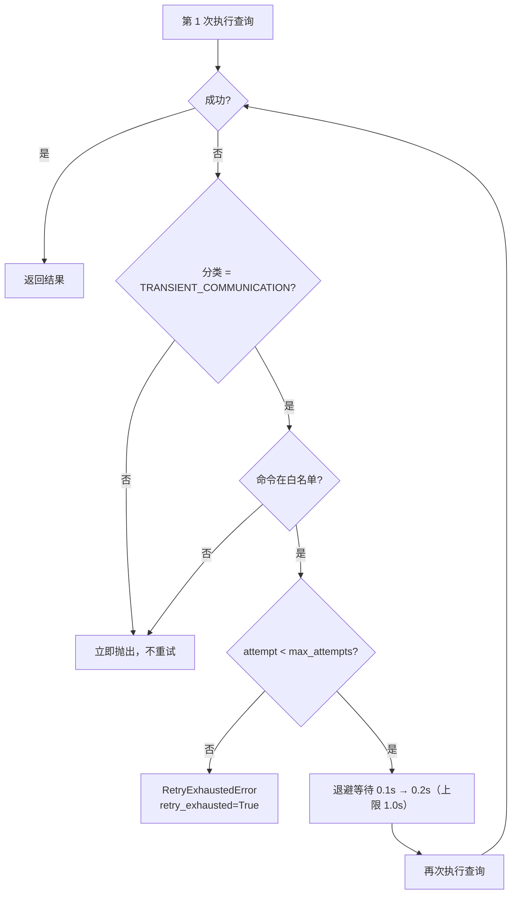
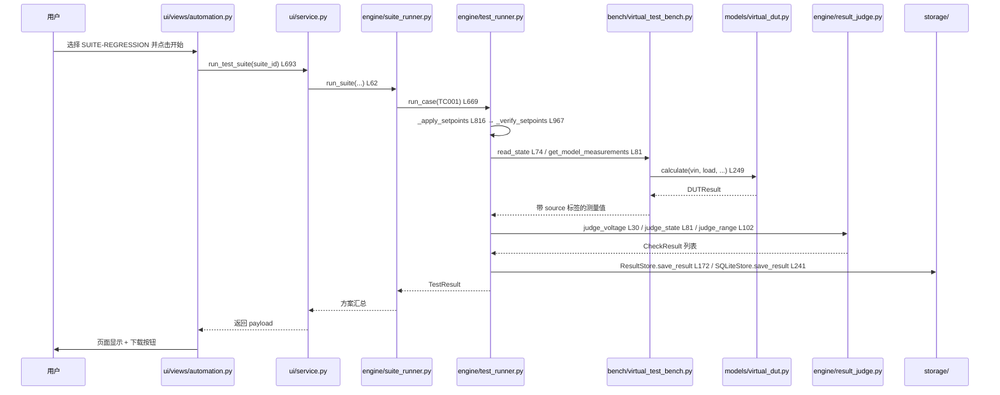
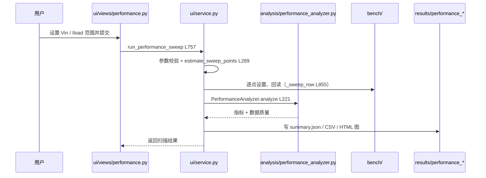
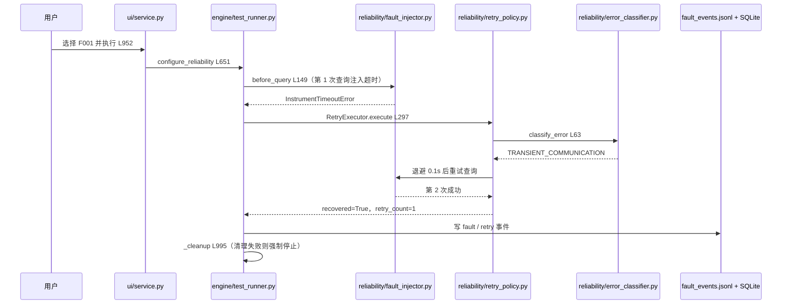

# TestLab 项目学习与面试实战手册

> 版本：1.0（基于当前工作区真实源码、配置、数据库与运行结果整理）
> 适用环境：Windows 10 + conda 环境 `kaifa`（Python 3.11.18）
> 项目路径：`TestLab`；`VERSION` = 1.0.0
> 证据文件：`portfolio/resume_evidence.md`、`portfolio/code_learning_guide.md`

## 使用说明

1. 本手册只描述当前工作区实际存在的代码与数据，未实现或未验证的内容均标注 `NOT_VERIFIED`。
2. 项目性质是 **PyVISA-sim 应用层二次开发 + AI 辅助开发**，不是企业量产项目，没有真实硬件与客户数据。
3. 面试时先讲“这是什么”，再讲“我做了什么”，最后讲“边界在哪”，不要夸大为真实产线系统。
4. 建议配合源码阅读：先读第 1、3 章建立地图，再按第 4–12 章逐层深入，最后背第 17、21 章。
5. 本手册中的所有数字都可回溯到 `resume_evidence.md`，不要临场改数字。

### 三个必须主动说明的边界

- 仪器是 PyVISA-sim 虚拟后端，DMM 的 SCPI 读数是固定模拟值（`static_mock`）。
- Docker 构建、Linux 部署、GitHub Actions 真实运行均为 `NOT_VERIFIED`。
- 可靠性“10/10 实验通过”指系统按预期识别并处理注入故障，不代表产品良率。

---

## 目录

- [第 1 章 项目全景：这是什么、不是什么](#ch1)
- [第 2 章 从项目代码学 Python 基础](#ch2)
- [第 3 章 目录结构与阅读路线](#ch3)
- [第 4 章 虚拟仪器与 SCPI（PyVISA-sim）](#ch4)
- [第 5 章 DUT 行为模型与保护状态](#ch5)
- [第 6 章 测试引擎：用例、方案、执行、判定](#ch6)
- [第 7 章 配置文件逐个讲解](#ch7)
- [第 8 章 可靠性验证：故障注入、重试、事件](#ch8)
- [第 9 章 数据模型与持久化（JSONL / CSV / SQLite）](#ch9)
- [第 10 章 工程指标与算法](#ch10)
- [第 11 章 Web 平台（Streamlit）](#ch11)
- [第 12 章 自动测试报告](#ch12)
- [第 13 章 测试体系与质量保障](#ch13)
- [第 14 章 工程化：Git、Docker、CI、依赖](#ch14)
- [第 15 章 真实运行数据解读](#ch15)
- [第 16 章 21 个循序渐进的练习](#ch16)
- [第 17 章 100+ 高频面试题（含必背 30）](#ch17)
- [第 18 章 三场模拟面试](#ch18)
- [第 19 章 15 天学习计划](#ch19)
- [第 20 章 简历写法与追问应对](#ch20)
- [第 21 章 求职八股文背诵手册](#ch21)
- [第 22 章 三条完整真实源码调用链](#ch22)
- [第 23 章 最终能力验收清单](#ch23)
- 附录 A 重要文件索引
- 附录 B 常用命令
- 附录 C 错误与异常速查
- 附录 D 术语表
- 附录 E 禁止写入简历的表述

---

<a id="ch1"></a>

# 第 1 章 项目全景：这是什么、不是什么

## 1.1 一句话定义

TestLab 是一个“电源类器件自动化测试平台”的学习型实现：用 PyVISA-sim 虚拟出电源、万用表、电子负载，
用确定性的 DUT 行为模型代替真实硬件，完成“配置用例 → 设置仪器 → 采集数据 → 判定 → 入库 → 出报告”的闭环。

## 1.2 它不是什么（面试必须先说）

| 不是 | 原因 |
| --- | --- |
| 企业量产测试系统 | 个人学习项目，无客户、无产线、无真实数据 |
| 真实仪器驱动 | 全部通过 PyVISA-sim 虚拟后端，未接入真实 GPIB/USB 仪器 |
| 高精度测量系统 | DMM SCPI 读数是固定模拟值，模型噪声为人工构造 |
| 电池/BMS 测试系统 | DUT 是 12 V→5 V DC-DC 模型，不是电池包 |
| 已上线的 Web 服务 | Streamlit 本地运行，无鉴权、无多用户并发 |
| 已完成容器化交付 | Dockerfile/Compose 已编写，但未实际构建运行 |

## 1.3 真实量化数字（面试可直接背）

| 维度 | 数字 | 口径 |
| --- | --- | --- |
| 虚拟仪器 | 3 类 / 3 个资源 | 电源、DMM、电子负载 |
| SCPI 指令 | 定义 21 条（查询 12 / 设置 9） | YAML 并集去重；驱动实际发送 18 条 |
| 驱动公开方法 | 30 个 | 业务 21 + 基类通信 9 |
| 业务用例 | 12 条（TC001–TC012） | 全部启用并实际执行 |
| 测试方案 | 4 套（2 / 4 / 12 / 5） | SMOKE / PROTECTION / REGRESSION / SUITE005 |
| DUT 状态 | 6 种 | 正常、输出关断、欠压、过压、过流、输入限流 |
| 工程指标函数 | 10 个（7 类指标） | 另有 4 个兼容实现、7 个辅助函数 |
| 扫描工况 | 39 点 | 负载 11 / 线性 10 / 二维 18 |
| 故障场景 | 9 个，实际触发 9 个 | 单次运行注入 11 次 |
| 可靠性实验 | 10 个，10/10 符合预期 | NONE + F001–F009 |
| pytest | 557 项全部通过 | 38 个测试文件 |
| 覆盖率 | 84.27% | 语句 87.1% / 分支 75.3% |
| Web 页面 | 6 页 | Streamlit 单进程 |
| 导出格式 | CSV / JSON / HTML + 综合报告 | 报告为离线单文件 |
| SQLite | 4 张业务表 | runs / test_results / check_results / fault_events |
| 代码规模 | 72 个应用层文件 / 15,201 行 | 不含测试与第三方 |

## 1.4 架构图（分层，文字版）



为什么这样分层：

- UI 不拼接 SCPI、不复制判定公式，避免“界面改一处、逻辑错三处”。
- 仪器层只负责通信与回读校验，模型层只负责物理计算，职责不混。
- 存储层同时提供“运行目录快照”和“SQLite 查询索引”，前者可追溯，后者可检索。
- 报告层只读快照，不重跑测试，保证“报告与历史运行一致”。

## 1.5 一条用例的完整数据流



## 1.6 常见误解（面试防坑）

| 误解 | 事实 |
| --- | --- |
| “21 条 SCPI 都被驱动调用” | 实际发送 18 条；`*RST/*CLS/SYST:ERR?` 只在 YAML 定义 |
| “效率 90% 是实测” | 是模型参数 `nominal_efficiency=0.90` |
| “10/10 可靠性 = 产品可靠” | 是“故障被正确识别”的实验通过率 |
| “覆盖率 84% 说明测试充分” | 页面层最低 40.6%，UI 分支仍有盲区 |
| “支持并发测试” | 只有单进程任务锁，串行执行 |

---

<a id="ch2"></a>

# 第 2 章 从项目代码学 Python 基础

> 本章不追求语法大全，只讲“项目里真实用到、面试常问”的部分。每节结构：
> 代码 → 讲解 → 项目位置 → 面试追问。

## 2.1 模块、包与 `__init__.py`

项目每个目录都是包，例如 `analysis/__init__.py` 统一导出：

```python
# analysis/__init__.py（节选）
from .metrics import calculate_metrics, efficiency_percent
from .data_quality import validate_dataset
```

讲解：

- 包让 `from analysis.metrics import ...` 可用，避免相对路径混乱。
- `__init__.py` 只做“稳定接口导出”，不写业务逻辑。
- 循环导入的常见解法：把共享常量下沉到 `core/`（本项目 `core/paths.py`）。

项目位置：`core/`、`analysis/`、`engine/` 等均有 `__init__.py`。

面试追问：**为什么不在 `__init__.py` 里初始化数据库？**
答：导入即副作用会让测试难以隔离，也会在只读脚本里意外建库；本项目把建目录放在 `ensure_runtime_directories()`，显式调用。

## 2.2 类型注解与 `from __future__ import annotations`

```python
from __future__ import annotations

def run_suite(self, suite: TestSuite) -> SuiteRunResult:
    ...
```

讲解：

- `list[str]`、`X | None` 在 3.9/3.10 才有完整支持；`from __future__` 让注解延迟求值，兼容更好。
- 注解不强制运行时不报错，但能让 IDE、mypy、读者快速理解接口。

项目位置：几乎所有模块首行都有该导入。

面试追问：**注解会在运行时检查类型吗？**
答：不会。需要运行时校验必须显式写 `isinstance` 或 pydantic；本项目在参数入口手工校验（如 `validate_number`）。

## 2.3 `dataclass`：测试结果的数据载体

```python
# engine/models.py L158 附近（简化）
@dataclass
class TestResult:
    case_id: str
    status: TestStatus
    metrics: dict[str, float | None] = field(default_factory=dict)
```

讲解：

- 自动生成 `__init__`、`__repr__`、`__eq__`，适合“字段多、行为少”的数据对象。
- `field(default_factory=dict)` 避免可变默认值共享（Python 经典坑）。
- 与普通类相比，dataclass 不提供校验；校验放在加载器/执行器。

项目位置：`engine/models.py` 的 `TestCase`、`TestResult`、`CheckResult`。

面试追问：**为什么不用 dict 传结果？**
答：dict 无字段约束、拼写错误运行时才发现；dataclass 可读、可补全，也方便序列化。

## 2.4 `Enum`：四态与 DUT 状态

```python
# engine/models.py L24 附近（简化）
class TestStatus(str, Enum):
    PASS = "PASS"
    FAIL = "FAIL"
    ERROR = "ERROR"
    SKIP = "SKIP"
```

讲解：

- 继承 `str` 让枚举可直接 JSON 序列化、可写入 SQLite。
- 固定枚举避免“pass/PASS/Pass”混用。
- DUT 状态同理：`NORMAL/OUTPUT_OFF/UNDERVOLTAGE/OVERVOLTAGE/OVERCURRENT/INPUT_CURRENT_LIMIT`（`models/virtual_dut.py` L39-50）。

项目位置：`engine/models.py`、`models/virtual_dut.py`。

面试追问：**PASS 和 ERROR 的本质区别？**
答：PASS/FAIL 是“产品行为”判断；ERROR 是“测试系统无法给出可信判断”（数据非法、通信失败、清理失败）。

## 2.5 异常体系：分层捕获，不吞异常

```python
# instruments/exceptions.py L11-36（结构）
class InstrumentError(Exception): ...
class InstrumentNotConnectedError(InstrumentError): ...
class InstrumentTimeoutError(InstrumentError): ...
class InstrumentResponseError(InstrumentError): ...
```

```python
# instruments/power_supply.py L107-112
def get_output(self) -> bool:
    value = self.query_int("OUTP?")
    if value not in (0, 1):
        raise InstrumentError(f"{self.name}: 输出状态响应非法 {value!r}")
    return value == 1
```

讲解：

- 自定义异常让上层能区分“没连接 / 超时 / 回包非法”。
- 非法响应不猜测、不返回默认值，直接抛错，避免把异常伪装成 PASS。
- `raise ... from exc` 保留原始异常链（见 `virtual_dut.from_yaml` L203-204）。

项目位置：`instruments/exceptions.py`、`engine/test_runner.py`、`reliability/exceptions.py`。

面试追问：**为什么不用一个 Exception 打天下？**
答：无法按类型重试/降级；例如只有超时类可重试，写入错误不应重试。

## 2.6 上下文管理器：资源必须关闭

```python
# instruments/base.py L132 附近（简化）
def __enter__(self):
    self.connect()
    return self

def __exit__(self, exc_type, exc, tb):
    self.close()
    return False
```

讲解：

- 即使中间抛异常，`__exit__` 也会执行，保证资源释放。
- 本项目还在 `ui/service.py` 用 `finally` 显式关闭台架与数据库连接。
- 备份脚本用 `contextlib.closing(sqlite3.connect(...))` 解决 Windows 文件占用问题。

项目位置：`instruments/base.py`、`scripts/backup_database.py`。

面试追问：**`__exit__` 返回 True 意味着什么？**
答：吞掉异常；本项目返回 False（或 None），让异常继续向上传播。

## 2.7 生成器与迭代：逐条处理结果

```python
for case in suite.cases:
    result = runner.run_case(case)
    yield result
```

讲解：

- 生成器适合“边执行边产出”，避免一次性把所有结果放内存。
- 但本项目方案执行需要汇总与提前停止，因此实际用列表累积 + 循环控制。

项目位置：`engine/suite_runner.py`。

面试追问：**生成器和列表的区别？**
答：惰性求值、内存友好；但不能重复遍历，异常时机的语义也不同。

## 2.8 `pathlib.Path`：跨平台路径

```python
path = Path(config_path)
if not path.exists():
    raise FileNotFoundError(...)
```

讲解：

- 避免手工拼 `\` 或 `/`；`Path / "results"` 自动适配平台。
- 本项目统一在 `core/paths.py` 解析根目录，脚本不再各自拼路径。

项目位置：`core/paths.py`、`scripts/*`。

面试追问：**为什么 Docker 里 `TESTLAB_RESULTS_DIR` 之前不生效？**
答：旧代码在导入时固化路径；现在 `results_dir()` 在调用时读环境变量。

## 2.9 `try/except/finally` 与任务锁

```python
if not _TASK_LOCK.acquire(blocking=False):
    raise TaskBusyError(...)
try:
    ...
finally:
    _TASK_LOCK.release()
```

讲解：

- 非阻塞锁实现“已有任务就立即提示”，而不是排队卡死。
- `finally` 保证异常时也释放锁，避免永久锁死。

项目位置：`ui/service.py` L52-80 附近。

面试追问：**为什么不用数据库锁做并发控制？**
答：当前是单进程 Streamlit，进程级锁足够；多进程场景需要改用文件锁/Redis 锁。

## 2.10 `math.isfinite` 与数据质量

```python
if not math.isfinite(number):
    raise ValueError(f"非法 {name}: 必须是有限数值")
```

讲解：

- NaN 与 Infinity 都能通过 `float()`，但会污染后续计算与 JSON。
- 本项目在模型输入、指标计算、数据质量三层都拦截非有限值。

项目位置：`models/virtual_dut.py` L208-221、`analysis/data_quality.py`。

面试追问：**NaN 和 None 的区别？**
答：NaN 是浮点数，比较永远为 False；None 是缺失对象。数据库/JSON 处理方式不同。

## 2.11 字典与 `setdefault` / `defaultdict`

项目在多处按 `run_id`、`case_id` 聚合结果：

```python
grouped.setdefault(status, []).append(result)
```

讲解：

- 避免 `if key not in dict` 的三行模板。
- 统计时常用 `Counter` 计数，再计算通过率。

项目位置：`analysis/statistics.py`、`reports/generator.py`。

面试追问：**`defaultdict(list)` 与 `setdefault` 怎么选？**
答：临时聚合用 `setdefault`；长期结构用 `defaultdict` 更清晰，但注意访问不存在的键会创建它。

## 2.12 字符串格式化与数值稳定

```python
self.write(f"VOLT {value:.3f}")
```

讲解：

- SCPI 参数固定 3 位小数，避免 `5.0000000001` 这类浮点噪声。
- 报告与 CSV 同样需要固定格式，否则同一数据每次输出不同。

项目位置：`instruments/power_supply.py` L86。

面试追问：**浮点数能直接比较相等吗？**
答：不能；判限值要用容差或明确边界，本项目限值比较有明确上下限与容差参数。

## 2.13 `random.Random(seed)`：可复现的噪声

```python
self._rng = random.Random(seed)
def read_dc_voltage(self, true_value: float) -> float:
    return true_value + self._rng.gauss(0.0, self.noise_rms)
```

讲解：

- 固定种子让测试可复现；直接用全局 `random` 会被其他代码影响。
- 噪声 RMS 默认 0.0008 V，是模型假设，不是硬件指标。

项目位置：`instruments/multimeter.py` L42-43、L85-87。

面试追问：**为什么测试里要固定随机种子？**
答：否则同一用例可能偶发失败，无法区分“代码回归”与“随机波动”。

## 2.14 本章小结与自测

能回答以下问题才算过关（15 题）：

1. 为什么 `TestStatus` 要继承 `str`？
2. `dataclass` 的可变默认值为什么要用 `default_factory`？
3. 自定义异常体系解决了什么问题？
4. 任务锁为什么必须放在 `finally` 释放？
5. NaN 为什么必须在入口拦截？
6. `from __future__ import annotations` 解决什么问题？
7. 为什么 `Enum` 成员比较要用身份而不是字符串拼接？
8. `with` 语句在异常退出时还会执行 `__exit__` 吗？
9. 生成器表达式和列表推导式在内存上的区别？
10. `Path` 相比字符串拼接路径的优势是什么？
11. `dict.setdefault` 与 `defaultdict` 各适合什么场景？
12. `try/except/else/finally` 中 `else` 什么时候执行？
13. `math.isfinite` 能拦住哪些值？
14. 为什么 `f"{value:.4g}"` 比 `round()` 更适合报告显示？
15. `random.Random(seed)` 为什么能保证结果可复现？

五个小代码练习（先自己写，再对照源码）：

| 练习 | 任务 | 对照文件 |
| --- | --- | --- |
| 1 | 写一个 `@dataclass` 表示“一条检查项”，含名称、限值、实测值 | `engine/models.py` 的 `CheckResult` |
| 2 | 写一个上下文管理器，进入时打印开始、退出时打印结束 | `instruments/base.py` 的 `__enter__/__exit__` |
| 3 | 写一个生成器，逐条产出列表中的偶数 | `engine/suite_runner.py` 的逐用例循环 |
| 4 | 用 `pathlib` 拼出 `results/automation/run_<id>/summary.json` 并判断是否存在 | `storage/result_store.py` L112 |
| 5 | 用 `try/except/finally` 模拟“设置失败也要关闭输出” | `engine/test_runner.py` 的 `_cleanup` L995 |

<a id="ch3"></a>

# 第 3 章 目录结构与阅读路线

## 3.1 顶层目录

```text
TestLab/
├─ app.py                  Streamlit 入口（页面配置 + 导航）
├─ core/                   全局路径（项目根、results、数据库）
├─ ui/                     界面层：6 个页面 + 服务层 + 组件 + 状态
├─ engine/                 测试引擎：加载、执行、判定、编排、桥接
├─ instruments/            PyVISA-sim 驱动：基类、电源、DMM、负载、管理
├─ models/                 DUT 行为模型
├─ bench/                  测试台架（仪器组合 + 模型取值）
├─ analysis/               指标、数据质量、性能分析、统计
├─ reliability/            故障模型、注入、重试、事件、实验分析
├─ storage/                JSONL/CSV 运行目录 + SQLite
├─ reports/                离线 HTML 综合报告 + 模板
├─ configs/                13 个 YAML（10 主用 + 3 测试/回归专用）
├─ scripts/                演示、运行、备份、报告、验收脚本
├─ tests/                  557 项 pytest
├─ docs/                   28–34 阶段文档
├─ portfolio/              简历、证据表、学习手册
├─ assets/                 截图素材
├─ .github/workflows/      CI 配置（未真实运行）
├─ Dockerfile / compose.yaml
└─ VERSION / LICENSE / CHANGELOG / README
```

## 3.2 每个目录的职责与“不要做什么”

| 目录 | 负责 | 不该出现 |
| --- | --- | --- |
| `ui/` | 渲染、交互、调用 service | 直接 `write("VOLT ...")`、复制限值判断 |
| `engine/` | 用例编排、执行、判定 | Streamlit 代码、SQL 字符串 |
| `instruments/` | 通信、回读校验 | 业务限值、DUT 物理公式 |
| `models/` | 物理行为计算 | 仪器通信、文件读写 |
| `analysis/` | 纯函数计算 | 数据库连接、界面状态 |
| `storage/` | 持久化 | 判定逻辑 |
| `reports/` | 只读快照出报告 | 重新执行测试 |
| `configs/` | 参数与用例 | 可执行代码 |

## 3.3 推荐阅读路线（按依赖顺序）

1. `core/paths.py`：知道文件放哪。
2. `instruments/base.py` + `instruments/manager.py`：知道怎么连仪器。
3. `models/virtual_dut.py`：知道数据从哪来。
4. `engine/case_loader.py` + `engine/models.py`：知道用例长什么样。
5. `engine/test_runner.py` + `engine/result_judge.py`：知道一条用例怎么跑、怎么判。
6. `storage/*`：知道结果怎么落盘。
7. `engine/suite_runner.py`：知道一套方案怎么编排。
8. `reliability/*`：知道故障与重试。
9. `analysis/*`：知道指标怎么算。
10. `reports/generator.py`：知道报告怎么生成。
11. `ui/service.py` + `ui/views/*`：知道界面怎么串起来。

## 3.4 两个入口

- Web 入口：`app.py`，`streamlit run app.py`。
- 命令行入口：`python -m scripts.run_test_suite --suite SUITE-REGRESSION`。

面试追问：**为什么要有两个入口？**
答：Web 适合演示与人工操作；脚本适合回归、CI 与自动化验收，二者共用同一 service/engine，不重复实现。

## 3.5 快速定位代码的方法

| 想找 | 命令/位置 |
| --- | --- |
| 某条 SCPI 在哪定义 | 搜 `configs/instruments.yaml` |
| 谁调用了判定 | 搜 `aggregate_status` / `judge_range` |
| 结果写到哪里 | `storage/result_store.py`、`storage/sqlite_store.py` |
| 某个指标公式 | `analysis/metrics.py` |
| 某个页面逻辑 | `ui/views/<page>.py` |
| 某个错误 | `docs/30_release_validation.md`、`附录 C` |

---

<a id="ch4"></a>

# 第 4 章 虚拟仪器与 SCPI（PyVISA-sim）

## 4.1 先理解三个概念

1. **VISA**：仪器通信的统一 API，屏蔽 GPIB/USB/TCP 差异。
2. **SCPI**：建立在 VISA 之上的命令语言，例如 `VOLT 5`（设置）、`VOLT?`（查询）。
3. **PyVISA-sim**：不连真实仪器，用 YAML 描述“收到什么命令、回什么响应”的模拟后端。

本项目的资源字符串：

```text
USB::0x1111::0x2222::PS001::INSTR
USB::0x1111::0x2222::DMM001::INSTR
USB::0x1111::0x2222::LOAD001::INSTR
```

`0x1111/0x2222` 是模拟的厂商/型号 ID，`PS001/DMM001/LOAD001` 是序列号，用于角色识别。

## 4.2 YAML 结构逐段讲解

以电源为例（`configs/instruments.yaml` L11-64）：

```yaml
virtual_power_supply:
  eom:
    USB INSTR:
      q: "\n"      # 发送终止符
      r: "\n"      # 接收终止符
  error:
    response:
      command_error: "ERROR"
      query_error: "ERROR"
    error_queue:
      - q: "SYST:ERR?"
        default: '0,"No error"'
        command_error: '1,"Command error"'
  dialogues:
    - q: "*IDN?"
      r: "TestLab,VirtualPowerSupply,PS001,1.0.0"
    - q: "*RST"
    - q: "*CLS"
  properties:
    voltage:
      default: 0.0
      getter:
        q: "VOLT?"
        r: "{:.3f}"
      setter:
        q: "VOLT {:.3f}"
        e: "ERROR"
      specs:
        type: float
        min: 0
        max: 30
```

逐段含义：

| 字段 | 作用 | 踩坑点 |
| --- | --- | --- |
| `eom` | 消息终止符 | 不配 `\n` 会一直等不到完整消息 |
| `error.response` | 命令/查询出错时回什么 | 回 `ERROR` 后若继续按数字解析会“响应错位” |
| `error_queue` | `SYST:ERR?` 的返回 | 本项目驱动未调用，属于保留能力 |
| `dialogues` | 固定问答 | `*RST/*CLS` 只需定义，无需响应 |
| `properties` | 有状态的读写属性 | 只读属性必须写 `specs`，否则默认值按字符串保存 |
| `specs` | 类型与范围 | 超范围时模拟器回 `ERROR`，不是抛 Python 异常 |

只读属性的坑（DMM 的 `resistance`，L109-118）：如果只写 `getter` 不写 `specs`，
PyVISA-sim 会把 `default` 当字符串，`"{:.4f}"` 格式化直接失败。这是本项目实际踩过并写进注释的问题。

## 4.3 21 条 SCPI 指令全表

| 设备 | 查询命令 | 设置命令 | 小计 |
| --- | --- | --- | --- |
| 电源 | `*IDN?`、`SYST:ERR?`、`VOLT?`、`CURR?`、`OUTP?` | `*RST`、`*CLS`、`VOLT`、`CURR`、`OUTP` | 10 |
| 万用表 | `*IDN?`、`SLOW?`、`BAD?`、`MEAS:VOLT?`、`MEAS:CURR?`、`MEAS:RES?` | `*RST`、`*CLS`、`CONF:VOLT:DC`、`CONF:CURR:DC` | 10 |
| 电子负载 | `*IDN?`、`SYST:ERR?`、`MODE?`、`CURR?`、`INP?` | `*RST`、`*CLS`、`MODE`、`CURR`、`INP` | 10 |

去重后：**21 条 = 查询 12 + 设置 9**（共享 `*IDN?`、`*RST`、`*CLS`、`SYST:ERR?`、`CURR?`、`CURR`）。
驱动代码实际发送 **18 条**，未发送的是 `*RST`、`*CLS`、`SYST:ERR?`。

面试追问：**为什么定义了却不用？**
答：保留标准仪器的复位/清错能力，便于将来接入真实仪器；当前测试流程通过显式设置保证状态，不依赖 `*RST`。

## 4.4 驱动方法 → SCPI 映射

| 驱动方法 | 行号 | 发送/查询 | 校验 |
| --- | --- | --- | --- |
| `PowerSupply.set_voltage` | L83 | `VOLT {:.3f}` | 0–30 V |
| `get_voltage` | L88 | `VOLT?` | 无 |
| `set_current` | L92 | `CURR {:.3f}` | 0–5 A |
| `get_current` | L97 | `CURR?` | 无 |
| `set_output` | L101 | `OUTP 0/1` | 必须 bool |
| `get_output` | L107 | `OUTP?` | 只接受 0/1 |
| `VirtualMultimeter.configure_voltage` | L47 | `CONF:VOLT:DC` | 无 |
| `configure_current` | L51 | `CONF:CURR:DC` | 无 |
| `measure_voltage` | L57 | `MEAS:VOLT?` | 无（固定模拟值） |
| `measure_current` | L61 | `MEAS:CURR?` | 无 |
| `measure_resistance` | L65 | `MEAS:RES?` | 负值拒绝 |
| `measure_bad` | L75 | `BAD?` | 触发非法响应 |
| `measure_slow` | L79 | `SLOW?` | 触发超时 |
| `read_dc_voltage` | L85 | 不走 SCPI | 模型真值 + 高斯噪声 |
| `ElectronicLoad.set_mode` | L21 | `MODE {s}` | CC/CV/CR/CP |
| `get_mode` | L28 | `MODE?` | 转大写 |
| `set_current` | L32 | `CURR {:.3f}` | 0–5 A 且必须 CC |
| `get_current` | L43 | `CURR?` | 回读越界报错 |
| `set_input` | L50 | `INP 0/1` | 必须 bool |
| `get_input` | L56 | `INP?` | 只接受 0/1 |

## 4.5 基类做了什么（`instruments/base.py` L73-281）

- `bind` L132：绑定 resource，记录是否由自己管理。
- `write` L191：发送命令，处理未连接/超时/响应异常。
- `query` L209：发送并读取，返回去掉终止符的字符串。
- `query_float` L248：解析失败抛 `InstrumentResponseError`，不返回 0。
- `query_int` L259：同上，要求整数。
- `identify` L279：发送 `*IDN?`。
- 会话失效：连接断开后再次操作必须抛错，不能“假装还能用”。

面试追问：**为什么不用 `float(response)` 直接转？**
答：仪器可能回 `ERROR`、空串或带单位；必须捕获并给出明确异常，否则 NaN/0 会污染判定。

## 4.6 异常与真实故障的对应

| 现象 | 代码路径 | 结果 |
| --- | --- | --- |
| 设置 31 V | `validate_number` 先拦截 | `ValueError`，不发送 |
| 仪器回 `ERROR` | `query_float` 解析失败 | `InstrumentResponseError` |
| `SLOW?` 无响应 | VISA 超时（默认 2000 ms） | `InstrumentTimeoutError` |
| 断开后查询 | 会话失效检查 | `InstrumentNotConnectedError` |
| 负载非 CC 设电流 | `set_current` 显式检查 | `RuntimeError` |
| 回读 0/1 之外 | `get_output/get_input` | `InstrumentError` |

这些异常最终由 test_runner 转成 ERROR 或触发故障/重试，而不是被吞掉。

## 4.7 数据来源标签（报告与简历都要用）

| 标签 | 含义 | 出现位置 |
| --- | --- | --- |
| `pyvisa-sim SCPI` | 仪器回读的设定值 | 电源/负载设置回读 |
| `static_mock` | DMM SCPI 固定模拟读数 | `measure_voltage/current/resistance` |
| `model(virtual_dut)+dmm_noise` | 模型真值 + ADC 噪声 | `read_dc_voltage` |
| `behavioral_model` | 引擎直接使用模型结果 | 普通自动化测试 |
| `fault_injected_model` | 注入故障后的模型视图 | 可靠性实验 |

面试追问：**为什么同一份报告里要区分这么多来源？**
答：避免把“模型计算值”误读为“仪器测量值”；数据可追溯是测试系统的基本要求。

## 4.8 本章自测

1. PyVISA-sim 的 `properties` 与 `dialogues` 有什么区别？
2. 为什么只读属性必须写 `specs`？
3. `VOLT 5` 与 `VOLT?` 分别属于设置还是查询？
4. 驱动实际发送多少条 SCPI？未发送哪三条？
5. DMM 的 `measure_voltage` 返回值能代表真实电压吗？

<a id="ch5"></a>

# 第 5 章 DUT 行为模型与保护状态

## 5.1 模型定位

`models/virtual_dut.py` 是一个**确定性稳态模型**：给定输入电压 Vin、负载电流 Iload、输出/负载开关，
直接算出 Vout、Iin、Pin、Pout、效率与状态。它不模拟开关波形、纹波、瞬态或温度。

模型参数来自 `configs/dut_config.yaml`：

| 参数 | 值 | 含义 |
| --- | --- | --- |
| `nominal_input_voltage` | 12 V | 标称输入 |
| `min_input_voltage` | 9 V | 欠压阈值 |
| `max_input_voltage` | 16 V | 过压阈值 |
| `nominal_output_voltage` | 5 V | 标称输出 |
| `max_output_current` | 2 A | 过流阈值 |
| `output_resistance` | 0.02 Ω | 输出内阻（负载调整来源） |
| `nominal_efficiency` | 0.90 | 固定效率参数 |
| `protection_strategy` | shutdown | 保护即停机 |

## 5.2 六个状态（L39-50）

```python
class DUTState(str, Enum):
    NORMAL = "NORMAL"
    OUTPUT_OFF = "OUTPUT_OFF"
    UNDERVOLTAGE = "UNDERVOLTAGE"
    OVERVOLTAGE = "OVERVOLTAGE"
    OVERCURRENT = "OVERCURRENT"
    INPUT_CURRENT_LIMIT = "INPUT_CURRENT_LIMIT"
```

判定顺序（L310-322，必须背）：

```text
输出关闭 > 欠压 > 过压 > 过流 > 输入限流 > 正常
```

对应的判定流程：



为什么顺序不能乱：

- 输出关闭时讨论欠压没有意义；
- 欠压/过压是输入侧先决条件，应先于负载侧过流；
- 输入限流依赖效率反推的 Iin，必须最后判断。

## 5.3 公式（L334-340）

```text
Vout = 5.000 − Iload × 0.02
Pout = Vout × Iload
Pin  = Pout / 0.90
Iin  = Pin / Vin
Ploss = Pin − Pout
η    = Pout / Pin = 0.90（稳态非停机时）
```

注意：

- 效率是**模型参数**，不是实测；因此效率类用例永远接近 90%。
- `Ploss` 允许为负（指标函数不强行截断），用于暴露输入数据异常。
- 输出内阻 0.02 Ω，所以 1 A 时 Vout=4.98 V，2 A 时 4.96 V，而不是恒定 5.00 V。

## 5.4 手算示例（面试可现场算）

Vin=12 V，Iload=1 A，输出开：

```text
Vout = 5 − 1×0.02 = 4.98 V
Pout = 4.98×1 = 4.98 W
Pin  = 4.98/0.9 = 5.5333 W
Iin  = 5.5333/12 = 0.4611 A
Ploss= 0.5533 W
```

| 工况 | Vout | Pout | Pin | Iin |
| --- | --- | --- | --- | --- |
| 12 V / 0.5 A | 4.99 V | 2.495 W | 2.7722 W | 0.2310 A |
| 12 V / 1.0 A | 4.98 V | 4.980 W | 5.5333 W | 0.4611 A |
| 12 V / 2.0 A | 4.96 V | 9.920 W | 11.0222 W | 0.9185 A |
| 9 V / 2.0 A | 4.96 V | 9.920 W | 11.0222 W | 1.2247 A |
| 16 V / 2.0 A | 4.96 V | 9.920 W | 11.0222 W | 0.6889 A |

最后一行很重要：同样 2 A 负载，输入电压越低，输入电流越大；若输入限流设为 1.0 A，
9 V 工况会触发 `INPUT_CURRENT_LIMIT`，16 V 不会。

## 5.5 停机结果（L223-247）

任何保护状态都返回：

```text
vin = 0（输出关闭时）或设定值
iin = 0
vout = 0
iout = 0
pin = pout = power_loss = 0
efficiency = None
state = 保护状态
```

`efficiency=None` 而不是 0，是因为“输出为 0 时效率无定义”，避免被当成 0% 效率参与统计。

## 5.6 参数校验（L208-221）

规则：

- 拒绝 `bool`（Python 中 `True` 是 1，容易误传）；
- 必须能转 `float`；
- 必须有限（拒绝 NaN/Infinity）；
- 必须非负。

非法输入直接 `ValueError`，不进入模型计算。

## 5.7 兼容旧调用（L282-286）

```python
if not isinstance(enabled, bool) and input_current_limit is None:
    input_current_limit = load_current
    load_current = enabled
    enabled = True
```

含义：历史脚本可能用 `calculate(vin, limit, load)` 的位置参数顺序；当第三个参数不是 bool 时，
自动解释为“电流限制 + 负载电流”。这是为了不破坏已有测试与脚本，属于兼容层，不是新功能。

面试追问：**这种兼容写法有什么风险？**
答：可读性差、容易误判；新代码应使用关键字参数。项目保留它是因为旧测试已固定该调用方式。

## 5.8 模型边界（必须主动说）

| 不支持 | 说明 |
| --- | --- |
| 纹波/噪声波形 | 无时间序列，只有稳态值 |
| 瞬态响应 | 无电感/电容动态 |
| 温度漂移 | 参数固定 |
| 真实器件非线性 | 输出内阻恒定、效率恒定 |
| 电池特性 | 不是 BMS/电芯模型 |

## 5.9 本章自测

1. 为什么 `OUTPUT_OFF` 要排在欠压之前？
2. 12 V/2 A 时 Vout 是多少？为什么不是 5.00 V？
3. 效率 90% 是测出来的吗？
4. 为什么保护停机时效率返回 `None`？
5. 9 V/2 A 在 1 A 输入限流下会发生什么？

---

<a id="ch6"></a>

# 第 6 章 测试引擎：用例、方案、执行、判定

## 6.1 引擎的五个对象

| 对象 | 文件 | 作用 |
| --- | --- | --- |
| `TestCase` | `engine/models.py` L73 | 一条用例：工况、限值、预期状态 |
| `CheckResult` | `engine/models.py` L110 附近 | 单项检查结果 |
| `TestResult` | `engine/models.py` L158 | 一条用例的最终结果 |
| `TestSuite` | `engine/models.py` L205 附近 | 一组用例 |
| `SuiteRunResult` | `engine/models.py` L240 附近 | 一次方案运行汇总 |

## 6.2 用例加载（`engine/case_loader.py`）

- `validate_number` L92：统一数值校验，拒绝 bool/NaN/Infinity。
- `validate_limits` L117：检查下限 ≤ 上限、单位存在。
- `load_test_cases` L171：读取 YAML，逐条构造 `TestCase`；缺字段、重复 `case_id`、未知字段都报错。
- `load_test_suites` L258：读取方案，校验引用的 `case_id` 必须存在。

设计原则：**配置错误必须在启动时暴露**，不能等到执行到一半才发现。

## 6.3 判定核心（`engine/result_judge.py`）

| 函数 | 行号 | 职责 |
| --- | --- | --- |
| `judge` | L52 | 单条用例总判定 |
| `judge_state` | L81 | DUT 状态是否符合预期 |
| `judge_range` | L102 | 数值是否在限值内 |
| `aggregate_status` | L165 | 多检查项聚合为最终状态 |

判定顺序（与 DUT 状态不同，这是“结果判定”顺序）：

```text
1. 数据质量（缺失/NaN/负值/功率不守恒）→ ERROR
2. DUT 状态是否符合预期 → FAIL/ERROR
3. 工程限值（电压窗口、效率、调整率）→ FAIL
4. 全部通过 → PASS
```

为什么数据质量最先：

- 数据本身不可信时，讨论“超没超限”没有意义；
- 空检查项必须 ERROR，不能因为“没有失败项”就默认 PASS。

聚合规则（L165 附近）：

- 任一 ERROR → ERROR；
- 否则任一 FAIL → FAIL；
- 否则全 PASS → PASS；
- 没有检查项 → ERROR。

## 6.4 执行器（`engine/test_runner.py`）

`TestRunner` L611，核心 `run_case` L669。执行阶段：

```text
参数校验
 → 建立/复用台架
 → 设置电源与负载（先安全状态）
 → _verify_setpoints L967：回读必须与设定一致
 → 采集（模型 / DMM 通道）
 → _analyze L889：调用指标与数据质量
 → _judge L534：四态判定
 → _cleanup L995：关负载输入 → 关电源输出 → 回读确认
 → 写结果
```

关键异常：

| 异常 | 行号 | 处理 |
| --- | --- | --- |
| `SetpointMismatchError` | L607 | 直接 ERROR，不继续测量 |
| 注入故障异常 | `engine/fault_injector.py` | 按场景转为 ERROR/FAIL |
| 清理异常 | L995 | 结果强制 ERROR，并停止后续 |

为什么“回读不一致”必须 ERROR：

- 仪器可能没接受设置（越界、模式不对、通信错位）；
- 此时测到的数据不能代表目标工况，继续判定会得到“假 PASS/假 FAIL”。

## 6.5 方案编排（`engine/suite_runner.py`）

`SuiteRunner` L41，`run_suite` L62：

- 按 `case_ids` 顺序执行；
- `stop_on_error=True`：遇 ERROR 停止，剩余用例记 SKIP；
- `stop_on_fail` 由方案配置决定；
- 每个用例结果同时写运行目录与 SQLite；
- 存储失败调用 `_storage_failure` L337，整体标记 ERROR；
- `exit_code_for_results` L409：0 全通过 / 1 有 FAIL / 2 有 ERROR / 3 运行未完成。

面试追问：**为什么 ERROR 后不是继续跑完？**
答：ERROR 通常意味着仪器/环境不可信，继续执行会产生一连串无效结果；停止并 SKIP 更诚实。

## 6.6 四态语义（必须能各举一例）

| 状态 | 含义 | 例子 |
| --- | --- | --- |
| PASS | 数据可信且满足预期 | 12 V/1 A，Vout 4.98 V 在 4.9–5.1 |
| FAIL | 数据可信但产品行为不符 | 注入 -0.3 V 偏移，Vout 4.68 V |
| ERROR | 测试系统无法可信判断 | DMM 回 `ERROR`、NaN、清理失败 |
| SKIP | 未执行 | ERROR 后剩余用例、F009 后续用例 |

## 6.7 三种通过率（别混用）

```text
有效判定通过率 = PASS / (PASS + FAIL)          # 排除 ERROR/SKIP
已执行通过比例 = PASS / (PASS + FAIL + ERROR)  # 已执行口径
计划通过比例   = PASS / 计划数                 # 含未执行
```

代码位置：

- 引擎 `engine/models.py` L304（第一种）；
- `analysis/metrics.py` L283（第二种）；
- 引擎 L306（第三种）。

面试追问：**为什么不能只报一个通过率？**
答：ERROR 多时，第一种会显得很高，掩盖执行失败；三种并列才能看清“判定质量”和“执行完整性”。

## 6.8 本章自测

1. 判定顺序为什么是“数据质量 → 状态 → 限值”？
2. 回读不一致为什么要 ERROR 而不是 FAIL？
3. `stop_on_error` 与 `stop_on_fail` 的区别？
4. 退出码 2 代表什么？
5. 三种通过率各什么分母？

<a id="ch7"></a>

# 第 7 章 配置文件逐个讲解

## 7.1 十个 YAML 的分工

| 文件 | 作用 | 谁读取 |
| --- | --- | --- |
| `instruments.yaml` | 三台虚拟仪器的 SCPI 行为 | `InstrumentManager` |
| `dut_config.yaml` | DUT 物理参数 | `VirtualDUT.from_yaml` |
| `test_cases.yaml` | 12 条业务用例 | `load_test_cases` |
| `test_suites.yaml` | 4 套测试方案 | `load_test_suites` |
| `performance_limits.yaml` | 工程限值 | `load_performance_limits` |
| `sweep_config.yaml` | 三种扫描工况点 | 扫描脚本/页面 |
| `fault_scenarios.yaml` | 9 个故障场景 | `load_fault_scenarios` |
| `retry_policy.yaml` | 有限重试策略 | `load_retry_policy` |
| `reliability_cases.yaml` | 2 条可靠性基准用例 | 可靠性执行器 |
| `reliability_experiments.yaml` | 10 个实验的固定预期 | `load_experiments` |

## 7.2 12 条业务用例（`test_cases.yaml` L32-175）

| 用例 | 名称 | Vin | 限流 | 负载 | 预期状态 | 关键检查 |
| --- | --- | --- | --- | --- | --- | --- |
| TC001 | 标称输入 | 12 V | 3 A | 1 A | NORMAL | Vout 4.9–5.1；η 85–100% |
| TC002 | 空载 | 12 V | 3 A | 0 A（负载关） | NORMAL | Vout 4.9–5.1（不查效率） |
| TC003 | 轻载 | 12 V | 3 A | 0.5 A | NORMAL | Vout；η 80–100% |
| TC004 | 满载 | 12 V | 3 A | 2 A | NORMAL | Vout；Pout 9.5–10.2；η 80–100% |
| TC005 | 最低输入 | 9 V | 3 A | 1 A | NORMAL | Vin 8.9–9.1；Vout |
| TC006 | 最高输入 | 16 V | 3 A | 1 A | NORMAL | Vin 15.9–16.1；Vout |
| TC007 | 欠压保护 | 8 V | 3 A | 1 A | UNDERVOLTAGE | Vout=0；Iout=0 |
| TC008 | 过压保护 | 17 V | 3 A | 1 A | OVERVOLTAGE | Vout=0；Pout=0 |
| TC009 | 过流保护 | 12 V | 3 A | 2.5 A | OVERCURRENT | Vout=0；Iin=0 |
| TC010 | 输入限流 | 12 V | 0.1 A | 1 A | INPUT_CURRENT_LIMIT | Vout=0；Vin≈12 |
| TC011 | 输出关闭 | 12 V | 3 A | 1 A | OUTPUT_OFF | Vout=0 |
| TC012 | 负载关闭 | 12 V | 3 A | 1 A（负载关） | NORMAL | Vout；Iout=0 |

注意：TC002 和 TC012 都关负载，但 TC002 是“空载工况”，TC012 是“控制开关验证”；
TC010 输入限流时 Vin 仍然存在，所以只检查 Vout=0 与 Vin 范围。

## 7.3 4 套方案（`test_suites.yaml` L16-62）

| 方案 | 用例 | stop_on_fail | stop_on_error |
| --- | --- | --- | --- |
| `SUITE-SMOKE` | TC001、TC003 | false | true |
| `SUITE-PROTECTION` | TC007–TC010 | true | true |
| `SUITE-REGRESSION` | TC001–TC012 | false | true |
| `SUITE005` | TC001、TC002、TC003、TC011、TC012 | false | true |

`SUITE-PROTECTION` 遇 FAIL 即停，因为保护功能失败通常意味着后续保护用例也不可信。

## 7.4 工程限值（`performance_limits.yaml`）

| 限值 | 值 | 用途 |
| --- | --- | --- |
| 输出电压 | 4.9–5.1 V | 稳压精度 |
| 电压误差 | ≤2.0% | 相对误差 |
| 效率 | 85–100% | 效率窗口 |
| 负载调整率 | ≤1.0% | 负载变化影响 |
| 线性调整率 | ≤1.0% | 输入变化影响 |
| 功率守恒容差 | 1e-6 W / 1e-6 相对 | 数据质量 |

文件头部明确写了：这些是教学假设，不是任何厂商数据手册规格。

## 7.5 扫描配置（`sweep_config.yaml`）

| 扫描 | 点数 | 明细 | 隐藏信息 |
| --- | --- | --- | --- |
| 负载 | 11 | 0–2.5 A，步长 0.25 | 2.25/2.5 A 超过 2 A，会进入 OVERCURRENT |
| 线性 | 10 | 8–17 V，步长 1 | 8 V 欠压、17 V 过压 |
| 二维 | 18 | 3 个 Vin × 6 个 Iload | 含 2.5 A 过流点 |

所以“39 个扫描点”不等于“39 个正常稳压点”；演讲时要说明其中包含保护态点，
否则会被追问“为什么效率图里有空值”。

## 7.6 重试策略（`retry_policy.yaml`）

| 参数 | 值 | 含义 |
| --- | --- | --- |
| `max_attempts` | 3 | 总尝试次数（含第一次），最多 3 次 |
| `initial_delay_seconds` | 0.1 | 首次退避 |
| `backoff_multiplier` | 2.0 | 0.1 → 0.2 → 0.4（上限 1.0） |
| `retryable_categories` | `TRANSIENT_COMMUNICATION` | 只重试瞬态通信异常 |
| `allowed_query_commands` | `*IDN?`、`VOLT?`、`CURR?`、`OUTP?`、`INP?`、`MODE?` | 白名单只读查询 |
| `retry_writes` | false | 写入不重试 |
| `retry_invalid_data` | false | 非法数据不重试 |
| `retry_failed_test` | false | 测试 FAIL 不重试 |
| `retry_shutdown_failure` | false | 清理失败不重试 |

面试追问：**为什么写入不重试？**
答：写入可能已生效但响应丢失，重试会重复执行；例如 `OUTP 1` 重试本身无害，但通用写入无法保证幂等。

## 7.7 可靠性配置（第 8 章展开）

- `fault_scenarios.yaml`：9 个场景定义。
- `reliability_cases.yaml`：2 条相同基准用例（第二条用于验证 F009 后强制 SKIP）。
- `reliability_experiments.yaml`：10 个实验的预期，运行前固定、运行后不得修改。

---

<a id="ch8"></a>

# 第 8 章 可靠性验证：故障注入、重试、事件

## 8.1 为什么要做故障注入

正常用例只能证明“顺利时能过”，不能证明“异常时系统知道自己在异常”。
故障注入验证三件事：

1. 异常是否被**识别**（而不是被当成正常数据）；
2. 异常是否被**正确分类**（可重试 / 不可重试）；
3. 异常后是否能**安全收尾**（关闭输出、记录 NOT_VERIFIED）。

## 8.2 两层注入结构

| 层 | 文件 | 职责 |
| --- | --- | --- |
| 可靠性层 | `reliability/fault_injector.py` | 在 query/write/cleanup/measurement 钩子上注入 |
| 引擎适配层 | `engine/fault_injector.py` | 按用例启停场景、把异常接入执行流程 |

冲突规则：同一 `operation` 只能有一个活动场景（例如 F001/F002 都作用于 `VOLT?`），
同时启用会被拒绝，避免隐式优先级。

## 8.3 九个场景（`fault_scenarios.yaml` L32-110）

| ID | 名称 | 类型 | 目标 | 操作 | 参数 | 预期业务结果 |
| --- | --- | --- | --- | --- | --- | --- |
| F001 | 单次查询超时 | TIMEOUT | 仪器查询 | `VOLT?` | 第 1 次，1 次 | PASS（重试恢复） |
| F002 | 持续查询超时 | TIMEOUT | 仪器查询 | `VOLT?` | 第 1 次，最多 5 次 | ERROR（重试耗尽） |
| F003 | 通信断开 | DISCONNECT | 仪器查询 | `CURR?` | 1 次 | ERROR（清理 NOT_VERIFIED） |
| F004 | 非法响应 | INVALID_RESPONSE | 仪器查询 | `VOLT?` | 1 次 | ERROR |
| F005 | 模型 NaN | NAN_VALUE | 模型测量 | `vout` | 1 次 | ERROR |
| F006 | 模型 Infinity | INFINITY_VALUE | 模型测量 | `iin` | 1 次 | ERROR |
| F007 | 电压偏低 | VOLTAGE_OFFSET | 模型测量 | `vout` | −0.3 V | FAIL |
| F008 | 电流偏移 | CURRENT_OFFSET | 模型测量 | `iout` | +0.2 A | FAIL |
| F009 | 关闭失败 | SHUTDOWN_FAILURE | 清理 | `OUTP 0` | 1 次 | ERROR + 强制停止 |

关键设计：

- `trigger_at` 从 1 开始，`occurrences` 限制最大注入次数，绝不无限注入。
- F001 只注入 1 次，所以第一次失败、第二次成功 → 重试恢复。
- F002 注入 5 次，但策略最多 3 次尝试 → 重试耗尽。
- F009 只作用于 cleanup 阶段的 `OUTP 0`，不影响测试开始时关闭输出。

## 8.4 重试执行器（`reliability/retry_policy.py`）

`RetryExecutor.execute` L297 的规则：

```text
尝试 1 失败 → 分类
  ├─ 非瞬态 / 非白名单 / 写入 / 清理 → 立即抛出，不重试
  └─ 瞬态通信 + 白名单查询 → 退避 0.1s → 尝试 2
        ├─ 成功 → recovered=True，retry_count=1
        └─ 失败 → 退避 0.2s → 尝试 3
              ├─ 成功 → recovered=True，retry_count=2
              └─ 失败 → RetryExhaustedError，retry_exhausted=True
```

同一流程的判定图：



为什么只允许白名单查询：

- 查询是幂等的，重复执行不会改变仪器状态；
- 写入可能已经生效，重试会造成重复动作；
- 清理失败重试可能掩盖真实问题。

## 8.5 实验结果表（真实运行 `20261124_094417_ea05cd14`）

| 场景 | 业务状态 | 重试次数 | 是否恢复 | 清理状态 | 实验结论 |
| --- | --- | --- | --- | --- | --- |
| NONE | PASS | 0 | 否 | VERIFIED_OFF | 符合预期 |
| F001 | PASS | 1 | 是 | VERIFIED_OFF | 符合预期 |
| F002 | ERROR | 2 | 否 | VERIFIED_OFF | 符合预期 |
| F003 | ERROR | 0 | 否 | NOT_VERIFIED | 符合预期 |
| F004 | ERROR | 0 | 否 | VERIFIED_OFF | 符合预期 |
| F005 | ERROR | 0 | 否 | VERIFIED_OFF | 符合预期 |
| F006 | ERROR | 0 | 否 | VERIFIED_OFF | 符合预期 |
| F007 | FAIL | 0 | 否 | VERIFIED_OFF | 符合预期 |
| F008 | FAIL | 0 | 否 | VERIFIED_OFF | 符合预期 |
| F009 | ERROR | 0 | 否 | NOT_VERIFIED | 符合预期（强制停止） |

汇总：

- 实验通过率 10/10 = 100%；
- 业务有效判定通过率 2/4 = 50%（NONE、F001 为 PASS，F007/F008 为 FAIL）；
- 已执行通过比例 2/10 = 20%；
- 重试 3 次、可重试操作 2 个、恢复 1 个、恢复率 50.0%、重试开销 400 ms。

## 8.6 事件日志

`reliability/fault_logger.py`：

- `EventType` L32 定义事件类型；
- `FaultLogger.emit` L163 同时写 JSONL 与 SQLite `fault_events` 表；
- 事件记录场景、操作、尝试次数、结果、清理状态等，用于复盘。

为什么双写：JSONL 是原始流水，便于追加与人工查看；SQLite 便于按 run_id 查询与统计。

## 8.7 常见误解

| 误解 | 事实 |
| --- | --- |
| “F002 是 ERROR，所以可靠性实验失败” | 实验预期就是 ERROR，符合预期才算通过 |
| “10/10 通过 = 产品可靠” | 只证明故障被正确识别与处理 |
| “重试次数 3 = 3 次重试” | `max_attempts=3` 是总尝试，实际重试最多 2 次 |
| “恢复率 50% 说明系统不稳定” | 分母是 2 个可重试操作，样本极小，仅用于演示口径 |
| “断开后清理状态应该是 VERIFIED_OFF” | 断开后无法回读，只能 NOT_VERIFIED |

## 8.8 本章自测

1. F001 与 F002 的区别是什么？
2. 为什么写入不重试？
3. 实验通过率与业务通过率有什么区别？
4. F009 为什么会产生 SKIP？
5. 清理状态三种值分别何时出现？

<a id="ch9"></a>

# 第 9 章 数据模型与持久化

## 9.1 为什么同时要 JSONL 和 SQLite

| 存储 | 优势 | 局限 |
| --- | --- | --- |
| 运行目录 JSONL/CSV | 追加式、进程中断不丢已完成结果、可直接看 | 不适合跨运行查询 |
| SQLite | 按 run_id/状态检索、支持报告与历史页 | 需要事务与迁移管理 |

两者写入同一条结果，但**用途不同**：JSONL 是事实流水，SQLite 是查询索引。

## 9.2 运行目录结构（`storage/result_store.py` L3-12）

```text
results/automation/run_<run_id>/
├─ metadata.json              # 运行元数据 + 配置快照清单
├─ test_cases_snapshot.yaml   # 用例配置快照
├─ dut_config_snapshot.yaml   # DUT 参数快照
├─ limits_snapshot.yaml       # 限值快照
├─ results.jsonl              # 逐条追加完整结果
├─ results.csv                # 宽表（Excel/pandas）
├─ summary.json               # 汇总
└─ execution.log              # 执行日志
```

快照的意义：半年后回看某次运行，能知道当时用的限值、DUT 参数和用例，而不是拿今天的配置解释历史结果。

## 9.3 序列化：NaN/Infinity 不静默变数字

`result_store._sanitize` L71-85：

```python
if math.isnan(value):
    return "NaN"
if math.isinf(value):
    return "Infinity" if value > 0 else "-Infinity"
```

为什么：标准 JSON 不允许 NaN/Infinity；直接 `json.dump` 可能写出非法 JSON，
或某些库把它变成 `null`，导致“数据异常”被误读为“缺失”。

## 9.4 SQLite 四张表（`storage/sqlite_store.py` L30-104）

### runs（运行主表）

| 字段 | 类型 | 说明 |
| --- | --- | --- |
| `run_id` | TEXT PK | 运行唯一 ID |
| `suite_id` / `suite_name` | TEXT | 方案 |
| `started_at` / `finished_at` | TEXT | ISO 时间 |
| `status` | TEXT | RUNNING/COMPLETED 等 |
| `planned_count` | INTEGER | 计划用例数 |
| `summary_json` | TEXT | 汇总快照 |

### test_results（用例结果）

关键字段：`result_id` 自增主键、`run_id` 外键、`case_id`、`execution_index`、`status`
（CHECK 只允许四态）、`expected_state`、`actual_state`、`raw_data_json`、`metrics_json`、
`data_source`、`error_message`、`duration_ms`。唯一约束 `(run_id, execution_index)` 保证重复写入幂等。

### check_results（单项检查）

`check_id` 自增、`result_id` 外键、`check_name`、`actual_json`、`expected_json`、`status`、`message`。

### fault_events（可靠性与故障事件）

`event_id` 主键、`run_id`、`case_id`、`scenario_id`、`event_type`、`fault_type`、`operation`、
`attempt_number`、`retry_number`、`error_category`、`original_value`、`injected_value`、
`cleanup_status`、`details_json`。

索引：`idx_results_run`、`idx_results_status`、`idx_fault_run`、`idx_fault_type`、`idx_fault_event_type`。

## 9.5 事务与幂等

- 单条结果与其检查项在同一事务写入，异常回滚，避免“有结果没有检查项”。
- 重复写入同一 `(run_id, execution_index)` 按幂等处理，不删除历史。
- 开启外键约束：结果必须属于已存在的 run。

面试追问：**为什么不用 ORM？**
答：只有 4 张表、查询简单，标准库 `sqlite3` 足够；少一层依赖，部署更轻。

## 9.6 默认路径与环境变量

| 变量 | 优先级 | 说明 |
| --- | --- | --- |
| `TESTLAB_RESULTS_DIR` | 最高 | 直接指定 results 根目录 |
| `TESTLAB_RESULTS_ROOT` | 次之 | 兼容旧变量 |
| 默认 | 最低 | 项目下 `results/` |
| `TESTLAB_DB_PATH` | 单独覆盖 | 数据库文件 |

实现：`core/paths.py::results_dir` L35、`database_path` L43，均在调用时读取，支持测试隔离。

## 9.7 备份

`scripts/backup_database.py`：

- 使用 SQLite 在线备份或复制 + `PRAGMA integrity_check`；
- 文件名带 UTC 时间戳，不覆盖旧备份；
- 实测备份 307,200 字节，完整性 ok。

面试追问：**为什么不能直接复制正在写入的 db 文件？**
答：可能拿到不一致快照；应使用 SQLite Backup API 或先加锁。脚本已按安全方式实现。

---

<a id="ch10"></a>

# 第 10 章 工程指标与算法

## 10.1 指标函数全表（`analysis/metrics.py`）

| 函数 | 行号 | 公式 | 异常/边界 |
| --- | --- | --- | --- |
| `input_power(vin, iin)` | L54 | Pin = Vin×Iin | 负值拒绝 |
| `output_power(vout, iout)` | L61 | Pout = Vout×Iout | 负值拒绝 |
| `efficiency_percent(vin, iin, vout, iout)` | L68 | η = Pout/Pin×100 | Pin≤0 返回 None |
| `efficiency_anomaly(η)` | L84 | η>100% 返回异常描述 | 不截断数值 |
| `voltage_absolute_error(measured, reference)` | L109 | \|Vm−Vr\| | 有限值 |
| `voltage_error_percent(measured, reference)` | L116 | \|Vm−Vr\|/Vr×100 | Vr≤0 报错 |
| `load_regulation_percent(Vnl, Vfl, Vnom)` | L133 | \|Vnl−Vfl\|/Vnom×100 | Vnom≤0 报错 |
| `line_regulation_percent(Vlow, Vhigh, Vin_low, Vin_high)` | L153 | \|Vhigh−Vlow\|/Vlow×100 | 输入区间为 0 报错 |
| `power_watts(V, I)` | L171 | V×I | 通用功率 |
| `voltage_error_volts(measured, reference)` | L178 | Vm−Vr（带符号） | 有限值 |
| `signed_voltage_error_percent` | L189 | (Vm−Vr)/Vr×100 | Vr≤0 报错 |
| `absolute_voltage_error_percent` | L197 | \|带符号误差%\| | 判限值用 |
| `power_loss_watts(vin, iin, vout, iout)` | L202 | Pin−Pout | 允许负值 |
| `line_regulation_span_percent(voltages, Vnom)` | L211 | (Vmax−Vmin)/Vnom×100 | 至少 2 点 |
| `line_regulation_mv_per_v(vin_min, vin_max, vout_min, vout_max)` | L229 | \|ΔVout\|×1000/\|ΔVin\| | ΔVin=0 报错 |

其中只有前 10 个（Pin、Pout、Ploss、η、电压误差 3 种、负载调整率、线性调整率 2 种）
属于独立工程指标；`power_watts`、`voltage_absolute_error`、`voltage_error_percent`、
`line_regulation_percent` 是兼容/重复实现。

## 10.2 负载调整率为什么用标称电压作分母

代码注释（L136-143）明确：

```text
本平台：|V空载 − V满载| / V标称 × 100
部分规范：|V空载 − V满载| / V空载 × 100
```

例：空载 5.1 V、满载 5.0 V、标称 5.0 V：

- 本平台：0.1/5.0 = 2.0%
- 空载分母：0.1/5.1 ≈ 1.96%

对比外部数据手册时必须确认分母，否则会得出“测试不一致”的错误结论。

## 10.3 数据质量检查（`analysis/data_quality.py`）

检查顺序与内容：

1. 必填字段缺失；
2. NaN / Infinity；
3. 负电压/负电流（物理不可能）；
4. 功率不守恒（Pin 与 Pout+Ploss 的绝对/相对容差，默认 1e-6）；
5. 效率 >100%（异常，不截断）。

输出：`QualityIssue` 列表；任何 issue 都使结果进入 ERROR，而不是 FAIL。

面试追问：**功率不守恒为什么是 ERROR？**
答：说明采集或计算链路有问题，不能据此判断产品好坏。

## 10.4 性能分析（`analysis/performance_analyzer.py`）

- `load_performance_limits` L78：读取限值 YAML。
- `PerformanceAnalyzer.analyze` L221：对扫描数据计算：
  - 电压窗口合规；
  - 效率窗口；
  - 负载调整率（空载/满载）；
  - 线性调整率（最低/最高输入）；
  - 状态分布（NORMAL/保护态计数）。
- 输出 CSV/JSON + 图表数据。

真实结果（`results/performance_20261124_174411_09c255`）：

| 指标 | 值 | 限值 | 结论 |
| --- | --- | --- | --- |
| 负载调整率 | 0.80% | ≤1.0% | PASS |
| 线性调整率 | 0.00% | ≤1.0% | PASS |
| 输出电压范围 | 4.96–5.00 V | 4.9–5.1 | PASS |
| 效率 | 90.0% | 85–100% | PASS |

线性调整率为 0 的原因：模型输出只与负载有关，与 Vin 无关（理想稳压），这是模型假设，不是实测。

## 10.5 统计函数（`analysis/statistics.py`）

- `summarize` L33：计数、最小/最大/均值/标准差；
- `summarize_by_group` L79：按状态/用例分组。

注意：统计函数不是工程指标，不能混进“10 个指标函数”。

## 10.6 手算与代码对照练习

以 TC001（12 V/1 A）为例：

```text
Vout = 4.98
Pout = 4.98
Pin  = 5.5333
Iin  = 0.4611
η    = 90.0%
负载调整率（空载 5.00 / 满载 4.96 / 标称 5.00）= 0.04/5.00 = 0.8%
```

能对上这五个数，说明你理解了模型、指标与限值三条链路。

## 10.7 本章自测

1. 为什么效率可能 >100%？代码怎么处理？
2. 负载调整率的分母是什么？与外部规范差在哪？
3. 功率不守恒应该判 FAIL 还是 ERROR？
4. 线性调整率为 0 说明产品完美吗？
5. `power_watts` 为什么不算独立指标？

<a id="ch11"></a>

# 第 11 章 Web 平台（Streamlit）

## 11.1 Streamlit 的执行模型

每次交互，Streamlit 都会**从头重新执行** `app.py`：

```python
# app.py L42-67（结构）
def main():
    apply_page_config()
    inject_css()
    ensure_state(st.session_state)
    service = _build_service()
    with st.sidebar:
        page = st.radio("功能导航", list(PAGES), key="navigation")
    PAGES[page].render(service)

main()
```

因此：

- 不能把“数据库连接/仪器对象”放在模块全局，否则每次 rerun 都会重建或泄漏；
- 需要跨交互保留的数据放 `st.session_state`；
- 耗时任务必须加锁，防止用户连续点击重复执行。

## 11.2 六个页面

| 页面 | 文件 | PAGE_NAME 行号 | 主要功能 |
| --- | --- | --- | --- |
| 运行概览 | `ui/views/dashboard.py` | L26 | 最新运行、KPI、趋势 |
| 仪器控制 | `ui/views/instruments.py` | L26 | 发现、单次会话、回读 |
| 自动化测试 | `ui/views/automation.py` | L25 | 方案/用例执行、导出 |
| 性能扫描 | `ui/views/performance.py` | L23 | 负载/线性/二维扫描 |
| 可靠性验证 | `ui/views/reliability.py` | L34 | 场景执行、事件时间线 |
| 历史记录 | `ui/views/history.py` | L27 | 查询详情、生成报告 |

## 11.3 服务层边界（`ui/service.py`）

`TestLabService` L206 是页面唯一入口：

| 方法 | 行号 | 作用 |
| --- | --- | --- |
| `get_environment` | L310 附近 | 环境信息 |
| `list_test_cases` / `list_test_suites` | L330 附近 | 读取配置 |
| `run_instrument_session` | L520 附近 | 单次仪器会话 |
| `run_test_suite` | L693 | 执行方案 |
| `run_performance_sweep` | L757 | 扫描 |
| `run_fault_scenario` | L952 | 单场景可靠性 |
| `run_reliability_validation` | L963 | 批量可靠性 |
| `get_run_details` | L1257 | 历史详情 |
| `export_run_csv` / `export_run_json` / `export_run_html` | L1363-1455 | 导出 |
| `generate_run_report` | L1455 | 综合报告 |

设计约束：页面不 import `instruments`、不拼 SCPI、不复制限值判断。

## 11.4 任务锁

```python
_TASK_LOCK = threading.Lock()

@contextmanager
def exclusive_task():
    if not _TASK_LOCK.acquire(blocking=False):
        raise TaskBusyError("已有测试任务正在执行...")
    try:
        yield
    finally:
        _TASK_LOCK.release()
```

- 非阻塞：第二次点击立即提示，不排队；
- 进程级：只保证单进程串行，不声明多用户并发；
- `task_is_running()` 用于界面提示，但不抢锁。

面试追问：**Streamlit 多用户访问时这个锁有效吗？**
答：同一进程内有效；多进程/多副本部署需要外部锁（Redis/文件锁），本项目未实现。

## 11.5 会话状态（`ui/state.py`）

| 函数 | 行号 | 作用 |
| --- | --- | --- |
| `ensure_state` | L25 | 补齐默认键，不覆盖已有值 |
| `begin_task` | L32 | `task_running=True`，清空错误 |
| `finish_task` | L37 | `task_running=False` |
| `set_error` | L41 | 记录最近错误 |
| `remember_test_run` | L45 | 缓存 run_id、结果、汇总 |
| `remember_reliability` | L73 | 缓存可靠性结果 |
| `reset_results` | L79 | 清结果但保留导航 |

原则：只缓存轻量数据（dict/list/字符串），不缓存仪器对象、数据库连接、文件句柄。

## 11.6 页面测试（AppTest）

`tests/test_streamlit_app.py` 覆盖：

- 六页渲染无异常；
- 自动化页真实执行方案并写库；
- 跨页导航不重复执行；
- 未选用例时拦截；
- 扫描超上限时禁用按钮；
- 下载按钮不触发重跑；
- 可靠性场景执行与历史展示。

AppTest 使用临时数据库与临时 results，不污染真实历史。

## 11.7 已知限制

| 限制 | 说明 |
| --- | --- |
| 无登录/鉴权 | 本地演示 |
| 无并发 | 单进程串行锁 |
| 无长任务队列 | 浏览器关闭即中断（已完成结果已落盘） |
| 无云部署 | 仅本机 `streamlit run` |
| UI 覆盖率低 | 多个页面分支未覆盖（最低 40.6%） |

---

<a id="ch12"></a>

# 第 12 章 自动测试报告

## 12.1 报告是什么

`reports/generator.py` 生成一个**完全离线**的单文件 HTML：

- 本地 CSS，无 CDN、无外部字体；
- 已按 A4 排版，浏览器“打印/另存为 PDF”即可；
- 只读数据库与运行目录快照，**不重新执行测试**。

## 12.2 七个章节（`render_report_html` L748-787）

1. 报告基本信息（run_id、方案、时间、软件版本、数据模式）；
2. DUT 技术参数；
3. 测试结果汇总（PASS/FAIL/ERROR/SKIP、三种通过率）；
4. 详细测试结果（逐用例、检查项）；
5. 电源性能分析（扫描指标）；
6. 故障与异常分析（事件时间线、清理状态）；
7. 测试结论（确定性规则生成）。

报告开头有免责声明：模拟环境、效率 0.90 是模型参数、不代表真实硬件。

## 12.3 生成链路

```text
generate_test_report L822
  → build_test_report L706（纯函数，组装数据）
      → load_run_bundle L308（SQLite 只读 + 运行目录快照）
      → _load_persisted_summary（计数以 DB 为准）
      → build_conclusion L425（规则结论）
  → render_report_html L748（模板替换）
  → write_html_report L803（x 模式，不覆盖）
```

## 12.4 唯一文件名与安全约束

```python
stamp = _utc_now().strftime("%Y%m%dT%H%M%S_%fZ")
path = target_dir / f"test_report_{run_id}_{stamp}_{uuid4().hex[:8]}.html"
with path.open("x", encoding="utf-8") as file:
    file.write(html_text)
```

- 时间戳 + uuid8，避免并发/同微秒碰撞；
- `x` 模式：文件已存在直接失败，绝不覆盖历史报告；
- `_resolve_output_dir` L790：输出必须位于 results 内，防止路径穿越；
- `validate_run_id` L171：只允许安全字符；
- `ReportError` L167：统一报告异常。

## 12.5 结论规则（`build_conclusion` L425）

按顺序判断，命中即返回：

```text
清理 NOT_VERIFIED → “清理未验证”
运行未完成        → “运行未完成”
ERROR > 0         → “存在执行错误”
FAIL > 0          → “存在失败项”
PASS = 0          → “无有效通过”
SKIP > 0          → “部分用例跳过”
否则              → “全部通过”
```

为什么用规则而不是大模型：测试结论必须可复现、可审计，不能每次措辞不同。

## 12.6 报告与历史数据的一致性

- 计数来自 SQLite 实际状态，不信任手写 summary；
- 软件版本/提交若历史未保存，显示“未知（历史记录未保存）”，不拿当前版本冒充；
- DUT 参数与限值只取运行目录快照，缺失显示“无法追溯（缺少配置快照）”。

真实报告：`results/reports/test_report_6e5b..._be2b37be.html`，13,614 字节。

## 12.7 本章自测

1. 为什么报告不能重跑测试？
2. `x` 模式解决什么问题？
3. 为什么结论用规则而不是模型？
4. 历史 run 缺少版本信息时怎么显示？
5. 报告输出为什么必须在 results 内？

<a id="ch13"></a>

# 第 13 章 测试体系与质量保障

## 13.1 测试规模与组织

| 维度 | 实际值 |
| --- | --- |
| 测试文件 | 38 个 |
| 测试数量 | 557 项 |
| 通过 | 557（0 失败/0 跳过） |
| 全量耗时 | 20.47 s（不带覆盖率）；34.53 s（带覆盖率） |
| 综合覆盖率 | 84.27%（语句 87.1% / 分支 75.3%） |

测试分层：

| 层 | 代表文件 | 验证内容 |
| --- | --- | --- |
| 纯函数单元 | `test_metrics.py`、`test_result_judge.py`、`test_statistics.py` | 公式、边界、NaN |
| 设备/模型 | `test_power_supply.py`、`test_multimeter.py`、`test_virtual_dut.py` | SCPI、回读、保护状态 |
| 引擎集成 | `test_runner.py`、`test_suite_runner.py`、`test_end_to_end.py` | 一条/一套用例真实执行 |
| 存储 | `test_sqlite_store.py`、`test_result_store.py` | 双写、幂等、事务 |
| 可靠性 | `test_fault_injector.py`、`test_retry_policy.py`、`test_reliability_analyzer.py` | 注入、分类、重试、实验 |
| Web | `test_ui_service.py`、`test_streamlit_app.py` | 服务层、AppTest 六页 |
| 交付 | `test_project_paths.py`、`test_database_backup.py`、`test_release_validation.py`、`test_report_generator.py` | 路径、备份、验收、报告 |

## 13.2 关键 fixture 技巧

```python
@pytest.fixture()
def results_root(tmp_path, monkeypatch):
    root = tmp_path / "results"
    monkeypatch.setenv("TESTLAB_RESULTS_ROOT", str(root))
    monkeypatch.setenv("TESTLAB_DB_PATH", str(root / "testlab.db"))
    return root
```

- `tmp_path`：每个测试独立目录，互不污染；
- `monkeypatch.setenv`：测试后自动恢复环境变量；
- 路径在调用时读取（`core/paths.py`），所以 fixture 能即时生效。

## 13.3 如何新增一条测试（标准流程）

1. 选定层级：纯函数放 `tests/test_metrics.py`，端到端放 `test_end_to_end.py`。
2. 构造最小输入，不依赖真实 `results/`。
3. 断言“状态 + 关键字段”，不只断言“不抛异常”。
4. 异常路径用 `pytest.raises`，并检查异常类型。
5. 运行 `pytest tests/test_xxx.py -q`，再跑全量。
6. 若新增分支，检查覆盖率是否变化。

反例：`assert result is not None` 这种永真断言没有价值，应删除。

## 13.4 覆盖率解读

| 模块 | 综合覆盖率 | 说明 |
| --- | --- | --- |
| `core` | 100% | 路径纯函数 |
| `bench` | 100% | 取值分支简单 |
| `engine` | 91.9% | 核心逻辑覆盖充分 |
| `instruments` | 90.0% | 异常路径基本覆盖 |
| `analysis` | 87.2% | 指标与质量 |
| `models` | 86.6% | 边界与保护 |
| `storage` | 84.8% | 双写与幂等 |
| `reports` | 84.3% | 报告与模板 |
| `reliability` | 81.9% | 注入组合多 |
| `ui` | 76.2% | 页面分支多 |

最低文件：`ui/views/instruments.py` 40.6%、`ui/views/performance.py` 42.2%。

面试追问：**84% 算好吗？**
答：核心逻辑（engine/instruments/models）在 87%–92%，页面层拖低总体；比起数字，更重要的是关键异常路径都有测试。

## 13.5 静态检查

- `ruff check .`：0 错误（E4/E7/E9/F）；
- `pip check`：无依赖冲突；
- `pytest --collect-only`：确认 557 项可收集。

## 13.6 测试中的三个真实坑

| 坑 | 现象 | 解决 |
| --- | --- | --- |
| Windows 临时目录占用 | `verify_release` 测试后 tmp 无法删除 | `contextlib.closing(sqlite3.connect(...))` |
| 报告文件名同微秒碰撞 | “不覆盖”测试偶发失败 | 文件名加 `uuid4().hex[:8]` |
| 表格混合类型 | Streamlit Arrow 警告 `Expected bytes, got 'int'` | `instruments.py::_text()` 统一转字符串 |

---

<a id="ch14"></a>

# 第 14 章 工程化：Git、Docker、CI、依赖

## 14.1 Git 状态

| 项 | 实际值 |
| --- | --- |
| 分支 | `master` |
| 提交数 | 4 |
| HEAD | `6156c2b` |
| remote | 无 |
| 未提交变更 | 151 项（33 修改 / 1 删除 / 117 未跟踪） |

未提交分类：自主源码 49、测试 36、配置/依赖 18、文档/素材 43、工程化配置 5。

`.gitignore` 已忽略：`results/`、`*.db`、`.coverage`、`coverage.xml`、`__pycache__/`、`.pytest_cache/`、
`.ruff_cache/`、虚拟环境、日志、`.streamlit/secrets.toml`。

面试追问：**为什么不把 results/ 提交？**
答：运行结果体积大、含时间戳、可重新生成；应提交的是代码、配置与文档。

## 14.2 依赖与版本

| 文件 | 内容 |
| --- | --- |
| `requirements.txt` | 运行依赖（PyVISA 1.16.2、PyVISA-sim 0.7.1、Streamlit、pandas、plotly、PyYAML） |
| `requirements-dev.txt` | pytest-cov 7.1.0、coverage 7.17.5、ruff 0.17.6 |
| `environment.yml` | conda 环境 `testlab` |
| `pyproject.toml` | ruff 规则、pytest 配置、coverage 配置 |
| `VERSION` | 1.0.0 |

## 14.3 Docker（NOT_VERIFIED）

已有文件：`Dockerfile`、`.dockerignore`、`compose.yaml`。

设计意图：

- 多阶段/精简基础镜像；
- 挂载 `results/` 与数据库；
- 暴露 Streamlit 端口；
- 通过 `TESTLAB_RESULTS_DIR` 指定结果目录。

现状：**本机未安装 Docker，未构建、未运行、未验证**。简历与面试必须标 `NOT_VERIFIED`。

## 14.4 GitHub Actions（NOT_VERIFIED）

`.github/workflows/ci.yml` 已编写：安装依赖 → ruff → pytest → 覆盖率。

现状：仓库无 remote、未推送，**没有任何真实 CI 运行记录**。不能写“CI 全绿”。

## 14.5 Linux 部署（NOT_VERIFIED）

已有 `scripts/start_linux.sh` 与 `docs/31_linux_deployment.md`，
但未在 Linux 实机执行，路径大小写、权限、字体、端口均未验证。

## 14.6 版本与交付文档

| 文件 | 作用 |
| --- | --- |
| `VERSION` | 1.0.0 |
| `CHANGELOG.md` | 版本变更 |
| `LICENSE` | 未选择许可证的说明与建议（不构成授权） |
| `THIRD_PARTY_NOTICES.md` | 第三方依赖声明 |
| `docs/30_release_validation.md` | 发布验收（7 PASS + 3 NOT_VERIFIED） |
| `docs/33_final_delivery_report.md` | 最终交付报告 |
| `docs/34_database_backup.md` | 备份说明 |

## 14.7 安全与边界

| 项 | 现状 |
| --- | --- |
| 鉴权 | 无（本地演示） |
| 密钥 | 无；`.streamlit/secrets.toml` 已忽略 |
| 路径穿越 | 报告输出限制在 results 内 |
| SQL 注入 | 全部参数化查询 |
| 任意命令执行 | 无用户输入拼接 shell |
| 数据隐私 | 全部模拟数据，无真实客户信息 |

---

<a id="ch15"></a>

# 第 15 章 真实运行数据解读

## 15.1 四次真实运行

| 运行 | run_id / 目录 | 结果 | 用途 |
| --- | --- | --- | --- |
| 12 用例完整回归 | `0ac59300384940b98fc78633e064f439` | 12/12 PASS | 简历主证据 |
| SUITE005 普通回归 | `6e5b159fc91b43e3a5d1eb1d3879276c` | 5/5 PASS | 阶段八验收 |
| 性能扫描 | `performance_20261124_174411_09c255` | 39 点 | 指标与图表 |
| 可靠性验证 | `20261124_094417_ea05cd14` | 10/10 实验符合预期 | 故障与重试 |

## 15.2 12 用例运行明细

- 计划 12 / 执行 12 / PASS 12 / FAIL 0 / ERROR 0 / SKIP 0；
- 检查项 35 条全部 PASS；
- 引擎 11.698 ms，墙钟 178 ms；
- 数据来源全部 `behavioral_model`。

逐用例耗时 0.823–1.655 ms。耗时极短是因为没有真实仪器 I/O，不能类比硬件测试节拍。

## 15.3 性能扫描怎么读

- 39 点 = 负载 11 + 线性 10 + 二维 18；
- 负载 2.25/2.5 A 超过 2 A，进入 OVERCURRENT，Vout=0、效率为空；
- 线性 8 V 欠压、17 V 过压，同样是保护态；
- 因此效率图出现空值/0 值是预期行为，不是数据缺失。

报告结论：负载调整率 0.80%（限值 1.0%）、线性调整率 0.00%、输出电压 4.96–5.00 V、效率 90.0%。

## 15.4 可靠性运行怎么读

- 业务状态：PASS 2、FAIL 2、ERROR 6、SKIP 1；
- 有效判定通过率 50%，已执行通过比例 20%，实验通过率 100%；
- 重试 3 次、可重试操作 2 个、恢复 1 个、恢复率 50%；
- 注入 11 次（F002 触发 3 次）；
- F003/F009 清理状态 `NOT_VERIFIED`，其余 `VERIFIED_OFF`。

三种通过率必须分开说，否则会被认为“自相矛盾”。

## 15.5 数据库现状

| 表 | 行数 | 说明 |
| --- | --- | --- |
| `runs` | 57 | 含历史运行 |
| `test_results` | 133 | 含新增 12 条 |
| `check_results` | 328 | 含新增 35 条 |
| `fault_events` | 188 | 可靠性事件 |

## 15.6 数据解读的四个禁止

1. 不把不同 run 的数据拼成一次结果；
2. 不把模型耗时当硬件节拍；
3. 不把实验通过率当产品良率；
4. 不把历史报告的数字套到新运行上。

<a id="ch16"></a>

# 第 16 章 21 个循序渐进的练习

> 统一约定：
> - 所有命令在 `TestLab` 下执行，使用 `conda run -n kaifa python ...`。
> - 涉及写文件时只用临时目录或复制出的配置，**不修改生产配置与业务代码**。
> - 每个练习都给出“预期现象”和“判错标准”，出现判错说明理解有偏差。

## 练习 1：启动 Web 并跑 SMOKE

- 目标：确认平台可运行、懂页面与 service 的关系。
- 前置：依赖已装（`pip check` 无冲突）。
- 涉及：`app.py` L42-67、`ui/views/automation.py`、`engine/suite_runner.py` L62。
- 步骤：`conda run -n kaifa streamlit run app.py`；浏览器打开后选“自动化测试”→方案 `SUITE-SMOKE` → 开始执行。
- 预期：2 条 PASS，数据库新增 2 条结果，页面出现下载按钮。
- 判错：出现异常、任务锁未释放（`task_running` 一直 True）、数据库无新增。
- 扩展：关掉浏览器再打开，确认历史仍可查（数据在 SQLite，不在会话）。
- 面试点：为什么页面不直接调仪器？

## 练习 2：命令行执行 12 用例方案

- 目标：掌握无界面回归入口。
- 涉及：`scripts/run_test_suite.py`、`engine/suite_runner.py` L409。
- 步骤：`python -m scripts.run_test_suite --suite SUITE-REGRESSION`。
- 预期：输出 12/12 PASS、run_id、退出码 0。
- 判错：退出码非 0、结果条数不等于 12。
- 扩展：加 `--list` 查看四套方案与用例数。
- 面试点：退出码 0/1/2/3 各代表什么？

## 练习 3：改限值观察 FAIL（临时副本）

- 目标：理解“限值来自配置，不写死在代码”。
- 涉及：`configs/test_cases.yaml`、`engine/case_loader.py` L171、`engine/result_judge.py` L102。
- 步骤：复制 `test_cases.yaml` 到临时目录，把 TC001 的 Vout 下限从 4.9 改为 5.01；
  用 `TestLabService(cases_config=临时文件)` 跑 TC001。
- 预期：TC001 从 PASS 变 FAIL，检查项显示实际值与限值。
- 判错：仍然 PASS（说明限值被缓存/写死）。
- 扩展：把下限改成 4.99，观察 4.98 仍 FAIL。
- 面试点：为什么不把限值写在代码里？

## 练习 4：新增一条临时用例

- 目标：掌握用例结构与加载校验。
- 涉及：`engine/models.py` L73、`engine/case_loader.py` L171。
- 步骤：在临时 YAML 中复制 TC001，改 `case_id` 为 TC999、负载 1.5 A；
  用 `load_test_cases(临时文件)` 加载并打印。
- 预期：成功加载；删除 `limits` 后加载报错。
- 判错：缺字段仍能加载（说明校验缺失）。
- 扩展：把 `case_id` 改成重复值，观察报错。
- 面试点：配置错误应该在什么时候暴露？

## 练习 5：观察四种状态

- 目标：把 PASS/FAIL/ERROR/SKIP 与真实场景对应。
- 涉及：`engine/models.py` L24、`engine/suite_runner.py` L62。
- 步骤：
  1. 跑 `SUITE-SMOKE` → PASS；
  2. 用 F007 场景跑可靠性 → FAIL；
  3. 用 F003 场景 → ERROR；
  4. 在 `stop_on_error` 方案中先注入 F002，再观察后续 SKIP。
- 预期：四种状态都能复现，且 SKIP 不计入 PASS。
- 判错：ERROR 被当 FAIL 统计。
- 扩展：打印每种状态的 `error_message`。
- 面试点：ERROR 与 FAIL 的本质区别？

## 练习 6：手算并核对指标

- 目标：把公式与代码对上。
- 涉及：`analysis/metrics.py` L54-241。
- 步骤：取 TC001 的 `raw_data`，手算 Pin/Pout/Ploss/η/负载调整率，再调用函数。
- 预期：五个数完全一致；η≈90%。
- 判错：Pin 与 Pout/0.9 不一致（说明取错字段）。
- 扩展：用 2 A 数据再算一次。
- 面试点：效率是模型参数还是实测？

## 练习 7：保护状态优先级

- 目标：验证“输出关 > 欠压 > 过压 > 过流 > 输入限流”。
- 涉及：`models/virtual_dut.py` L310-322。
- 步骤：分别构造 8 V、17 V、2.5 A、限流 0.1 A、输出关五种输入，调用 `calculate`。
- 预期：状态依次为 UNDERVOLTAGE、OVERVOLTAGE、OVERCURRENT、INPUT_CURRENT_LIMIT、OUTPUT_OFF。
- 判错：同时满足两个条件时状态不符合优先级。
- 扩展：输出关 + 8 V，确认仍是 OUTPUT_OFF。
- 面试点：为什么顺序不能乱？

## 练习 8：回读校验

- 目标：理解“设置成功 ≠ 仪器接受”。
- 涉及：`engine/test_runner.py` L967、`instruments/power_supply.py` L83。
- 步骤：调用 `set_voltage(31)` 观察 `ValueError`；再用 F004 让 `VOLT?` 回非法值。
- 预期：前者不发送命令；后者 ERROR。
- 判错：31 V 被静默截断为 30。
- 扩展：比较“越界拦截”和“响应非法”的异常类型。
- 面试点：为什么回读不一致必须 ERROR？

## 练习 9：清理失败

- 目标：理解 F009 与强制停止。
- 涉及：`engine/test_runner.py` L995、`reliability/fault_injector.py` L212。
- 步骤：启用 F009 跑一条用例。
- 预期：结果 ERROR、清理 `NOT_VERIFIED`、后续用例 SKIP。
- 判错：清理失败仍显示 PASS，或后续继续执行。
- 扩展：对比正常清理的 `VERIFIED_OFF`。
- 面试点：为什么清理失败不能被忽略？

## 练习 10：单次超时与重试恢复

- 目标：掌握 F001 的事件序列。
- 涉及：`reliability/fault_injector.py` L149、`retry_policy.py` L297。
- 步骤：用 F001 跑一次，打开 `fault_events.jsonl`。
- 预期：`attempt 1` 超时 → 退避 0.1 s → `attempt 2` 成功；`retry_count=1`、`recovered=True`。
- 判错：没有重试事件，或重试了写入。
- 扩展：把 `max_attempts` 临时改为 2，观察行为。
- 面试点：为什么只重试白名单查询？

## 练习 11：持续超时耗尽

- 目标：理解重试上限与 `RetryExhaustedError`。
- 涉及：F002、`retry_policy.py` L297、`reliability/exceptions.py`。
- 步骤：启用 F002。
- 预期：3 次尝试、2 次重试、最终 ERROR、`retry_exhausted=True`。
- 判错：无限重试或只尝试 1 次。
- 扩展：计算总退避时间（0.1+0.2=0.3 s）。
- 面试点：如何避免重试风暴？

## 练习 12：断开与 NOT_VERIFIED

- 目标：理解“无法回读就不能声称已关闭”。
- 涉及：F003、`engine/test_runner.py` L995。
- 步骤：启用 F003。
- 预期：ERROR，清理状态 `NOT_VERIFIED`。
- 判错：清理状态仍为 `VERIFIED_OFF`。
- 扩展：说明三种清理状态各自何时出现。
- 面试点：为什么不允许猜测清理成功？

## 练习 13：NaN / Infinity 拦截

- 目标：掌握数据质量优先于限值。
- 涉及：F005/F006、`analysis/data_quality.py` L267。
- 步骤：分别启用 F005、F006。
- 预期：都是 ERROR，不是 FAIL；报告中显示数据质量原因。
- 判错：出现 FAIL 或 PASS。
- 扩展：手工构造 `vout=NaN` 调 `validate_record`。
- 面试点：NaN 与 None 的区别？

## 练习 14：数据质量校验

- 目标：独立使用数据质量模块。
- 涉及：`analysis/data_quality.py` L134、L267、L415。
- 步骤：构造三条记录：负电流、功率不守恒、效率 120%。
- 预期：分别得到对应 `QualityIssue`。
- 判错：只返回第一条问题、或静默通过。
- 扩展：调整容差参数，观察边界。
- 面试点：为什么功率不守恒是 ERROR？

## 练习 15：JSONL 与 SQLite 对账

- 目标：理解双写一致性。
- 涉及：`storage/result_store.py` L172、`storage/sqlite_store.py` L241。
- 步骤：跑一次 SMOKE，统计 `results.jsonl` 行数、`test_results` 行数、`check_results` 行数。
- 预期：用例数一致，检查项数一致。
- 判错：数据库多出/缺少记录。
- 扩展：重复写同一 `(run_id, execution_index)`，确认幂等。
- 面试点：哪个是事实来源？

## 练习 16：用 SQL 算三种通过率

- 目标：把口径落到 SQL。
- 涉及：`results/testlab.db`。
- 步骤：按 `run_id` 分组统计四态，分别算 PASS/(PASS+FAIL)、PASS/(PASS+FAIL+ERROR)、PASS/计划。
- 预期：与页面/报告数字一致。
- 判错：把 SKIP 放进分母导致数字不同。
- 扩展：对 `0ac59300...` 与 `20261124_094417...` 各算一次。
- 面试点：为什么不能只报一个通过率？

## 练习 17：生成报告并验证不覆盖

- 目标：掌握报告生成与安全约束。
- 涉及：`reports/generator.py` L803、L822。
- 步骤：对同一 run 连续生成两次。
- 预期：得到两个不同文件名；输出都在 `results/reports/`。
- 判错：第二次覆盖第一个文件，或写到 results 外。
- 扩展：传入 `output_dir` 指向项目外，确认 `ReportError`。
- 面试点：`x` 模式的作用？

## 练习 18：数据库备份与完整性

- 目标：掌握安全备份。
- 涉及：`scripts/backup_database.py`。
- 步骤：执行备份，记录文件名与大小；用 `PRAGMA integrity_check` 验证。
- 预期：新文件、完整性 ok、不覆盖旧备份。
- 判错：备份文件为 0 字节或与源文件同时被占用。
- 扩展：备份后删除临时副本，确认不影响主库。
- 面试点：为什么不能直接复制正在写入的 db？

## 练习 19：覆盖率定位盲区

- 目标：学会用 `term-missing` 找未测分支。
- 涉及：`ui/views/instruments.py`、`ui/views/performance.py`。
- 步骤：`pytest tests --cov=ui --cov-report=term-missing`，挑一个 Missing 行段。
- 预期：能指出对应 UI 分支，并设计一个 AppTest 场景。
- 判错：只看百分比，不看缺失行。
- 扩展：对比加一个测试前后覆盖率变化。
- 面试点：覆盖率高等于测试有效吗？

## 练习 20：用 AppTest 写页面断言

- 目标：掌握 Streamlit 无浏览器测试。
- 涉及：`tests/test_streamlit_app.py`。
- 步骤：仿照现有用例，断言“历史记录页无异常且能选到某个 run”。
- 预期：测试通过且不写真实数据库。
- 判错：测试污染 `results/`。
- 扩展：断言下载按钮不会触发重跑。
- 面试点：AppTest 与 Selenium 的区别？

## 练习 21：路径优先级实验

- 目标：彻底理解 results/db 路径解析。
- 涉及：`core/paths.py` L35、L43。
- 步骤：设置 `TESTLAB_RESULTS_DIR`、`TESTLAB_RESULTS_ROOT` 两个变量，分别调用 `results_dir()`。
- 预期：前者优先；删除后回落到后者；都删除回落默认。
- 判错：导入时固化，环境变量改了不生效。
- 扩展：设置 `TESTLAB_DB_PATH` 单独覆盖数据库。
- 面试点：为什么默认数据库位置不能随便改？

<a id="ch17"></a>

# 第 17 章 100+ 高频面试题（含必背 30）

> 用法：
> - 必背 30：每题给出“30 秒答案 + 易错点”，要求能脱口而出。
> - 分类题：给出“问题 + 要点答案”，用于查漏补缺；答不出就回到对应章节。
> - 所有数字以 `resume_evidence.md` 为准，不要临场发挥。

## 17.1 必背 30 题

**Q1 这个项目是什么？**
A：基于 PyVISA-sim 的电源测试平台应用层二次开发，用 3 台虚拟仪器和 DC-DC 行为模型，
完成用例配置、执行、四态判定、入库与离线报告的闭环。
易错：不要说成“企业量产测试系统”。

**Q2 为什么用虚拟仪器？**
A：没有真实硬件也能验证测试流程、判定逻辑与异常处理；PyVISA-sim 用 YAML 定义 SCPI 行为，可复现。
易错：不要回避“不是真实测量”。

**Q3 SCPI 到底多少条？**
A：YAML 定义 21 条（查询 12、设置 9）；驱动实际发送 18 条，`*RST/*CLS/SYST:ERR?` 只定义未调用。
易错：把 21 说成“驱动全部使用”。

**Q4 四种状态怎么定义？**
A：PASS 数据可信且符合预期；FAIL 数据可信但行为不符；ERROR 系统无法可信判断；SKIP 未执行。
易错：把通信失败判 FAIL。

**Q5 ERROR 和 FAIL 的本质区别？**
A：FAIL 是产品问题，ERROR 是测试系统问题（数据非法、通信失败、清理失败）。
易错：混用会导致质量指标失真。

**Q6 判定顺序？**
A：数据质量 → DUT 状态 → 工程限值；数据不可信时不做产品判断。
易错：先判限值会把 NaN 判成 FAIL。

**Q7 三种通过率？**
A：有效判定 PASS/(PASS+FAIL)；已执行 PASS/(PASS+FAIL+ERROR)；计划 PASS/计划数。
易错：只报一个，掩盖 ERROR。

**Q8 工程指标多少个？**
A：10 个指标函数，覆盖 7 类指标（功率、效率、电压误差、负载调整率、线性调整率）；
另有 4 个兼容实现、7 个辅助函数。
易错：把统计函数算成指标。

**Q9 六个 DUT 状态？**
A：NORMAL、OUTPUT_OFF、UNDERVOLTAGE、OVERVOLTAGE、OVERCURRENT、INPUT_CURRENT_LIMIT。
易错：漏掉输入限流。

**Q10 输出电压怎么算？**
A：Vout = 5.000 − Iload × 0.02；1 A 时 4.98 V，2 A 时 4.96 V。
易错：以为恒为 5.00 V。

**Q11 效率 90% 是实测吗？**
A：不是，是模型参数 `nominal_efficiency=0.90`。
易错：说成“实测效率 90%”。

**Q12 清理状态三种？**
A：VERIFIED_OFF（回读确认关闭）、NOT_VERIFIED（无法确认）、NOT_APPLICABLE（无输出设备）。
易错：断开后仍写 VERIFIED_OFF。

**Q13 回读不一致为什么 ERROR？**
A：设置可能未生效，测到的数据不代表目标工况，继续判定会得到假 PASS/假 FAIL。

**Q14 F001 与 F002 区别？**
A：F001 只注入 1 次，重试后恢复（PASS）；F002 持续注入，3 次尝试耗尽（ERROR）。

**Q15 为什么只重试白名单查询？**
A：查询幂等；写入可能已生效，重试会重复执行；清理失败重试会掩盖问题。

**Q16 恢复率 50% 怎么算？**
A：恢复的可重试操作 1 / 可重试操作 2 = 50%，不是注入次数（11）的占比。
易错：分母用错。

**Q17 10/10 实验通过说明什么？**
A：9 个故障场景 + 基线都按预期被识别与处理，不代表产品良率或可靠性。

**Q18 测试规模？**
A：557 项 pytest 全部通过；综合覆盖率 84.27%（语句 87.1% / 分支 75.3%）。

**Q19 几个页面？**
A：6 页：运行概览、仪器控制、自动化测试、性能扫描、可靠性验证、历史记录。

**Q20 为什么 JSONL + SQLite 双写？**
A：JSONL 是可追溯流水、抗中断；SQLite 是查询索引，支持历史与报告。

**Q21 四张表？**
A：runs、test_results、check_results、fault_events。

**Q22 报告会重跑测试吗？**
A：不会；只读 SQLite 与运行目录快照，结论由确定性规则生成。

**Q23 报告会覆盖吗？**
A：不会；文件名带时间戳 + uuid8，`x` 模式写入，重复即失败。

**Q24 Docker 验证了吗？**
A：没有，`NOT_VERIFIED`；只有 Dockerfile/Compose 配置，本机未安装 Docker。

**Q25 Linux / CI 验证了吗？**
A：都没有，`NOT_VERIFIED`；仓库无 remote、未推送，无真实 CI 记录。

**Q26 覆盖率最低在哪？**
A：`ui/views/instruments.py` 40.6%、`ui/views/performance.py` 42.2%，页面分支未全覆盖。

**Q27 并发怎么控制？**
A：`ui/service.py` 的进程级 `threading.Lock`，非阻塞，已有任务立即提示；只保证单进程串行。

**Q28 数据来源标签有哪些？**
A：`pyvisa-sim SCPI`、`static_mock`、`model(virtual_dut)+dmm_noise`、`behavioral_model`、`fault_injected_model`。

**Q29 项目边界？**
A：无真实硬件、无纹波/瞬态、无多用户、Docker/Linux/CI 未验证；是学习型应用层项目。

**Q30 最大收获？**
A：理解了“测试系统本身也要被测试”——异常分类、清理验证、口径统一比功能数量更重要。

## 17.2 Python（15 题）

1. **可变默认参数有什么坑？** `def f(x=[])` 会跨调用共享；用 `None` + 内部创建。
2. **`dataclass` 与普通类区别？** 自动生成 init/repr/eq；不提供运行时校验。
3. **`Enum` 继承 `str` 的好处？** 可直接 JSON/DB 序列化，避免字符串拼写漂移。
4. **`@property` 有什么用？** 把只读计算暴露为属性；本项目仪器 `connected` 等。
5. **上下文管理器原理？** `__enter__/__exit__`，异常也会执行 `__exit__`。
6. **生成器与列表？** 惰性、省内存；不可重复遍历。
7. **装饰器本质？** 函数包装；`@contextmanager` 把生成器变成上下文管理器。
8. **`*args/**kwargs`？** 可变位置/关键字参数；本项目大量用于透传参数。
9. **浅拷贝与深拷贝？** 浅拷贝共享嵌套对象；深拷贝递归复制。
10. **异常链 `raise ... from`？** 保留原始异常，便于定位根因。
11. **`pathlib` 优点？** 跨平台、运算符拼接、方法丰富。
12. **`typing` 注解运行时会检查吗？** 不会；需显式校验。
13. **`math.isfinite` 作用？** 同时排除 NaN 与 Infinity。
14. **`random.Random(seed)` 为什么？** 独立随机源，测试可复现。
15. **`Counter/defaultdict` 场景？** 分组计数；注意 defaultdict 访问即创建。

## 17.3 仪器与 SCPI（12 题）

1. **VISA 是什么？** 仪器通信统一 API，屏蔽总线差异。
2. **SCPI 是什么？** 基于 VISA 的命令语言，分设置与查询。
3. **`write` 与 `query` 区别？** 前者只发，后者发+读。
4. **终止符为什么重要？** 没有终止符无法判定消息结束，会超时。
5. **`*IDN?` 用途？** 识别厂商/型号/序列号/版本。
6. **仪器回 `ERROR` 怎么处理？** 抛响应异常，不能按数字解析。
7. **`specs` 不写会怎样？** 只读属性默认值按字符串保存，格式化失败。
8. **资源字符串怎么组成？** 总线 + 厂商/型号 ID + 序列号 + INSTR。
9. **超时单位？** PyVISA 用毫秒。
10. **回读校验意义？** 确认仪器真正接受设置。
11. **虚拟后端与真实仪器差异？** 无电气噪声、无总线抖动、响应确定。
12. **如果接真实仪器要改什么？** 资源地址、超时、终止符、错误队列、量程与安全限制。

## 17.4 电源与 DUT（12 题）

1. **DC-DC 效率定义？** Pout/Pin。
2. **负载调整率？** 负载变化引起输出电压变化，常用标称电压作分母。
3. **线性调整率？** 输入变化引起输出变化。
4. **OVP/UVP/OCP？** 过压/欠压/过流保护。
5. **CC/CV 模式？** 恒流/恒压；电子负载设电流要求 CC。
6. **为什么输出内阻会影响 Vout？** Vout = Vnom − I×Rout。
7. **输入限流怎么触发？** 低压大负载时 Iin 超限。
8. **效率能 >100% 吗？** 物理不可能；出现说明数据/计算异常。
9. **纹波怎么测？** 需要示波器与带宽限制；本项目未实现。
10. **瞬态响应怎么测？** 负载阶跃 + 示波器；本项目未实现。
11. **热设计怎么验证？** 温箱/热电偶；本项目未实现。
12. **为什么模型效率恒定？** 教学简化，便于验证流程而非器件特性。

## 17.5 测试理论（12 题）

1. **测试用例要素？** 前置、输入、步骤、预期、判定。
2. **测试方案？** 一组用例的编排与停止策略。
3. **等价类/边界值？** 减少用例数量同时覆盖边界。
4. **正/负向测试？** 正常路径与异常路径都要覆盖。
5. **回归测试？** 修改后确认旧功能未破坏。
6. **Flaky test？** 偶发失败；用固定种子、隔离环境解决。
7. **测试预言（oracle）？** 判断结果对错的依据；本项目是限值 + 状态。
8. **覆盖率意义与局限？** 衡量执行范围，不保证断言有效。
9. **ATE 是什么？** 自动测试设备；本项目是类 ATE 流程的学习实现。
10. **DUT 是什么？** 被测设备。
11. **可追溯性？** 结果能回溯到配置、版本、原始数据。
12. **为什么保存配置快照？** 避免用今天的配置解释历史结果。

## 17.6 判定与可靠性（12 题）

1. **故障注入目的？** 验证异常识别、分类与收尾。
2. **确定性故障？** 触发次数/位置固定，可复现。
3. **重试幂等性？** 只重试幂等操作。
4. **指数退避？** 0.1→0.2→0.4，避免重试风暴。
5. **熔断器？** 连续失败后快速失败；本项目未实现。
6. **事件溯源？** 以事件流记录状态变化；本项目 JSONL + fault_events。
7. **清理验证？** 回读确认输出关闭，否则 NOT_VERIFIED。
8. **SKIP 语义？** 未执行，不计入 PASS/FAIL。
9. **实验预期能否运行后修改？** 不能，否则结论不可审计。
10. **恢复率分母？** 可重试操作数，不是注入次数。
11. **为什么 F009 要强制停止？** 清理失败意味着后续结果不可信。
12. **如何证明重试没掩盖问题？** 记录每次尝试与分类，报告原始错误。

## 17.7 存储与 SQL（10 题）

1. **JSONL 优点？** 追加写、抗中断、逐行可读。
2. **CSV 优点？** Excel/pandas 直接分析。
3. **SQLite 优点？** 零部署、事务、索引、SQL 查询。
4. **事务作用？** 结果与检查项原子写入。
5. **外键作用？** 防止孤儿结果。
6. **唯一约束作用？** 幂等，防重复写入。
7. **索引代价？** 写入变慢、占空间；本项目只建必要索引。
8. **NaN 怎么存？** 转字符串 `"NaN"`，避免非法 JSON。
9. **备份怎么做？** Backup API / 安全复制 + integrity_check。
10. **Schema 演进？** 迁移脚本或兼容读取；本项目固定 4 表。

## 17.8 Web 与 Streamlit（8 题）

1. **Streamlit 执行模型？** 每次交互从头执行脚本。
2. **session_state 作用？** 跨 rerun 保存轻量状态。
3. **为什么不能存连接对象？** rerun/序列化/泄漏问题。
4. **任务锁怎么实现？** 非阻塞 `threading.Lock`。
5. **AppTest 是什么？** Streamlit 官方无浏览器测试。
6. **为什么页面不直接调仪器？** 分层与可测试性。
7. **如何扩展多用户？** 外部锁、任务队列、鉴权、独立进程。
8. **Plotly 作用？** 交互图表；报告则用静态 HTML/CSS。

## 17.9 工程化（10 题）

1. **Git 忽略哪些？** results、db、缓存、覆盖率、密钥。
2. **语义化版本？** 主.次.修订；本项目 1.0.0。
3. **ruff 作用？** 快速 lint + 部分格式化。
4. **pytest-cov 作用？** 统计语句/分支覆盖。
5. **依赖锁定？** 固定版本，避免环境漂移。
6. **Docker 分层？** 依赖层缓存，代码层常变。
7. **CI 典型阶段？** 安装 → lint → test → coverage → 构建。
8. **密钥管理？** 环境变量/密钥文件，不进仓库。
9. **日志作用？** 复盘执行过程；本项目 execution.log。
10. **回滚策略？** 版本 + 变更记录 + 数据备份。

## 17.10 项目与简历（10 题）

1. **为什么 12 条用例？** 覆盖正常、边界、四类保护、开关控制。
2. **为什么 39 个扫描点？** 负载/线性/二维三类工况，含保护态点。
3. **为什么 9 个故障场景？** 覆盖超时、断开、非法响应、数据异常、偏移、清理失败。
4. **最有技术含量的部分？** 四态判定 + 清理验证 + 有限重试 + 报告可追溯。
5. **最大的坑？** PyVISA-sim 只读属性未写 specs 导致格式化失败；ERROR 响应错位。
6. **如果接真实仪器，第一步做什么？** 小电流低压冒烟、超时/终止符、错误队列、急停与清理。
7. **项目局限？** 无真实硬件、无纹波/瞬态、无并发、容器/CI 未验证。
8. **如何扩展？** 真实驱动、SCPI 错误队列、更多 DUT、任务队列、数据库迁移。
9. **三分钟怎么讲？** 背景 → 架构 → 一条用例链路 → 三个难点 → 数字 → 边界。
10. **为什么招你？** 能写测试也能写被测系统，重视可追溯与异常路径，不夸大结果。

<a id="ch18"></a>

# 第 18 章 三场模拟面试

## 18.1 模拟一：自动化测试开发（45 分钟）

**Q1 先做个自我介绍。**
好答案：姓名/背景（20 秒）→ 项目一句话（30 秒）→ 三个数字（1 分钟）→ 求职方向（10 秒）。
红旗：从头讲课程、讲无关经历超过 3 分钟。

**Q2 你项目里“测试框架”体现在哪？**
要点：分层（UI/service/engine/instruments/storage）、配置驱动、四态判定、双写、报告、测试体系。
追问：这算框架还是脚本？答：可复用编排 + 配置化 + 可追溯，不是一次性脚本。

**Q3 557 个测试怎么组织的？**
要点：单元/集成/端到端/AppTest；tmp_path 隔离；异常路径；覆盖率模块级。
追问：哪些没覆盖？答：UI 两个页面 40% 左右，分支未全覆盖。

**Q4 覆盖率 84% 你怎么看？**
要点：核心 87–92%，页面拖低；更关注异常路径；不把覆盖率高等同测试有效。

**Q5 任务锁怎么做的？为什么不用队列？**
要点：`threading.Lock` 非阻塞；单进程 Streamlit；多用户需外部锁/队列，当前不声称支持。

**Q6 如果 CI 上跑，哪些会失败？**
要点：UI 覆盖率阈值、Streamlit 端口、路径大小写、Docker 未验证；需分阶段。
陷阱：不要说“直接就能跑”。

**Q7 你怎么保证测试不污染数据？**
要点：环境变量 + tmp_path + 独立 db；AppTest 临时目录；不写真实 results。

**Q8 让你重构，你先改什么？**
要点：统一通过率口径、拆分超大 service、UI 分支补测试、报告配置化。

评分：架构 30%、测试 30%、边界诚实 20%、表达 20%。

## 18.2 模拟二：电源/硬件测试（40 分钟）

**Q1 你这个项目测的是什么电源？**
要点：12 V→5 V、2 A、效率 0.90 的稳态行为模型；不是真实器件。

**Q2 负载调整率怎么测？**
要点：空载/满载输出电压，公式与分母；本项目 0.80%，限值 1.0%。

**Q3 线性调整率为什么是 0？**
要点：模型输出与 Vin 无关；是模型假设，不是器件完美。

**Q4 保护怎么验证？**
要点：欠压 8 V、过压 17 V、过流 2.5 A、输入限流 0.1 A；状态与输出归零。

**Q5 如果实测纹波超标，你怎么定位？**
要点：示波器带宽/探头、输入/输出、负载条件、布局；本项目未实现，但能说方法。

**Q6 效率和温度关系？**
要点：未建模；真实测试需温箱与热电偶，注意降额。

**Q7 电子负载 CC/CV 区别？**
要点：CC 拉恒定电流，CV 拉恒定电压；设电流必须 CC。

**Q8 真实仪器接入要注意什么？**
要点：量程、线损、远端补偿、时序、急停、清理、错误队列。

评分：电源概念 40%、测试方法 30%、边界 20%、表达 10%。

## 18.3 模拟三：项目深挖与压力追问（30 分钟）

**Q1 你说 10/10 可靠性通过，具体通过是什么意思？**
要点：实验预期固定，系统按预期识别/处理故障；不是良率。

**Q2 恢复率 50% 是不是说明系统不稳定？**
要点：分母只有 2 个可重试操作，样本极小，用于演示口径；不能外推。

**Q3 21 条 SCPI 为什么驱动只用 18 条？**
要点：复位/清错保留；当前流程显式设置状态，不依赖 *RST。

**Q4 你的报告结论是不是大模型写的？**
要点：不是；确定性规则，可复现、可审计。

**Q5 你的数字有证据吗？**
要点：run_id、数据库、结果目录、证据表；可现场打开。

**Q6 这个项目有什么没做好？**
要点：UI 覆盖低、容器/CI 未验证、无真实硬件、单进程、通过率口径曾不统一。

**Q7 如果给你一个月，你做什么？**
要点：真实仪器冒烟 → 错误队列 → 任务队列/鉴权 → CI 实跑 → 纹波/瞬态扩展。

**Q8 为什么你要强调 NOT_VERIFIED？**
要点：工程可信度；不把没做的事说成做了。

评分：诚实 40%、细节 30%、改进思路 20%、抗压 10%。

---

<a id="ch19"></a>

# 第 19 章 15 天学习计划

| 天 | 内容 | 产出 | 自检 |
| --- | --- | --- | --- |
| 1 | 第 1、3 章；跑通 Web 与命令行 | 能画出分层图 | 说出 6 个目录职责 |
| 2 | 第 2 章 Python；读 `models.py`、`base.py` | 笔记：5 个语法点 | 解释 dataclass/Enum/异常 |
| 3 | 第 4 章；读 `instruments.yaml` 与三个驱动 | 21 条 SCPI 表 | 说出 18/21 差异 |
| 4 | 第 5 章；手算 5 个工况 | 手算表 | Vout/Pin/Iin 全对 |
| 5 | 第 6 章；跑 SMOKE/REGRESSION | 一条用例时序图 | 解释四态与顺序 |
| 6 | 第 7 章；逐字段读 5 个 YAML | 配置速查表 | 说出 12 用例/4 方案 |
| 7 | 复习 + 第 17 章必背 1–15 | 录音 3 分钟 | 不看稿 |
| 8 | 第 8 章；跑 F001/F002/F009 | 事件序列笔记 | 解释重试与清理 |
| 9 | 第 9 章；SQL 查询 4 表 | 3 条 SQL | 算三种通过率 |
| 10 | 第 10 章；指标手算 + 扫描结果 | 指标对照表 | 10 个函数 |
| 11 | 第 11 章；读 service/state/一个页面 | 调用链 | 解释 rerun 与锁 |
| 12 | 第 12 章；生成报告并检查 | 报告文件 | 说出 7 章节 |
| 13 | 第 13、14 章；跑覆盖率/ruff | 模块覆盖率表 | 说出最低模块 |
| 14 | 第 16 章选 8 个练习 | 练习记录 | 每个能复现 |
| 15 | 第 17 章必背 16–30 + 模拟面试 | 三场自测 | 红旗问题能改 |

每天最低 1.5 小时；第 7、15 天必须开口讲，不要只默读。

每日完成勾选（当天没做到就不要勾）：

- [ ] Day 01 能画出分层图，说出 6 个目录职责
- [ ] Day 02 能解释 dataclass / Enum / 异常分层
- [ ] Day 03 能说出 21 条定义与 18 条实际发送的差异
- [ ] Day 04 能解释 3 类仪器与统一管理
- [ ] Day 05 能独立手算 5 个工况
- [ ] Day 06 能说出 10 个指标函数与 7 类指标
- [ ] Day 07 能脱稿讲项目 3 分钟
- [ ] Day 08 能解释四态定义与判定顺序
- [ ] Day 09 能算出三种通过率
- [ ] Day 10 能解释 F001 与 F002 的路径差异
- [ ] Day 11 能写 3 条 SQL 并解释索引
- [ ] Day 12 能解释覆盖率口径与最低模块
- [ ] Day 13 能说出报告的 7 个章节与数据来源
- [ ] Day 14 能复现 8 个练习中的任意 3 个
- [ ] Day 15 能完成三场模拟面试且不触碰禁止表述

---

<a id="ch20"></a>

# 第 20 章 简历写法与追问应对

## 20.1 通用项目条目（推荐）

**TestLab｜电源自动化测试平台（个人项目，PyVISA-sim 应用层二次开发 + AI 辅助开发）**

- 技术栈：Python 3.11、PyVISA/PyVISA-sim、Streamlit、SQLite、pytest、ruff。
- 一句话：用 3 台虚拟仪器与 DC-DC 行为模型，实现 12 条用例、4 套方案的四态判定与可追溯报告。
- 贡献：
  1. 设计六层架构与配置驱动用例，12 条用例完整回归 12/12 PASS；
  2. 实现四态判定、清理验证与 9 个故障场景，10 个可靠性实验全部符合预期；
  3. 建立 JSONL + SQLite 双写与离线 HTML 报告，报告不重跑、不覆盖；
  4. 编写 557 项 pytest，综合覆盖率 84.27%，ruff 0 错误。

## 20.2 三个岗位的替换句

- 自动化测试：强调框架分层、557 测试、84% 覆盖、AppTest、任务锁。
- 电源测试：强调 39 工况、10 指标、负载调整率 0.80%、四类保护。
- 硬件测试：强调 3 台仪器、21 条 SCPI、回读校验、清理状态、数据来源标签。

## 20.3 八个高频追问的标准答法

1. **“这些数字怎么证明？”** → 打开 `resume_evidence.md` 对应行 + run_id + SQLite 查询。
2. **“有真实硬件吗？”** → 没有，全部 PyVISA-sim；已标注 `NOT_VERIFIED`。
3. **“为什么不用 pytest-bdd/robot？”** → 当前规模不需要；配置驱动已覆盖编排需求。
4. **“为什么不用 PostgreSQL？”** → 单机、4 表、零部署；SQLite 足够。
5. **“为什么不用 FastAPI + React？”** → 目标是测试逻辑，Streamlit 降低前端成本。
6. **“10/10 是不是造假？”** → 实验预期是“故障被正确处理”，ERROR/FAIL 也可能是符合预期。
7. **“覆盖率为什么不是 90%？”** → 页面分支多，核心模块已 87–92%，不刷数字。
8. **“你最大的不足？”** → 真实硬件与 CI 未验证；下一步先做小信号冒烟与流水线实跑。

## 20.4 简历禁用词

- 禁用：量产、良率、客户交付、实测精度、性能提升 X%、MTBF、车规、量产爬坡。
- 替换：学习型项目、模拟环境、模型参数、实验通过率、可追溯。

<a id="ch21"></a>

# 第 21 章 求职八股文背诵手册

> 用法：先背“一句话答案”，再背“关键词”。面试时先给一句话，再展开 2–3 句即可。
> 记忆节奏：当天背 → 第 2 天复习 → 第 4 天复习 → 第 7 天复习 → 第 15 天复习。
> 标记 ⭐ 的是本项目直接用到、必须能举例的条目。

## 21.1 Python 八股（20 条）

1. **Python 为什么慢？** 解释执行 + 动态类型 + GIL；计算密集用 C/多进程。
2. **GIL 是什么？** 全局解释器锁，同一时刻一个线程执行字节码；I/O 密集仍可多线程。
3. **list 与 tuple？** list 可变、tuple 不可变；tuple 可作 dict 键。
4. **dict 底层？** 哈希表；3.7+ 保持插入顺序；查找平均 O(1)。
5. **set 特点？** 无序去重、哈希实现、查找 O(1)。
6. **深拷贝浅拷贝？** 浅拷贝共享嵌套对象；深拷贝递归复制。
7. **`is` 与 `==`？** `is` 比身份，`==` 比值；小整数有缓存。
8. **可变默认参数？** 只创建一次，会跨调用共享；用 None 代替。
9. **装饰器？** 接收函数返回函数；用于日志、计时、权限、缓存。
10. **闭包？** 内层函数引用外层变量；注意循环变量延迟绑定。
11. **生成器？** 含 yield，惰性求值，省内存，只能遍历一次。
12. **迭代器与可迭代？** 可迭代有 `__iter__`；迭代器还有 `__next__`。
13. **`*args/**kwargs`？** 可变位置/关键字参数；用于透传。
14. **异常处理？** `try/except/else/finally`；`raise ... from` 保留异常链。
15. **with 原理？** `__enter__/__exit__`，异常也释放资源。
16. **垃圾回收？** 引用计数为主 + 分代回收解决循环引用。
17. **多线程/多进程？** 线程共享内存受 GIL；进程独立内存，适合 CPU 密集。
18. **asyncio？** 单线程事件循环，适合高并发 I/O。
19. **dataclass？** 自动生成 init/repr/eq；不做运行时校验。
20. **类型注解？** 运行时不强制；供 IDE/静态检查。

## 21.2 测试理论八股（15 条）

1. **测试目的？** 发现缺陷、验证需求、建立质量信心，不是证明没有 bug。
2. **黑盒/白盒？** 黑盒看输入输出；白盒看内部逻辑与覆盖。
3. **单元/集成/系统/验收？** 由小到大，关注点从函数到业务。
4. **冒烟测试？** 快速确认核心链路可用。
5. **回归测试？** 改动后确认旧功能未破坏。
6. **等价类？** 把输入划分为行为等价的类，每类取代表。
7. **边界值？** 错误多发生在边界，取上/下/临界。
8. **场景法？** 按用户操作路径设计用例。
9. **错误推测？** 基于经验猜易错点。
10. **正交实验？** 多因素组合用正交表降维。
11. **测试用例要素？** 前置、步骤、输入、预期、优先级。
12. **缺陷生命周期？** 新建→确认→修复→验证→关闭。
13. **严重程度 vs 优先级？** 影响大小 vs 修复先后。
14. **覆盖率？** 语句/分支/路径；高覆盖不等于高有效。
15. **测试左移？** 需求/设计阶段就介入，降低成本。

## 21.3 电源与硬件八股（15 条）

1. **效率？** η=Pout/Pin×100%。
2. **负载调整率？** 负载变化引起输出变化；注意分母是标称还是空载。
3. **线性调整率？** 输入变化引起输出变化。
4. **纹波？** 输出直流上的交流成分；示波器 + 带宽限制测。
5. **瞬态响应？** 负载阶跃后的过冲/恢复时间。
6. **PSRR？** 输入扰动到输出的抑制能力。
7. **OVP/UVP/OCP/OTP？** 过压/欠压/过流/过温保护。
8. **CC/CV？** 恒流/恒压模式。
9. **降额？** 高温/低压时降低应力使用。
10. **热阻？** 功率到温升的阻力，决定散热。
11. **远端补偿？** 用 sense 线抵消线损。
12. **开环/闭环？** 无/有反馈调节。
13. **环路稳定？** 相位裕度、增益裕度。
14. **EMI？** 电磁干扰；传导/辐射。
15. **为什么测试要固定工况？** 输入、负载、温度不同结果不可比。

## 21.4 仪器与 SCPI 八股（10 条）

1. **VISA？** 仪器通信统一 API。
2. **SCPI？** 仪器命令语言，设置 + 查询。
3. **`*IDN?`？** 读厂商/型号/序列号/版本。
4. **`*RST`？** 复位到已知状态。
5. **`*CLS`？** 清状态寄存器。
6. **查询与设置区别？** 查询带 `?` 且返回数据。
7. **终止符？** 标记消息结束，常用 `\n`。
8. **超时？** 等待响应的最长时间，单位 ms。
9. **错误队列？** 仪器记录错误，`SYST:ERR?` 读取。
10. **回读？** 设置后再查，确认真正生效。

## 21.5 数据库八股（10 条）

1. **ACID？** 原子、一致、隔离、持久。
2. **索引？** 加速查询，代价是写入与空间。
3. **B+ 树？** 范围查询友好，磁盘 IO 少。
4. **主键/外键？** 唯一标识 / 引用完整性。
5. **事务隔离级别？** 读未提交、读已提交、可重复读、串行化。
6. **脏读/幻读？** 读到未提交 / 两次查询行数不同。
7. **范式？** 减少冗余；实际会适度反范式。
8. **慢查询？** 看执行计划、加索引、避免全表扫描。
9. **N+1？** 循环查库；用 join/批量查询解决。
10. **SQLite 特点？** 单文件、零部署、支持事务与索引。

## 21.6 Web 八股（8 条）

1. **HTTP 方法？** GET 查、POST 增、PUT 改、DELETE 删。
2. **常见状态码？** 200/301/400/401/403/404/500。
3. **幂等？** 多次执行结果一致；GET/PUT/DELETE 通常幂等。
4. **cookie/session/token？** 客户端存储 / 服务端会话 / 自包含凭证。
5. **REST？** 资源 + 标准方法 + 无状态。
6. **Streamlit 模型？** 每次交互重跑脚本。
7. **session_state？** 跨 rerun 保存轻量状态。
8. **为什么加锁？** 防重复提交与资源竞争。

## 21.7 Git / Docker / CI 八股（10 条）

1. **merge vs rebase？** 保留分叉 vs 线性历史；不要 rebase 公共分支。
2. **reset vs revert？** 改写历史 vs 追加反向提交。
3. **stash？** 临时保存未提交改动。
4. **cherry-pick？** 挑单个提交到当前分支。
5. **.gitignore？** 忽略生成物、密钥、缓存。
6. **镜像与容器？** 镜像是模板，容器是运行实例。
7. **Docker 分层？** 每条指令一层，层可缓存。
8. **volume？** 持久化数据，容器删除不丢。
9. **CI 阶段？** 安装→lint→test→coverage→构建→部署。
10. **密钥管理？** 环境变量/密钥管理服务，绝不进仓库。

## 21.8 项目数字口诀（背这段）

```text
三台仪器，二十一命令，十八实发；
十二用例，四套方案，六种状态；
十个指标，七类物理量；
三十九工况，九故障，十实验全符合；
五五七测试全过，八四覆盖，语句八七分支七五；
六页界面，三格式导出，四张表；
Docker/Linux/CI，三项未验证。
```

## 21.9 三档自我介绍模板

**30 秒**
“我做了一个基于 PyVISA-sim 的电源自动化测试平台，3 台虚拟仪器、12 条用例、4 套方案，
用四态判定和 SQLite 双写做可追溯结果；557 项测试全过，覆盖率 84%。我想找自动化测试/电源测试方向。”

**1 分钟**
在 30 秒基础上加：一条用例链路（设置→回读→采集→判定→清理→入库）、
三个难点（回读校验、清理 NOT_VERIFIED、有限重试）、一个边界（模拟环境，非真实硬件）。

**3 分钟**
按“背景 → 架构 → 链路 → 难点 → 数字 → 边界 → 下一步”讲，每段 20–30 秒，不背稿。

## 21.10 反问面试官（5 个）

1. 团队目前测试流程中，最耗时或最不稳定的环节是什么？
2. 这个岗位前三个月最重要的交付是什么？
3. 测试环境是真实仪器还是仿真为主？
4. 团队如何衡量测试有效性（覆盖率、漏测、回归周期）？
5. 新人培养方式与代码评审流程？

## 21.11 八股背诵检查表

- [ ] 能不看稿说出 21/18 SCPI 差异
- [ ] 能说出四态定义与判定顺序
- [ ] 能说出三种通过率的分母
- [ ] 能背 10 个指标中的 5 个公式
- [ ] 能解释 F001 与 F002
- [ ] 能解释清理三状态
- [ ] 能说出 557/84.27%/40.6%
- [ ] 能说出 Docker/Linux/CI 三项 NOT_VERIFIED
- [ ] 能在 30 秒内讲清项目是什么
- [ ] 能主动说出一个局限

---

<a id="ch22"></a>

# 第 22 章 三条完整真实源码调用链

> 本章所有行号均来自当前工作区源码；如后续代码变动，以实际文件为准。
> 面试时至少能脱稿讲清第一条，另外两条能说出“入口 → 关键类 → 产物”。

## 22.1 调用链一：从点击按钮到 12 条结果入库（TC001）



逐节点说明：

| 节点 | 文件与行号 | 输入 | 输出 | 失败时 |
| --- | --- | --- | --- | --- |
| 页面提交 | `ui/views/automation.py` | 方案 ID、场景开关 | 调用 service | 显示错误，不改数据库 |
| 服务入口 | `ui/service.py` L693（实现 L645） | suite_id | run_id + results | 抛 `TaskBusyError` 或返回 ERROR |
| 方案编排 | `engine/suite_runner.py` L62 | Suite 对象 | 逐用例结果 | 存储失败记 `storage_errors` |
| 单用例 | `engine/test_runner.py` L669 | TestCase | TestResult | 分类异常，必要时 ERROR |
| 下发与回读 | L816 / L967 | 电压、限流、负载 | 一致的设置值 | 不一致抛 `SetpointMismatchError` |
| 台架取数 | `bench/virtual_test_bench.py` L74 / L81 | 仪器回读值 | 模型测量 + 来源 | 禁止假设仪器共享状态 |
| 模型计算 | `models/virtual_dut.py` L249 | Vin、负载、使能 | DUTResult | 非 NORMAL 输出全 0 |
| 判定 | `engine/result_judge.py` L165 | CheckResult 列表 | PASS/FAIL/ERROR | 空检查项返回 ERROR |
| 存储 | `storage/result_store.py` L172、`storage/sqlite_store.py` L241 | TestResult | 运行目录 + 4 表 | 双写失败要在状态中体现 |

TC001 的真实数据变化（标称 12 V / 1 A）：

1. 设定：`VOLT 12.000`、`CURR 3.000`、`CURR 1.000`、`INP 1`。
2. 回读校验：12 V / 3 A / 1 A 与设定一致才继续。
3. 模型：`Vout=5.000−1×0.02=4.98 V`，`Pout=4.98 W`，`Pin=5.5333 W`，`Iin=0.4611 A`。
4. 指标：效率 90.00%、电压误差 −0.40%。
5. 判定：Vout 4.98 ∈ [4.9, 5.1]，效率 90 ∈ [85, 100] → PASS。
6. 入库：1 条 `test_results` + 若干 `check_results`，来源 `behavioral_model`。

需要主动说明：DMM 的 SCPI 读数是固定模拟值（`static_mock`），性能判定用的是
`VirtualTestBench` 提供的模型值，不是真实 ADC 采样。

## 22.2 调用链二：性能扫描到 39 点与图表



真实产物（`results/performance_20261124_174411_09c255/`）：

| 文件 | 内容 |
| --- | --- |
| `summary.json` | 39 点汇总、指标极值、扫描元数据 |
| `raw_load_sweep.csv` | 负载扫描 11 点 |
| `raw_line_sweep.csv` | 输入电压扫描 10 点 |
| `raw_matrix_sweep.csv` | 二维扫描 18 点 |
| `analyzed_results.csv` | 逐点指标与限值判定 |
| `data_quality_report.json` | 数据质量检查结果 |
| `power_analysis.html`、`efficiency_analysis.html` | 功率与效率图 |
| `load_regulation.html`、`line_regulation.html` | 调整率图 |
| `operating_state_heatmap.html` | 状态热力图 |

关键点：扫描点由配置组合生成，不是随机采样；线性调整率为 0.00% 是模型不含
输入电压影响的直接结果，不是“测不出来”。

## 22.3 调用链三：F001 单次超时与重试恢复



F001 与 F002 的差异：

| 对比项 | F001 单次超时 | F002 持续超时 |
| --- | --- | --- |
| 注入次数 | 1 次 | 每次命中都注入 |
| 重试结果 | 恢复，业务可继续 | 重试耗尽 |
| 业务状态 | 通常 PASS/FAIL（取决于数据） | ERROR |
| 事件重点 | `retried` + `recovered` | `retry_exhausted` |
| 可靠性实验 | 符合预期 | 符合预期 |

注意：业务 ERROR 不等于可靠性实验失败。实验判断的是“系统是否按设计识别并处理
故障”，不是“产品是否通过”。

## 22.4 三条链的共同点（面试总结句）

- 都从 `ui/service.py` 进入，页面不直接碰仪器。
- 都经过“设置 → 回读校验 → 模型/仪器取值 → 判定 → 存储”的顺序。
- 都把异常分类成“可重试 / 不可重试”，并用事件日志留痕。
- 都以“运行目录 + SQLite”双写保证可追溯，报告只读历史，不重跑。

---

<a id="ch23"></a>

# 第 23 章 最终能力验收清单

> 学完第 1–22 章后逐项自测；不能全部勾选时，回到对应章节复习，不要跳步。

## 23.1 项目理解

- [ ] 能脱稿说明项目性质（PyVISA-sim 应用层二次开发 + AI 辅助）
- [ ] 能说明原始开源项目提供什么、本项目新增什么
- [ ] 能画出 7 层架构图并解释每层职责
- [ ] 能讲清三条真实调用链
- [ ] 能主动说出仪器、Docker、Linux、CI 的边界

## 23.2 Python 能力

- [ ] 能解释类、对象、继承与 `super()`
- [ ] 能读懂函数参数、返回值与类型注解
- [ ] 能解释 `dataclass`、`Enum`、`frozen`
- [ ] 能解释 `try/except/else/finally` 与异常链
- [ ] 能解释 `with` 的资源释放时机
- [ ] 能独立修改一个简单函数并运行测试
- [ ] 能读懂 Traceback 并定位到文件行号

## 23.3 电子工程能力

- [ ] 能解释程控电源、DMM、电子负载的作用与接线差异
- [ ] 能解释 VISA 与 SCPI 的区别
- [ ] 能解释 Buck 基本原理与占空比
- [ ] 能手算 Vout、Pout、Pin、Iin、Ploss、η
- [ ] 能解释负载调整率与线性调整率
- [ ] 能解释 6 个 DUT 状态与判定优先级
- [ ] 能解释行为模型、SPICE 与真实实验的层次差异

## 23.4 工业测试能力

- [ ] 能独立新增一条 YAML 用例并执行
- [ ] 能修改限值制造一次 FAIL
- [ ] 能解释 PASS / FAIL / ERROR / SKIP
- [ ] 能触发一次通信超时并解释重试
- [ ] 能修改重试策略并验证尝试次数
- [ ] 能解释清理失败为什么必须停止方案
- [ ] 能用 SQL 查询 FAIL / ERROR / 指定 run_id
- [ ] 能独立写一个 Pytest 测试
- [ ] 能解释语句覆盖率、分支覆盖率与综合覆盖率

## 23.5 求职与面试能力

- [ ] 能解释简历中的每一个数字
- [ ] 能说明 21 / 18、30、10 / 7、557、84.27% 的口径
- [ ] 能诚实说明 AI 辅助开发过程
- [ ] 能完成 3–5 分钟项目演示
- [ ] 能回答第 17 章的 30 道必背题
- [ ] 能现场修改一个配置和一个 Python 函数
- [ ] 能完成第 16 章的 21 个练习
- [ ] 能完成第 18 章的三场模拟面试
- [ ] 能背完第 21 章的八股文清单

全部勾选后，再进入投递与模拟面试阶段；任何一项不确定，都回到对应章节。

---

# 附录 A 重要文件索引

| 文件 | 用途 |
| --- | --- |
| `app.py` | Web 入口 |
| `core/paths.py` | 路径解析 |
| `ui/service.py` | 服务层唯一入口 |
| `ui/state.py` | 会话状态 |
| `engine/models.py` | 数据模型与汇总 |
| `engine/case_loader.py` | 用例/方案加载 |
| `engine/test_runner.py` | 单用例执行 |
| `engine/result_judge.py` | 四态判定 |
| `engine/suite_runner.py` | 方案编排 |
| `instruments/base.py` | 仪器基类 |
| `instruments/manager.py` | 仪器管理 |
| `models/virtual_dut.py` | DUT 模型 |
| `bench/virtual_test_bench.py` | 台架 |
| `analysis/metrics.py` | 指标 |
| `analysis/data_quality.py` | 数据质量 |
| `analysis/performance_analyzer.py` | 性能分析 |
| `storage/result_store.py` | 运行目录 |
| `storage/sqlite_store.py` | SQLite |
| `reliability/fault_injector.py` | 故障注入 |
| `reliability/retry_policy.py` | 重试 |
| `reliability/reliability_analyzer.py` | 实验分析 |
| `reports/generator.py` | 报告 |
| `scripts/run_test_suite.py` | 命令行执行 |
| `scripts/verify_release.py` | 发布验收 |
| `scripts/backup_database.py` | 备份 |

# 附录 B 常用命令

```powershell
# 环境
conda run -n kaifa python --version
conda run -n kaifa python -m pip check

# 测试
conda run -n kaifa python -m pytest tests -q
conda run -n kaifa python -m pytest tests --collect-only -q
conda run -n kaifa python -m pytest tests --cov=engine --cov=instruments --cov-report=term-missing

# 静态检查
conda run -n kaifa python -m ruff check .

# 运行
conda run -n kaifa streamlit run app.py
conda run -n kaifa python -m scripts.run_test_suite --list
conda run -n kaifa python -m scripts.run_test_suite --suite SUITE-REGRESSION

# 报告与验收
conda run -n kaifa python -m scripts.generate_report --list
conda run -n kaifa python -m scripts.generate_report --run-id <run_id>
conda run -n kaifa python -m scripts.verify_release
conda run -n kaifa python -m scripts.backup_database
```

# 附录 C 错误与异常速查

| 现象 | 原因 | 处理 |
| --- | --- | --- |
| `InstrumentNotConnectedError` | 未连接/已关闭 | 重新 open |
| `InstrumentTimeoutError` | 无响应/终止符错 | 检查 `SLOW?`、超时、`\n` |
| `InstrumentResponseError` | 回 `ERROR`/非数字 | 查命令与量程 |
| `SetpointMismatchError` | 回读≠设定 | 判 ERROR，查模式/越界 |
| `RetryExhaustedError` | 3 次尝试失败 | 判 ERROR，记录事件 |
| `ReportError` | run_id 非法/路径越界 | 修正参数 |
| `TaskBusyError` | 已有任务 | 等待完成 |
| `ValueError`（配置） | 缺字段/类型错 | 修 YAML |
| Arrow 混合类型警告 | 表格列类型不一致 | 统一转字符串 |

# 附录 D 术语表

| 术语 | 含义 |
| --- | --- |
| DUT | 被测设备 |
| ATE | 自动测试设备 |
| SCPI | 仪器命令语言 |
| VISA | 仪器通信 API |
| UUT | 被测单元（同 DUT） |
| OVP/UVP/OCP | 过压/欠压/过流保护 |
| CC/CV | 恒流/恒压 |
| JSONL | 每行一个 JSON |
| 幂等 | 重复执行结果一致 |
| SKIP | 未执行 |
| NOT_VERIFIED | 未验证 |

# 附录 E 禁止写入简历的表述

- 真实硬件测量、实测精度、良率、MTBF/MTTR、量产、客户交付、车规认证。
- “性能提升 X%”“成本下降 X%”（无对照基线）。
- “CI 全绿”“已容器化上线”“已部署 Linux”（均为 `NOT_VERIFIED`）。
- “效率实测 90%”（是模型参数）。
- “10/10 可靠性 = 产品可靠”（是故障处理实验通过率）。

